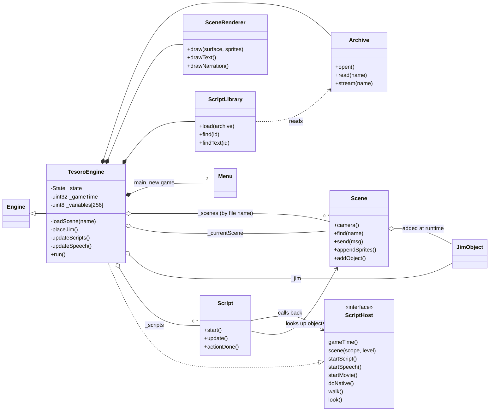
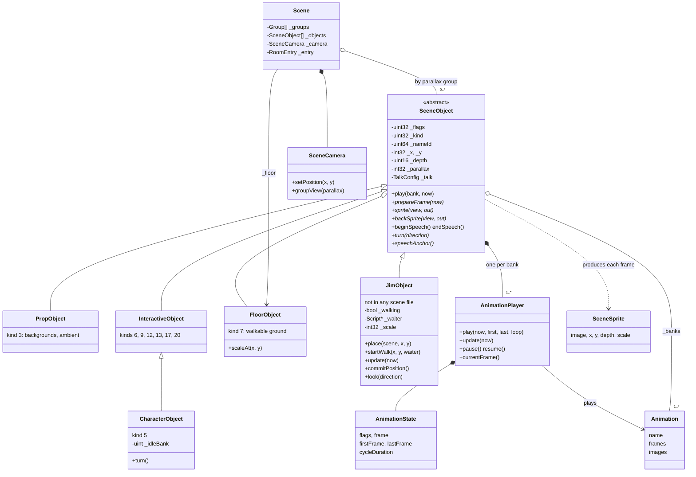
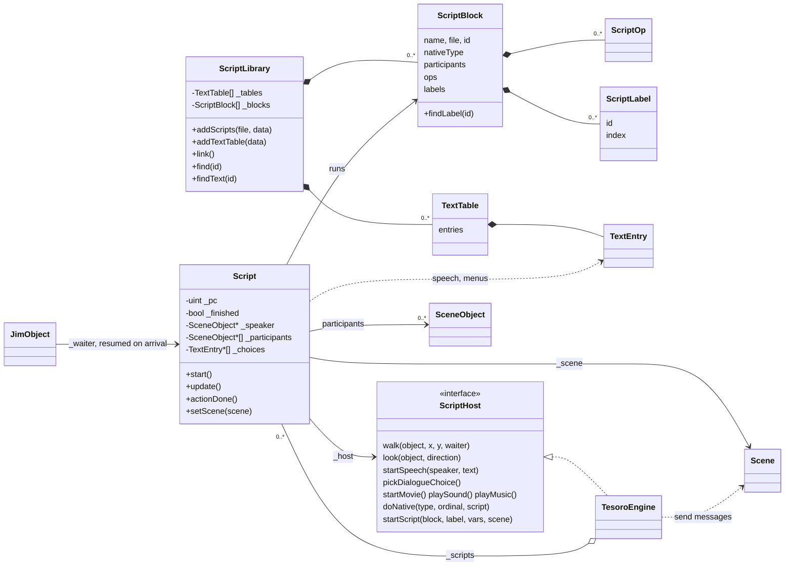
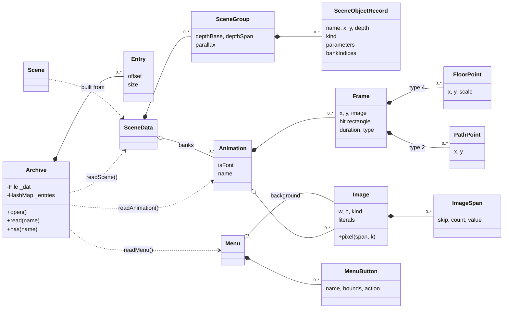

# Tesoro engine classes

The `Tesoro` namespace in `engines/tesoro` (branch `tesoro-engine`): about a dozen classes in eleven headers. Four views, from the whole engine down to the data it loads.

## Overview: who owns what

`TesoroEngine` is both the ScummVM `Engine` and the `ScriptHost` that scripts call back into. It owns the archive, the loaded scenes, Jim, the script library and the running scripts.

## Scene objects

Everything in a room derives from `SceneObject`, which holds one `AnimationPlayer` per animation bank and handles talking. The `kind` numbers come from the original scene files. Kinds without a class yet are built as inert placeholders with a warning.

## Scripts and the host

A `Script` runs one `ScriptBlock` until an op has to wait (sleep, speech, a walk, a menu), then `update` resumes it. Anything a script needs from the game goes through `ScriptHost`. `doNative` receives the block's `nativeType` and the DO ordinal, which is where native object methods live.

## Resources: what the archive decodes into

Plain structs from `resources.h`. Images stay as the file stores them (rows of spans) and are expanded only when drawn. `SceneData` is the parsed room file that a `Scene` is built from.

