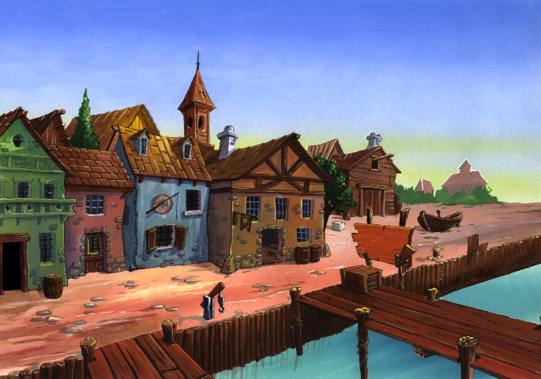

# El Tesoro de Isla Alcachofa: ScummVM feasibility and plan

**Update, 20 October 2026:** the first C++ ScummVM prototype is now runnable. It completes the office pen sequence and exits to the harbour with original dialogue and assets. [Run it and see current limitations](prototype/README.md).

Investigated 19 October 2026, using the copy in `/Users/gabriel/Desktop/ags/TESORO`.

**20 October update:** the original disc is mounted and its resource archives match this copy exactly. All 13 movie files have been found and identified as Indeo 5 AVI; their first frames decode successfully with FFmpeg. The user also supplied the full CUE/BIN: all 19 audio tracks are extracted and verified against the source PCM. See [the media inspection](MEDIA_STATUS.md). The missing-material discussion below records the initial investigation.

## Assessment

**Yes: a ScummVM reimplementation looks technically feasible, with a useful amount of groundwork already done.** It is a substantial engine project, rather than a small compatibility patch. For someone learning reverse engineering, it is a reasonable long-term project if divided into small, visible milestones; reproducing the entire game unaided would be challenging.

ScummVM would replace the original Windows program with new code that reads the original artwork, sounds, scenes and instructions. We would keep the game's own content and recreate the machinery that runs it. The game does not have to use LucasArts' SCUMM language to fit into ScummVM.

The strongest evidence is practical: the existing `adventure-explorer` reader passed a fresh full sweep of **2,012 images and 2,346 sound clips**. I also independently checked the archive and exported recognizable backgrounds and a Jim sprite. This takes much of the uncertainty out of accessing the content.

The largest remaining uncertainty is **behaviour**: character movement, layering, object actions, timing, and special rules embedded in the executable. I have not launched the original game, played through it, or built a ScummVM engine during this investigation. The assessment is based on files, working resource tools, source comparison, and targeted static inspection of the Windows program.

## What is in this copy?

| File | Size | Plain-language purpose |
| --- | ---: | --- |
| `TESORO.EXE` | 200,192 bytes | Original 32-bit Windows program; contains engine code and some special game rules. |
| `TESORO.TRE` | 67,788 bytes | Directory telling us where each named resource lives. |
| `TESORO.DAT` | 263,612,966 bytes | Storage for pictures, scene data, dialogue, scripts and sound. |

The folder name `ags` does not establish that the game uses Adventure Game Studio. The files and executable inspected here use custom formats; pointing ScummVM's AGS engine at them would not provide support.

The directory contains 2,421 records: 2,416 file records and five directory markers. All 2,416 indexed files have valid bounds and a matching size prefix. Their names are unique when case is ignored.

| Content | Confirmed count | What this means for a port |
| --- | ---: | --- |
| `.LVL` resources | 50 | Scene/level resources, including menus and numbered scenes; not a claim of 50 distinct playable rooms. |
| Standalone `.ANM` resources | 11 | Player graphics and a font bank. More animation banks are embedded inside levels. |
| Images | 2,012 | Decodable backgrounds, sprites, masks and font glyphs. |
| Animation banks | 371 | Image groups with frame metadata. |
| Multi-image sequence previews | 112 | Existing viewer previews; their fixed 100 ms timing does not reproduce original animation behaviour. |
| WAV clips | 2,346 | All inspected clips are uncompressed mono PCM, 22,050 Hz, 8-bit. Speech and effects are accessible. |
| `.DLG` resources | 4 | Readable instructions controlling dialogue, object interactions and sequences. |
| Script blocks | 145 | Named groups of instructions across 5,408 lines, including formatting and comments. |
| `.TXT` resources | 4 | Text identifiers and Spanish dialogue/subtitles. These are text tables, not compiled scripts. |
| `.TBL` resource | 1 | A 32,768-byte table used during graphics initialization; exact effect still needs documenting. |

There are also **3,448,956 bytes outside indexed resource ranges**, across nine gaps. They may include older resource versions left behind by updates, but that is unproven. A port should follow the current index; do not treat arbitrary signature matches in the gaps as additional live assets.

Example: the harbour background recovered directly from your data:



This is an extracted background, not a running or fully composed game scene. The separate character, ship, water and other layers still need their original placement and behaviour.

## The work that already exists

Your `adventure-explorer` project has a working resource reader:

- [Tesoro reader](/Users/gabriel/Desktop/source/adventure-explorer/scripts/engines/tesoro/engine.lua)
- [Format documentation](/Users/gabriel/Desktop/source/adventure-explorer/engine-sources.md:638)
- [Resource checks](/Users/gabriel/Desktop/source/adventure-explorer/scripts/tests/tesoro.lua)

I ran its existing checks against this copy. Result: `Tesoro full resource sweep passed`, with 2,012 images, 2,346 sounds and 112 sequence previews.

The reader is written in Lua for the resource browser. Its verified format knowledge can be carried into C++ for ScummVM. It does not implement the original game's walking, scene composition or scripts.

**Use the current reader and format documentation as the starting point.** The older `TESORO_RE_NOTES.md` contains historical sections superseded by its opening correction. In particular, the TRE has no eight-byte header; fonts and object text are not empty; the image format is already decoded. Its old claims about other games sharing an identical engine are not established by this investigation.

An earlier machine-generated executable analysis also survives at `/tmp/tesoro/decomp.c`. It provides useful starting points, but contains incorrect inferred parameters and misses some callback routines. It is not the original source code and should be checked against the actual instructions. Important findings are recorded below so the plan does not depend on a temporary file surviving.

## Can the existing ScummVM Alcachofa engine do it?

**It offers useful reference code, but direct compatibility is not demonstrated.** Tesoro is absent from the current upstream Alcachofa detection table and the compatibility list checked for this report. Current support includes other Alcachofa titles, such as the Mortadelo games. See the [upstream detection table](https://github.com/scummvm/scummvm/blob/master/engines/alcachofa/detection_tables.h) and [ScummVM compatibility list](https://www.scummvm.org/compatibility/).

The formats inspected here differ materially:

| Area | Tesoro | Existing Alcachofa V1 code inspected |
| --- | --- | --- |
| Main storage | `.TRE` index plus size-prefixed `.DAT` resources | `.EMC` world/map resources |
| Graphics | `ANM` banks, `LVL` scenes, RGB565 span images | `ANI` banks, different bank/image layouts |
| Game instructions | Readable `.DLG` instructions plus native callbacks | Compiled script operations |
| Screen | Executable requests 640 × 480, 16-bit | V1 game configuration requests 800 × 600 |

These differences mean that adding Tesoro's filename to detection would only recognize it; it would not make it playable. The source comparison used local `engines/alcachofa/game-v1.cpp`, `graphics.cpp` and `rooms.cpp`, plus [current upstream V1 code](https://github.com/scummvm/scummvm/blob/master/engines/alcachofa/game-v1.cpp). The local ScummVM checkout is from March 2026 and predates some current upstream support.

**Recommended approach:** discuss placement with the Alcachofa maintainer early. Prototype a small Tesoro-specific engine using ScummVM's graphics, input, audio and save services. Keep file readers, scene state and script execution separate so they can move into the existing engine later if that proves appropriate. Shared developer history alone is not enough reason to force the later engine architecture onto this game.

## The hard part, explained simply

The readable scripts tell us a great deal. They contain instructions equivalent to:

- Check whether a puzzle flag has a particular value.
- Show or enable an object.
- Make someone speak a numbered line.
- Move a character, play an animation, or wait.
- Present conversation choices.

But some lines say `DO ...`. These hand control to extra routines inside `TESORO.EXE`. Think of a recipe that occasionally says “now use the special machine”: reading the recipe is only part of understanding the process.

There are **87 `DO` markers** in the supplied scripts. Static inspection maps 31 to the default routine, which immediately returns. The other 56 markers dispatch through 19 specialized handler types. This is a useful boundary for investigation, not a measure of percentage complete: object classes and other executable code also contain game behaviour, and some individual handler cases may do nothing.

A particularly useful discovery: the words after `DO` are annotations. The parser numbers these calls in their order within a script block, and the executable handles that number. A future interpreter must preserve the original order. Implementing a generic function named after the annotation, such as `fade`, would not reproduce the dispatch correctly.

Other difficult areas are:

- **Walking:** where Jim can stand, how he gets around obstacles, and which way he faces.
- **Layering:** making him appear behind scenery, applying shadows, and positioning scrolling backgrounds.
- **Timing:** waiting for speech or animations without freezing everything else.
- **State:** remembering puzzle flags, inventory, changed objects and the current conversation, including after saving and loading.
- **Special sequences:** the board/fight scenes, transitions and finale need targeted examination.

## Missing material to resolve early

Only three files are present in the supplied folder. The scripts request external movies and CD audio, and the executable builds a path like `X:\INSTALL\BIN\DATA%02i.BIN` for movie playback.

The scripts explicitly reference movie numbers **1–8, 10 and 11**, and CD tracks **4, 6, 7, 9, 11, 13, 17, 18, 19 and 20**. Other references may exist in native code. These lists do not prove the total number of movies or music tracks.

Obtain the complete original media or full installed distribution and establish how those files/tracks are supplied. Inspect the `.BIN` file signatures before choosing a movie decoder; the extension does not identify the actual codec. Determine whether the CD music is audio tracks or redistributed music files in that edition.

This does not prevent a first-room prototype. It does prevent claiming that this folder alone is enough for a faithful, complete port. The next major requirement is a working original game installation for comparison, ideally with repeatable saves and recorded actions.

## A practical plan

### 1. Preserve the evidence and get a reference run

Save checksums and the corrected format notes, keep the original files intact, identify this edition, and locate the missing media. Run the original in a suitable Windows environment and record the opening, menu, first room, dialogue and an object pickup. Keep a short list of exact mouse actions that reproduces each example.

If useful, approach the original developers or rights holder about surviving source code or format information. ScummVM has previously credited Emilio de Paz for supplying Dráscula source, so there is a relevant precedent, although no Tesoro source availability has been established. See [ScummVM's own credits record](https://lists.scummvm.org/pipermail/scummvm-git-logs/2019-October/079943.html). No contact was made during this investigation.

**Finished when:** a reproducible original session and media checklist exist. Unknown edition or missing movies are written down explicitly.

### 2. Make a small ScummVM picture-and-sound prototype

Create detection for the verified edition, read the TRE/DAT directly, port the proven image reader, and display the harbour background and a Jim image. Play one original WAV through ScummVM's audio mixer. Add a debug command to select a scene or image.

**Finished when:** ScummVM loads these resources from the original files without launching the Windows executable. This proves integration and resource access, not gameplay.

### 3. Recreate one real scene

Decode the remaining LVL object records and frame metadata. Put the original scene's layers in their correct places, animate Jim using stored timing, restore the verb interface, identify clickable areas, and implement walking and exits. Choose the harbour and adjacent office as a small test area, subject to the reference playthrough confirming the earliest suitable interaction.

**Finished when:** clicking a reachable point makes Jim walk there; scenery overlaps him correctly; hovering/clicking objects selects the correct target; an exit changes scenes.

### 4. Complete one puzzle using original instructions

Implement script parsing, labels, local variables, dialogue choices, object messages, waits and nested script calls. Preserve `DO` ordinals and implement the native handlers reached by the chosen puzzle. Investigate variable ownership and reset rules rather than assuming every `v0` is global.

A good candidate is the early pen interaction in the office, which appears in both scripts and named objects. Verify its exact sequence against the original before committing to it. Reproduce the spoken lines, object/inventory changes and follow-up response. Save and reload in the middle of that interaction.

**Finished when:** the same recorded inputs produce the same visible results in the original and ScummVM. A changed puzzle flag and inventory survive saving and loading.

**Decision point:** re-estimate the whole project here. This milestone exercises most of the machinery and exposes difficulties much better than a gallery of decoded images does.

### 5. Expand through the game in story order

Complete the Bristol section, then the ship, then the island and ending. For each section, map the additional native callbacks and object types, add required transitions, and compare a repeatable playthrough with the original. Track unknown behaviour and unimplemented instructions explicitly; log them instead of silently skipping them.

Implement external movies and CD music once their actual formats and numbering are confirmed. Save/load support should develop alongside gameplay; original Windows save-file import can be a separate later feature if needed.

**Finished when:** someone can finish the game from a new start, with dialogue, sound, music, movies and required special sequences, and can reload at representative points.

### 6. Prepare support for other players

Test on at least two ScummVM platforms and against any additional editions actually available. Check pause, skip, subtitles, Spanish glyphs, save thumbnails, error messages and missing-media behaviour. Follow the ScummVM team's contribution and testing requirements and request review. Upstream inclusion is a separate review outcome, not something a working local prototype guarantees.

**Finished when:** the agreed supported editions and platforms have repeatable completion tests, and the engine is ready for project review/public testing.

## Effort and how you can contribute

These are planning judgments, not measured schedules. With the existing resource reader, an experienced C++/ScummVM developer might get a picture-and-sound demonstration in days to a couple of weeks. One genuinely playable scene/puzzle could take several weeks. Reliable whole-game support is more plausibly **several months**; a rough initial allowance is **3–9 months of sustained work**, with substantial uncertainty until the first puzzle works. An evenings-and-weekends project while learning may take a year or longer.

The external media, native game rules, original runtime availability and debugging tools can move that estimate substantially. There is no defensible completion percentage yet.

You can make useful progress without being an expert reverse engineer: document the original game's behaviour, create repeatable saves, compare screenshots and audio, organize puzzle/flag observations, and work on the already-understood readers. The best place for experienced help is the executable's special callbacks and movement/state behaviour. Avoid starting by translating the entire executable or rewriting every puzzle manually from a walkthrough.

**My recommendation:** proceed to the one-puzzle milestone. The available content and successful decoders make this a credible candidate. Treat correct gameplay, rather than further asset extraction, as the next proof that matters.

## Investigation outputs

- [Machine-readable resource inventory and hashes](analysis/inventory.json)
- [Native callback markers and located handler addresses](analysis/native-callbacks.csv)
- [Technical starting points](TECHNICAL_NOTES.md)
- [Repeatable read-only audit tool](tools/inspect_tesoro.py)

Run the independent audit from this workspace:

```sh
python3 tools/inspect_tesoro.py /Users/gabriel/Desktop/ags/TESORO --output analysis
```

It validates all indexed resource sizes/bounds, parses all animation banks, checks all WAV data lengths, inventories script/media references, and exports four sample PNGs. The separate, existing Lua sweep checks decoding of every image. Extracted media remains local; it is not part of a distributable ScummVM engine.
