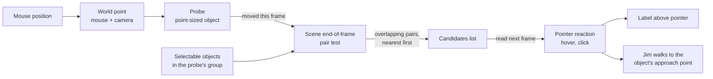
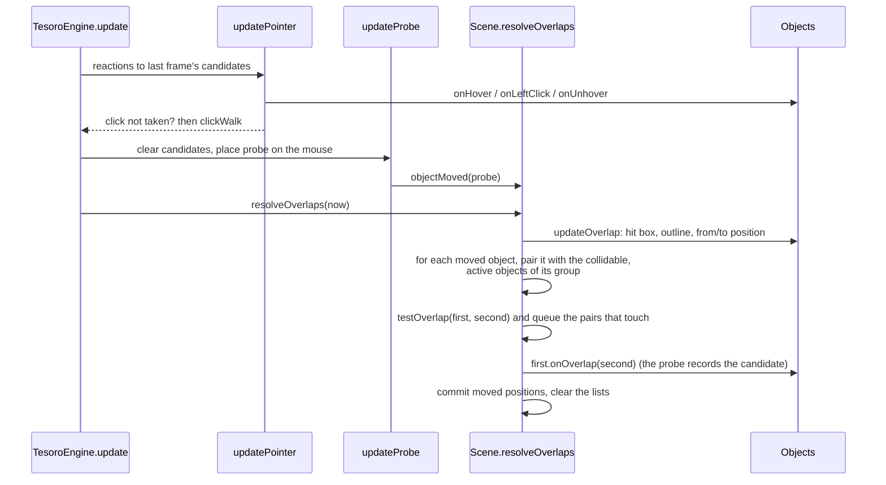
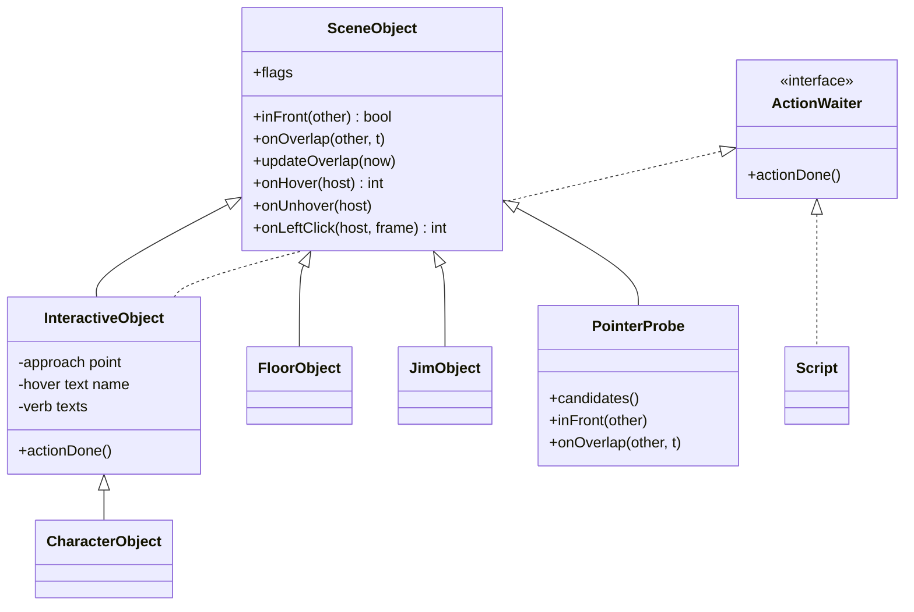
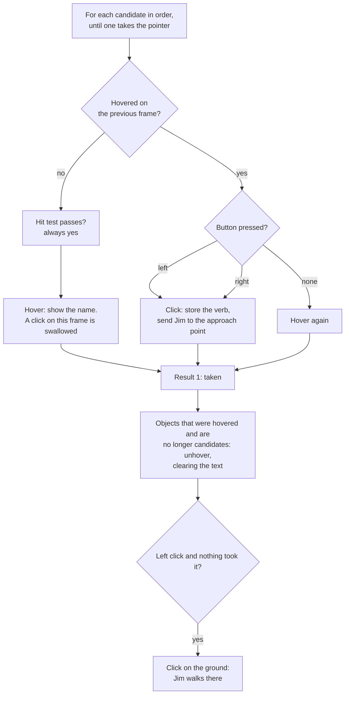

# How hotspot detection works (mouse hover and click)

Written 25 October 2026. This document explains the engine code on `tesoro-engine` and how it follows the
original. The recovery notes with addresses and evidence are in [CLICK_WALKING.md](CLICK_WALKING.md); the
status of each claim is in [RE_STATUS.md](RE_STATUS.md).

**Status of this document.** The engine side is verified by compiling, by running the office scene through the
engine's own scene code outside the game (every object picks itself at its own hit box), and by comparing the
overlap geometry with the original's routines in an emulator. The pointer reaction, the hover text and the click
were not run against the original game. Nothing here has been compared on screen with the original.

## 1. What the player sees

1. The mouse moves over an object in a room.
2. A label (the object's text, or its name in the scene file) appears above the pointer.
3. A click sends Jim to the object's approach point, he turns towards it, and the verb of the click runs. The
   default verb answers are ported on `codex/verbs` (Jim speaks); only verb 0 is reachable until the interface is ported.
4. A click that no object takes is a click on the ground: Jim walks there.

That is the whole behaviour. A "simple" implementation would test the mouse point against each object's hit
rectangle and take the first one. The rest of this document is about why the engine does it the way the original
does, and what each piece is.

## 2. The idea in one picture

The original has no separate "which hotspot is under the mouse" routine. The pointer owns a hidden,
point-sized object, the **probe**, and puts it on the mouse every frame. The scene then tests it against the
other objects with the same overlap routine it uses for walking and drawing order. The objects it overlaps
become the **candidates** the pointer reacts to on the next frame.

## 3. One frame, step by step

The order matters: the pointer reads the candidates from the previous frame before the probe is moved.

## 4. The pieces

| Piece | Where | What it is |
| --- | --- | --- |
| Flags `kCollidable` (8), `kSelectable` (0x400) | `scene.h` | Collidable objects take part in pair tests; selectable ones are what the pointer can pick. Interactive objects, characters and the floor have both. |
| `OverlapBody` | `overlap.h` | What the test needs from an object: hit box, frame outline, where it was and will be, depth. |
| `testOverlap` and helpers | `overlap.cpp` | The original's pair test: a swept-box test, then a polygon test when both objects have outlines. Compared with the original in an emulator. |
| `SceneObject::updateOverlap` | `scene.cpp` | Fills the body from the current frame. |
| `Scene::objectMoved`, `resolveOverlaps` | `scene.cpp` | The moved list and the end-of-frame pass. |
| `PointerProbe` | `scene.h/.cpp` | The point that follows the mouse. In front of any selectable object; records what it overlaps. |
| `TesoroEngine::updateProbe` | `tesoro.cpp` | Puts the probe on the mouse each frame. |
| `TesoroEngine::updatePointer` | `tesoro.cpp` | Reads the candidates: hover, click, unhover. |
| `InteractiveObject` | `scene.cpp` | Hover text, click, approach walk, arrival. Reads its approach point and texts from the scene file. |
| `ActionWaiter` | `scene.h` | What waits for Jim's walk to end: a script, or an object he was sent to. |
| `hotspots` console command | `console.cpp`, `tesoro.cpp` | Draws hit boxes and outlines over the scene. |

## 5. The pointer reaction

`updatePointer` follows the original's reaction routine (`0x402e80`). The candidates are in the order the pair
queue delivered them (nearest contact first, then by depth).

A click on an object is: `onLeftClick` stores the verb (the pointer's frame, always 0 for now) and calls
`walkJim(approachX, approachY, this)`. When Jim arrives, `actionDone` turns him to the object's direction and runs
the verb. The verb handlers are not ported, so the arrival logs `verb N of NAME does nothing yet`.

### Where an object's data comes from

The scene file's parameter bytes of an interactive object (checked against the game's data for the common
record sizes):

| Bytes | Meaning |
| --- | --- |
| `+2`, `+3` / `+4`, `+5` | Approach point offset from the object's position (signed 16 bit x / y) |
| `+6` | Direction Jim faces on arrival, minus one (1 up, 2 down, 3 left, 4 right) |
| `+7`... | The object's name in the dialogue tables, a number written as text such as `167`, or empty |
| `+0x13` + 12 k | Names of the lines the six verbs answer with (`OBJ053T03` style) |

Characters start 4 bytes later (the first four bytes are the text colour and width).

## 6. The shape of the probe, and why it matters

The probe is a **single point with no outline**. I could not find any frame data for the original's probe, so
it only registers where an object's hit rectangle is. The consequences:

- Only the hit rectangle of each object decides what is hovered. In the office, only the floor has an
  outline, so this makes no difference there.
- If the original's probe has a frame with an outline, hotspots with outlines would be picked more
  tightly than here.
- In the pair test a stationary point against a shape without an outline counts as overlapping when it is
  inside the box. That is why hover works with a still mouse.

## 7. Why it was built this way (and what is not needed yet)

The original reuses one routine for three jobs: choosing hotspots, Jim's collisions with obstacles
(detours), and ordering moving objects. The engine now has that routine. Only the first job uses it today,
so much of it is not exercised yet:

| Part | Used by hover today? | Needed for later |
| --- | --- | --- |
| Swept-box test | box test only, stationary | Jim walking into obstacles |
| Outline (polygon) tests | no, the probe has none | Obstacles, depth ordering of moving objects |
| Pair queue ordering by contact and depth | yes: decides which hotspot wins | Same |
| `from` / `to` positions | trivially equal | Moving objects |

A leaner design would be: take the mouse point, test it against the hit rectangles of selectable objects in
the group, and order the matches by depth. It would give the same hover results in the office. The difference
would be the order in which overlapping hotspots are tried (the original's order comes from the queue). It would
also leave the geometry unused until walking needs it.

## 8. The three commits

| Commit idea | Content | Visible effect |
| --- | --- | --- |
| Find the objects under the pointer | Overlap geometry, flags, per-object overlap state, moved list, pair queue, end-of-frame pass, probe | None. The probe collects candidates and nothing reads them. |
| Hover, click and approach | The pointer reaction, hover text and its drawing, click, approach walk with the object as waiter (`ActionWaiter`), arrival | Labels over objects; Jim walks to them on click |
| Movement fix | Interactive objects and the floor drop the animation's accumulated movement each frame | Hotspots land on their pictures: before the fix, invisible hotspots were shifted by their starting frame's offset (for example the `CARTA` hotspot at the top right) |

The movement fix is a correction to how the engine handled animation offsets, not hover logic. It follows
the original, where all the factory-built object classes zero the animation's movement after each advance
(`0x407770`).

## 9. Debugging

- The `hotspots` console command (Ctrl+Alt+D, then `hotspots [on|off]`) draws, over the scene: the hit box
  of every collidable, active object, yellow for the current candidates, cyan for Jim, green for the rest;
  the frame outline in magenta; the probe as a red cross on the mouse.
- Testing shortcuts (`TestingShortcuts` in `testing.h`): `kStartInOffice` starts in the office with the
  state the introduction leaves, `kSkipStartupScreens` skips the splash and the new-game screens.

## 10. Known gaps

1. **Verbs.** The default answers are ported on `codex/verbs` (see CLICK_WALKING.md, "Default verb answers"):
   Jim says the object's line or the generic one and the pointer stays off until he stops. A few objects
   override a verb in the original; those overrides are not ported.
2. **Pointer frame.** The engine has one cursor, so every click is verb 0. The original's cursor has frames
   that change the verb.
3. **Probe group.** The probe and Jim share the scene's first group. Objects in other groups would never be
   picked. In the office and the harbour, every object is in the first group.
4. **Jim.** His own overlap handling (detours around obstacles, clicking on him) is not ported. This may also
   change how click walks behave: see the note in [CLICK_WALKING.md](CLICK_WALKING.md).
5. **The interface scene** (inventory, toolbar) has its own pointer pass in the original; not ported.
6. **Undefined original behaviour.** On some inputs the original's clip routine reads memory past its point
   list, so its result depends on what follows in memory. The engine reads zeros there and stops its loops past
   the end. These cases are listed in the comparison reports (`analysis/overlap-comparison-seed*.json`).
