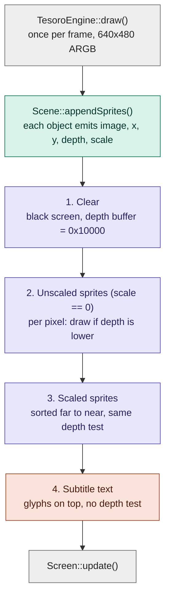
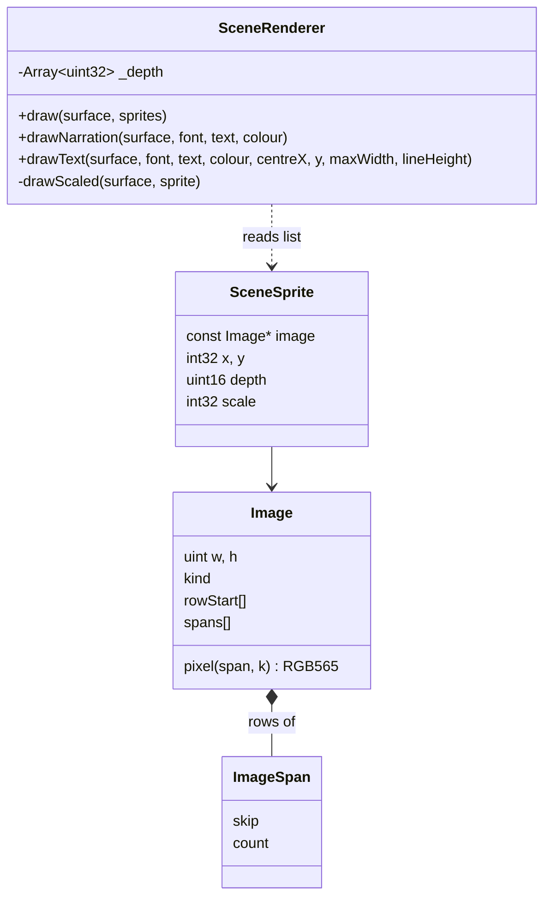

# Renderer

How the Tesoro engine draws a frame. Source: `engines/tesoro/renderer.cpp` and
`renderer.h` in the engine worktree (`scummvm-tesoro`), driven from
`TesoroEngine::draw()` in `tesoro.cpp`.

This describes the current engine implementation. It has not been checked
against the original executable here; fidelity is tracked by the comparison
tools in `tools/` and in `RE_STATUS.md`.

## Frame pipeline

Outside the adventure state (menus, censorship card) the engine skips this
pipeline and calls `drawImage()` on a black screen: the image is drawn as it
is, with no depth test.

## Data the renderer consumes

## Notes

- **Images** store only drawn pixels, as rows of spans (`skip`, `count`).
  Transparent pixels are never stored, so each span is a run of drawn pixels,
  converted from RGB565 to ARGB as it is written.
- **Depth** is a 640x480 buffer. A pixel is written only if
  `sprite.depth < _depth[index]`, so unscaled sprites are order-independent.
- **`scale`** is in 256ths (256 is full size); 0 means unscaled. Scaled sprites
  are drawn after all unscaled ones, farthest first. `drawScaled()` picks source
  pixels in 16.16 fixed point: rows by a vertical step, and each span from where
  it starts and ends once scaled.
- **Text** (`drawText`) wraps to `maxWidth`, centres the block on a point, and
  clamps it to the screen. Characters without a glyph are as wide as a space.
  `drawNarration` is `drawText` centred on the screen; spoken lines are anchored
  above the speaker's head.

## Not implemented

- Shadow images (`kind == 2`) drawn on their own (`drawImage`): `error()`. In the sprite pass they are composed
  since 25 October 2026 (`drawShadow`, unscaled only; see CLICK_WALKING.md).
- Scaling of non-literal images (`kind != 1`): `error()` in `drawScaled`.

Both fail visibly on purpose, so unfinished reachable behaviour is never drawn
wrongly.
