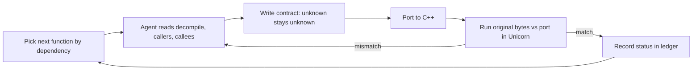

# Slide draft: reverse engineering with Ghidra, emulation and AI agents

30 minutes, engineers in general. 24 slides, 3 live demos (all in [demo/](demo/DEMO_SCRIPT.md)).
Each slide: **on screen** is what the audience sees (keep it sparse), **say** is the speaker note.
Project numbers are from `re/ledger.json` and `re/SUBSYSTEMS.md` as of 5 Nov 2026; refresh before the talk.

---

## Part 0: Hook (0:00 to 2:30)

### 1. Title
**On screen:** "Reading a program with no source: reverse engineering by hand, with Ghidra, and with AI agents". Your name and team.
**Say:** One line on what you do at work, then "this is a side project that taught me a lot".

### 2. The goal
**On screen:** Screenshot or 10-second clip of *El Tesoro de Isla Alcachofa* running in ScummVM. Caption: `TESORO.EXE` + the disc. No source. No docs.
**Say:** A 1990s adventure game. I want it to run in ScummVM, faithfully. All I have is the executable.

### 3. The obvious approach
**On screen:** Fake chat box: *"Hello Claude, implement this game in one shot, no errors."* Then a big red cross, "Narrator: it did not work."
**Say:** Pause a beat. Don't explain the joke.

### 4. Why that fails
**On screen:** Three lines. (1) The model can't see the binary, so it guesses. (2) Nothing is checked, so mistakes compound. (3) No process, so no idea what's done.
**Say:** Close with "so what does a reliable process look like?" That is the talk.

---

## Part 1: What is reverse engineering? (2:30 to 5:00)

### 5. Definition and uses
**On screen:** "Recovering how something works from the finished product." Four icons: interoperability, preservation, security, compatibility.
**Say:** Mention one legal/ethical line: I own the game, the goal is preservation. Name one work-relevant example (undocumented file format, legacy system, vendor library).

### 6. The pipeline we are running backwards
**On screen:** Source code → compiler → machine code → CPU. Arrow reversed along the bottom: "we start at the right".
**Say:** The compiler throws information away (names, types, comments, structure). Everything after this is getting some of it back.

---

## Part 2: Act 1, by hand (5:00 to 11:00)

### 7. DEMO 1: bytes and opcodes
**On screen:** Live: `sum_clamped.c` (10 lines), then the hex editor on the compiled bytes. Highlight `55 89 e5` (prologue), `3b 45 0c` (cmp), `7d 40` (jge), `c3` (ret).
**Live:** run the C natively, run the exact bytes in the emulator on audience-chosen inputs, then patch one byte (`83 c0 01` to `83 c0 02`) in the hex editor and watch 55 become 25.
**Say:** Decode two or three by hand using the table in the demo script. "This is real, and it is miserable."
**Cut if short:** drop the jump-offset arithmetic.

### 8. Let tools decode: disassembly
**On screen:** `objdump` output next to the hex, same bytes.
**Say:** A disassembler only translates bytes to mnemonics. It adds no meaning.

### 9. The compiler reveal
**On screen:** Side by side: `-O0` = 112 bytes, `-O2` = 303 bytes (vectorised with SSE). Same source.
**Say:** "Your ten lines of loop became SIMD." Structure you wrote is gone. Optimisers are why reverse engineering is not just reading.

### 10. What is lost
**On screen:** Table. Lost: names, types, structs, comments, loop shapes. Kept: behaviour.
**Say:** The whole job is recovering meaning from behaviour.

---

## Part 3: Act 2, Ghidra (11:00 to 15:00)

### 11. DEMO 2: the same function in Ghidra
**On screen:** Listing and decompiler side by side. Rename `param_1` to `values`, `param_2` to `count`, `local_10` to `total`.
**Live:** import the raw bytes (no symbols), create the function by hand with `D` then `F`, rename. Say: "in a real EXE Ghidra does that step itself."
**Say:** Ghidra gives control flow, cross-references and a C-like view. Naming is still on you. Watch renames propagate.

### 12. The scale problem
**On screen:** The real `TESORO.EXE` function list. Number: **706 functions** in the ledger, 447 of them game code.
**Live:** in the real project show the function list, a short function with its callers, the call graph, strings and imports. All found by Ghidra itself.
**Say:** Ghidra finds functions by following calls. Code reached only through function-pointer tables is invisible to it: 622 became 784 after 161 were defined with a script. Doing the rest by hand is weeks of tedium; one person is the bottleneck.

### 13. The decompiler is a hypothesis
**On screen:** "Decompiler output ≠ truth." Three bullets: wrong types, wrong signedness, wrong calling convention.
**Say:** It is excellent, but it is guessing. So how do you know a reading is right? (Sets up Act 3.)

---

## Part 4: Act 3, verification (15:00 to 20:00)

### 14. Run the original bytes (Unicorn)
**On screen:** Three steps (map the bytes, build the stack, run and read eax) beside a short code snippet.
**Say:** Unit tests for a binary you have no source for. Load one function at its original address, set up the stack by hand, run it, read the result. Optional aside: Capstone, a disassembler library, is its scriptable companion (Ghidra is for humans, Capstone for scripts).

### 15. DEMO 3: faithful vs plausible
**On screen:** Terminal. `faithful`: 305/305 pass. `plausible --happy-path-only`: passes. `plausible`: fails with `a=[1, 5, 9, 20] lo=8 hi=2: emulator=20 hypothesis=8`.
**Say:** `min(max(v, lo), hi)` looks equivalent and isn't, when `lo > hi`. This is what a confident AI explanation looks like.

### 16. The oracle, and its limits
**On screen:** Two columns. Strengths: executes the real bytes, deterministic, scales to many inputs. Limits: only tests the inputs you choose, OS and hardware calls need stubs, it is evidence not proof.
**Say:** A hypothesis is only as good as the inputs you tested it with. Pick edge cases deliberately.

---

## Part 5: Act 4, AI agents with the Ghidra MCP (20:00 to 26:00)

### 17. What the agent can touch
**On screen:** MCP tool list: `decompile_function`, `get_xrefs_to`, `disassemble_function`, `rename_function`, `set_function_prototype`.
**Say:** MCP gives the model hands in Ghidra. It reads real decompilation instead of guessing from a description.

### 18. The loop
**On screen:** Diagram (below). Pick next function → read it and its callers/callees → write a contract → port → emulate original vs port → record in the ledger.

**Say:** Key point: the AI proposes, the emulator checks, the ledger records. The model is boxed in by evidence.

### 19. The artifacts
**On screen:** Screenshots of `re/ledger.json` (one row per function), one contract in `re/contracts/`, and `re/STRUCTS.md`.
**Say:** Contract before code. Every field has a confidence marker. The ledger is how a new session, or a new agent, picks up with no memory.

### 20. A function only advances with evidence
**On screen:** Status ladder: untouched → decompiled → understood → ported → emu-compared → original-compared.
**Say:** "Decompiled" is not "done". The last rung is seeing it in the running original, in DOSBox-X.

### 21. Where it stands
**On screen:** Bar or table for the 447 game functions: 100% read, 96% understood, 90% ported, 79% matched against the original machine code. Honest line: *seen in the running original: 0% as functions; 2 menu screens and a saved game compared.*
**Say:** The restart was 28 October; these numbers are from 5 November. Show the honest limit as proudly as the headline.

---

## Part 6: Lessons and close (26:00 to 30:00)

### 22. The restart
**On screen:** "I threw it away and started again." Before: notes and conclusions. After: one function at a time, with evidence.
**Say:** Earlier work had drifted: conclusions that were plausible but unchecked. The restart rule: old notes are reference only, never evidence. Same lesson as slide 3, at project scale.

### 23. What AI was good and bad at
**On screen:** Two columns. Good: naming, summarising, struct recovery, cross-referencing, tireless repetition. Bad: plausible-but-wrong semantics, confident gaps.
**Say:** Real example: reading the scene routines found a real bug in my own port, a harbour guard switched on and off the wrong way round. Found by comparing against the original, not by asking the model.

### 24. The real prompt
**On screen:** Strike out the joke prompt from slide 3. Replace with: *"Decompile the next function in the ledger, write its contract, and verify it against the emulator."* Then "Questions?" and your contact or repo.
**Say:** AI doesn't replace understanding. It makes a systematic method affordable.

---

## Timing and cuts

| Section | Slides | Minutes |
|---|---|---|
| Hook | 1–4 | 2.5 |
| What is RE | 5–6 | 2.5 |
| Act 1 by hand | 7–10 | 6 |
| Act 2 Ghidra | 11–13 | 4 |
| Act 3 verification | 14–16 | 5 |
| Act 4 AI + MCP | 17–21 | 6 |
| Lessons and close | 22–24 | 4 |

If you run long, cut in this order: slide 8, the jump arithmetic in slide 7, slide 16, slide 13.

## To record or capture before the talk

- Screen recording of one real agent run through the loop (slide 18), in case a live run is slow.
- Screenshots of the ledger, a contract and `STRUCTS.md` (slide 19).
- Ghidra screenshots of `sum_clamped` before and after renaming (slide 11).
- Game screenshot or clip from ScummVM (slide 2); check that it shows something that really runs today.
