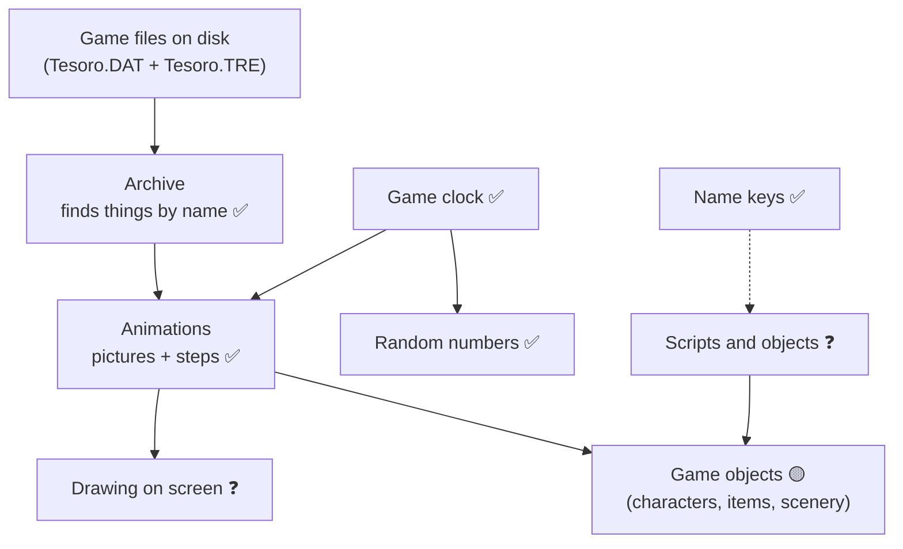
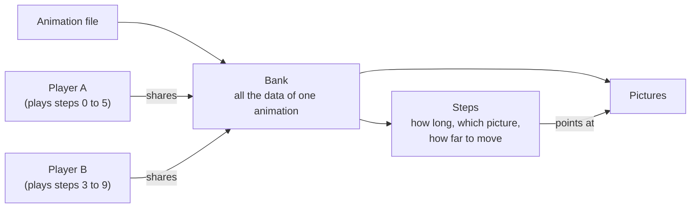
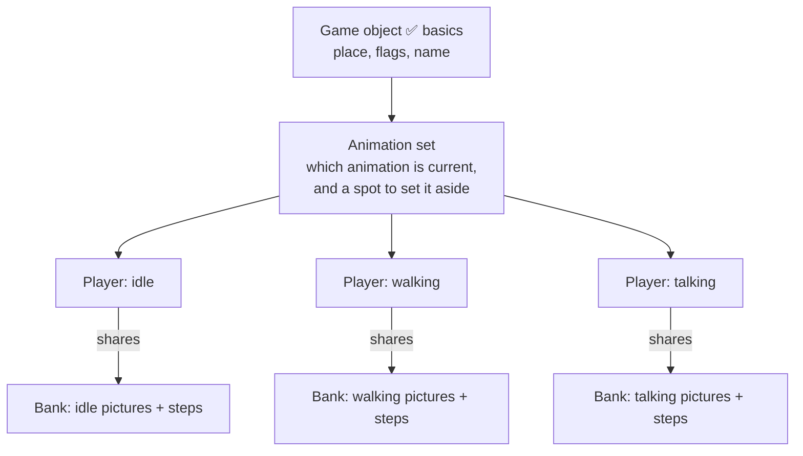
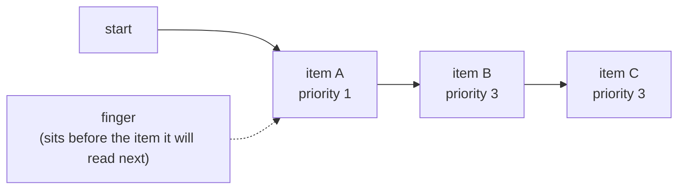
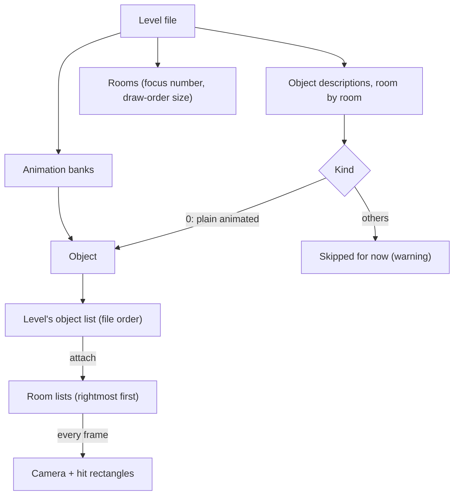
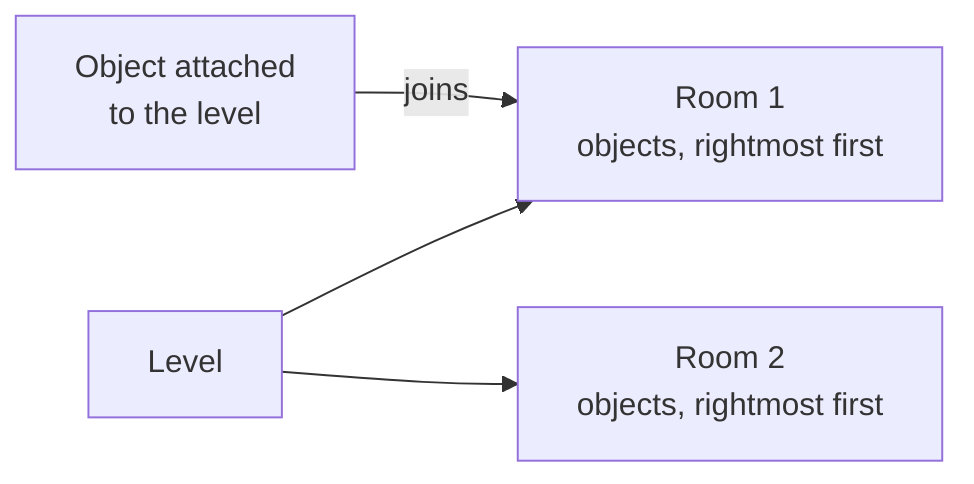
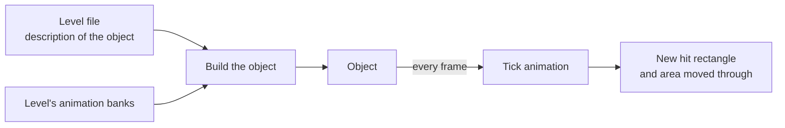

# How the parts of the game fit together

A plain-language map of the game's subsystems and how they talk to each other.
It grows as we recover more of the original. Written for people, not for the debugger.

**How much do we trust each part?**
- ✅ Recovered and checked against the original program
- 🟡 Recovered, but not yet checked or only partly understood
- ❓ Seen from the outside only, not read yet

Last updated: 29 October 2026.

---

## The big picture (what we know so far)

Read it top to bottom: the files feed the archive, the archive feeds the animations,
and animations are what game objects show on screen. The clock decides *when* things happen.
Boxes with a question mark are the parts we have not opened yet.

---

## Archive: the game's filing cabinet ✅

All the game's data sits in one big file (`Tesoro.DAT`). A second small file (`Tesoro.TRE`)
is the index: a list of names, each with the place in the big file where that thing starts.

When the game wants something (say an animation called `JIM`), it:
1. Looks the name up in the index (the index is kept in sorted order so the search is quick).
2. Gets back a position in the big file.
3. Jumps to that position and reads from there.

Everything else in the game that loads data goes through this.

*Open question:* we have not looked at the real files yet, only at the code that reads them.

## Clock and random numbers ✅

The game keeps its own clock that counts game time, not wall-clock time.
It can be paused (for example in menus), and it ignores long hiccups so a stall does not make
everything jump forward. Anything that moves or waits asks this clock what time it is.

Random numbers are derived from the clock, so they are not a separate generator with a seed.

## Name keys ✅

Names (of objects, animations and so on) are turned into a short number so the game can compare
and look them up quickly. The same name always gives the same number.

---

## Animations ✅ (loading and playing; drawing not read yet)

An animation file contains two things: **pictures** and **steps**.

- **Picture:** one image, kept as it is stored in the file. It can lighten or darken itself,
  and convert its colours if the screen needs a different colour format.
- **Step:** one moment of the animation. It says how long it lasts and which picture to show
  (or none). It can also carry a list of points (for example places a character may walk).
- **Bank:** everything one animation file holds. Loaded once, then only read.
- **Player:** the "play head". It remembers where in the animation we are, whether it loops,
  and when it started. Many players can share one bank, so ten characters can use the same
  animation without keeping ten copies of the pictures.

Some banks load their pictures later instead of straight away, to save memory until they are needed.

**Playing.** Each tick the player asks the clock for the time and moves its play head: while the
current step has lasted longer than its duration, it moves on to the next one. If the animation loops, it
jumps back to the first step and remembers how far the object moved during that lap, so a walking
character keeps advancing instead of snapping back. Between two steps the movement is blended smoothly
when the animation asks for it. The result is a small offset (x, y) that says where the object should be
drawn relative to its place. A player can be paused; on resume the time spent paused is subtracted so
the animation carries on where it stopped.

**Per object (the "animation set").** In the code this group is called an `AnimSet`; the original has no such
name, it keeps the same pieces inside every object. It is the set of animations that belong to one object:

 A game object owns one player for each of its animation banks (for example "idle", "walking",
"talking") and one of them is current. Choosing another bank also says which steps to play. Each frame the
object ticks its current player. An object can set its animation aside while it is paused (a dialogue, a
menu): it remembers which bank it was on and how it was playing, pauses, and afterwards puts it back and
resumes. Some objects discard the movement the animation produces, so the picture plays in place.

## Object lists ✅

The level keeps its objects in lists, and the game uses one kind of list everywhere. It is a plain chain of
items with a "finger" (a cursor) that remembers where the last walk stopped.

- Walking the list moves the finger along; almost every operation starts by putting the finger back at the
  start and ends wherever it stopped, so the finger's position is a by-product, not something to rely on.
- Inserting puts the new item right after the finger, which is in front of the item the finger is about to reach.
- Some lists keep their items sorted by a number (the priority, for example the draw order): a new item goes in
  front of the first item with a bigger number, so items with equal numbers stay in the order they arrived.
- In the original, removed items' slots go onto a free list and are reused, all slots come from a block reserved
  when the list is created, and several lists can share one block. That is memory management only, so our version
  is just an ordered array with a finger position and gives the same results.

One quirk is kept on purpose: right after removing the first item the finger is parked in a state where a
further step would skip the new first item. Nothing we have read relies on it yet.

## The frame loop over the objects ✅

Each frame the game walks the main object list twice: pass A, then pass B (skipped if pass A reported "3", a
state change or exit request). In a pass every active object gets one turn (A: its update, B: its second update).
Before a pass all objects are marked "not yet done"; an object that has had its turn is marked done, so it never
runs twice in a pass. If an object's turn adds or removes objects (a dialogue starting, an item appearing), the
walk notices that the list changed and starts again from the top, skipping everything already done. One detail
matters: an object added right behind the one being run does not count as a change, so it waits for the next pass.
A turn that returns 2 or 3 ends the pass at once with that number; otherwise the pass returns 1. The engine
functions are `runUpdatePass` and `runUpdate2Pass`. Checked against the original with random lists whose objects
add and remove other objects during their turn. What 2 and 3 mean to each caller is not read yet.

## The world: levels, Jim and the main list 🟡

At start-up the game loads every level file (47 of them, from the despacho, the port and the ship to the volcano, the final
scenes and the credits), plus two menu levels (the main menu and the new-game menu) and an interface level (the item strip
and the save/menu objects). Each level is itself an object in the one main list that the frame loop walks; the interface level is
walked first and the level Jim is in next. A level, in turn, keeps its own lists of objects, rooms and a camera. Jim is one
object that moves between levels: entering a level takes him out of his old level's lists, puts him in the new one's and
makes the new level's camera follow him. The game begins with Jim in the main menu. The cursor lives in the interface level,
and its companion in whichever level Jim is in. Some objects (a door, a chest, a canoe...) are switched off right at the start.
Read from the start-up code; the level class is ported (see Levels), Jim is not.

## Levels ✅ (loading and the bookkeeping; the collision pass and drawing are not ported)

A level file holds three things in this order: the level's animation banks, then its rooms, and in each room the objects
standing in it. Loading a level reads all of that, builds each object, and adds it to the level's one list of objects, in
file order. The objects are not yet in their rooms: a second step ("attach") gives each object its level and, for the kinds
that ask for it, sorts it into its room. A level also keeps a short list of the collidable objects that moved, which the
collision pass will use, a camera with fixed bounds, the time it was loaded, and a pointer to its single "special" object if
the file has one (an object of kind 1). The engine class is `Level`; it is itself an `Object`, so it can sit in the main list.

Each frame the second pass calls the level to update its cameras: for each room the camera moves towards that room's focus,
then every visible, active, not-yet-processed object of the room recomputes its hit rectangle and is told where the camera
is. Checked against the original on synthetic level files (load, attach, moved-list, lookup by name, camera move, room
camera update). Only objects of kind 0, the plain animated object, are built so far: other kinds are skipped with a warning
until their classes are ported, so a real level loads with most of its objects missing. Not checked: kind 1, real level
files from the archive.

## Level, room and scene: what the words mean

| Word | What it is | In the engine |
|---|---|---|
| **Level** | One scene file (`.LVL`) loaded into memory: the despacho, the port, the main menu, the interface strip. There are 47 game levels plus the main menu, the new-game menu and the interface. It owns the animation banks, the rooms, the object list and the camera. It is also an object itself, so it sits in the main list. | `Level` |
| **Room** | One screen-sized section inside a level. A level has one or more. A room keeps the list of the objects standing in it (rightmost first), a draw-order offset and the number the camera divides by. It is not an object and has no behaviour of its own. | `Room` (a plain struct inside the level) |
| **Scene** | Not a class. It is the everyday word for "a place in the game" and means the same thing as a level. The older prototype and its notes call a level a scene. | none, use *level* |

How they nest: the game has many levels; Jim is in one at a time; a level has rooms; a room lists its objects.
Every object also stays in the level's own list, in file order, which is what the frame passes and the lookup by name use.

Two things that are easy to mix up with a room:
- the **special object** of a level (kind 1, at most one per level) is a real object. The older notes sometimes call it the "room object". It is not a `Room`;
- the **camera** belongs to the level, not to a room. Each room only supplies the divisor the camera uses while that room is being updated.

## The camera ✅

Each level has a camera: a centre point on the level, kept so that the 640x480 view stays inside the level's bounds.
It can jump to a position or glide there over a given time, and it can follow an object (Jim) in coarse steps: when the
object walks more than a short distance (75 pixels) past where the camera is aiming, the aim moves 100 pixels toward it
and the camera glides there over three quarters of a second, as long as the level has room to scroll. Once per
frame, for each room, the game updates the camera and records its centre scaled by 300 divided by a number stored in the
room (apparently used to place subtitles; not checked on screen). The engine class is `Camera`. Checked against the
original with random sequences of moves, bounds, targets and clock steps. Which bound is the top of the screen is not established.

## Saving an object's state ✅

The level can write each object's state to a stream and read it back (apparently for save games, but the only caller found is not read yet, so it could also be a state kept while you are in another level). Each object writes a small record and reads it back: if it has animations, which animation bank is
current and the current bank's range and playing state (first and last step, and one byte each for the step being
played and the play flags, so only the low bytes survive a save); then, for objects that carry their own saved data, its
size and its bytes. Kinds that need more can add to this (not read yet). The engine functions are `saveState` and
`loadState` on the object. Checked against the original with random objects and streams, including cut-off streams.

## The pointer (cursor) 🟡

The mouse pointer is itself a game object. It takes part in the ordinary collision pass as the "hitter": whenever its shape
overlaps another object, the object is added to a "touched this frame" list. Once a frame the cursor works through that list:
- an object that was not under the pointer last frame gets the pointer's attention if it accepts it, and is asked to show its
  name next to the pointer; only the first such object is served, because showing the name reports "handled";
- an object that stays under the pointer gets the click: left button runs the current verb on it, right button the alternative;
- an object that is no longer touched has its name hidden.
The previous frame's list is shared by the level's cursor and its companion, a second, plain cursor object for the interface
strip. The name shown is held in a small text buffer with a colour (white), `HoverText`; clearing it only marks it empty.
Switching the cursor off hides the name of everything it was hovering over. Engine classes: `Cursor`, `HoverText`.
Checked against the original with random frames of touches and clicks, using stub objects for the click handlers.
Not ported yet: reading the mouse and keyboard each frame and scrolling the interface strip, the main cursor's own
construction (it creates the companion), the per-frame update that also walks Jim to a left click, drawing, and the thumbnail
capture. The verb used for a click is the cursor's current animation; how the companion gets its verb is not read yet.

## Rooms ✅

A level is split into rooms (screens). Each room keeps its own list of the objects standing in it, ordered by
horizontal position with the rightmost first; an object at the same position as another goes behind it.
An object joins its room's list when it is attached to the level (if it is a kind that asks for this), and
leaves it when it moves to another level. Each room also carries a draw-order offset, and the next room's offset
grows by the size of the one before. The engine class is `Room`. Checked against the original running the same
random sequences of inserts and removals. Each room also holds a number the camera uses as a divisor (see the camera). Not known: why the order
is right-to-left.

## Game objects 🟡

Everything you see in a level (Jim, other characters, items, doors, scenery) is a game object.
Whatever the kind, an object has:
- a place (x, y) and the place it is heading to, which it uses to work out the area it moved through;
- a few on/off switches: active, visible, can be hit, has animation;
- a name (stored as a short number so it can be compared quickly);
- a sort number that decides what is drawn in front of what: its own number, plus the number of the
  room it stands in, plus 5;
- its animation set (see above);
- a hit rectangle, taken from the picture it is currently showing, used to see what the mouse or a
  character touches.

A level file describes each object (place, name, which animations it uses). The level builds the
object from that description; building it also makes the object's own copy of each animation player.
Every frame the object ticks its animation and then recomputes its hit rectangle.

*Not done yet:* the kinds of object other than the plain animated one (Jim, items, doors...), and putting the picture on screen.

---

## What the levels contain (counted, not yet ported)

Counted from the shipped game files with `re/tools/drivers/level_kinds_driver.cpp` (the engine's own level loader, read-only).
Fifty levels in all. Only one object in the whole game is the plain animated kind we have ported (kind 0, in the interface strip).

| Kind | How many | Where |
|---|---|---|
| 3 | 217 | every level; the commonest object |
| 9 | 124 | most rooms of the story |
| 6 | 75 | numbered levels and most rooms |
| 20 | 44 | rooms with scenery |
| 7, 8 | 38, 39 | one of each in most rooms |
| 13 | 46 | interface strip only |
| 1 | 50 | exactly one per level (the special object) |
| 25 | 5 | main menu (2) and the new-game menu (3) |

**Kind 3 is ported ✅ (checked against the original's code).** It is an animated picture: it starts one run of animation
frames chosen by two bytes in the level file (hold one frame, hidden or shown, or play on to the next gap, optionally looping),
puts itself into its room's list when the level attaches its objects, ticks its animation every frame, and each frame asks
the screen (the new `Display` interface) to draw its current frame at a position worked out from the camera. The screen
itself (clipping and the three ways of copying pixels) is not ported yet, so nothing appears so far.

**Kind 1 is ported ✅ (checked against the original).** The "special object" is really a camera frame: each level has
one, and when the level attaches its objects the frame sets the area the camera may show (its first frame's rectangle) and
puts the camera on its own position. It also names another object of the level, which it looks up at that moment, and keeps
three small values nobody has been traced reading yet.

**Kind 25 is half ported ✅/⬜.** A menu item: it shows one frame, starts hidden, and carries a number saying what a
click does (start the game, easy, hard, and two more commands). Its construction, per-frame animation and drawing are
ported and checked against the original. What happens on a click, and the per-frame step that notices a click, are read
(see the contracts) but not ported: they need the screen fades, the script runner and the cursor/Jim globals. Until then
a click on a menu item prints a warning once and does nothing.

**The main menu** (`PRINCIPAL`) is the smallest level: one room, two animation banks, four objects: the special object (kind 1),
one kind 3, and two kind 25. All three kinds are now ported, so the menu level can be built; what is missing for a first picture is the screen's image copy, a frame loop and mouse input. The new-game menu
(`NUEVO`) adds more kind 3 and kind 25 and nothing else.

## The screen: how pictures get drawn (first layer ✅)

The screen does not paint each picture straight away. Each frame, every object hands the screen its picture and a depth
number (smaller = nearer). For every one of the 480 screen rows the screen keeps a short list of **spans**: stretches of
the row, each pointing at the pixels that will show there. A new span cuts the ones behind it and is cut by the ones in front,
so a row ends up as a left-to-right list of visible pieces with nothing overdrawn. Only at the end of the frame, when the frame
is composed, are the pieces copied into the picture. Scaled pictures, shadow pictures and text take other routes.

What is ported and checked against the original: emptying the lists, adding an ordinary (literal) picture, the span
cutting (including pictures hanging off any screen edge) and the **compose**, which copies the spans of every row into
the 640x480 picture, left to right. The new `ScreenDisplay` class owns the queue and the picture. The compose relies on
the first picture of a frame being a full-screen background, as the game always draws. Not yet: the other two picture kinds,
scaled pictures (used by characters), shadows, text, the fades, and putting the finished picture on the real screen.

## Still to explore

- Drawing: how pictures end up on the screen, and in which order.
- The other kinds of object (Jim, items, doors, scenery...) and the level's collision pass.
- Scripts: how story events and puzzles are described and run.
- Sound and music.
- Saving and loading.

Each time we finish one of these, its section above gets filled in and the diagram is updated.
