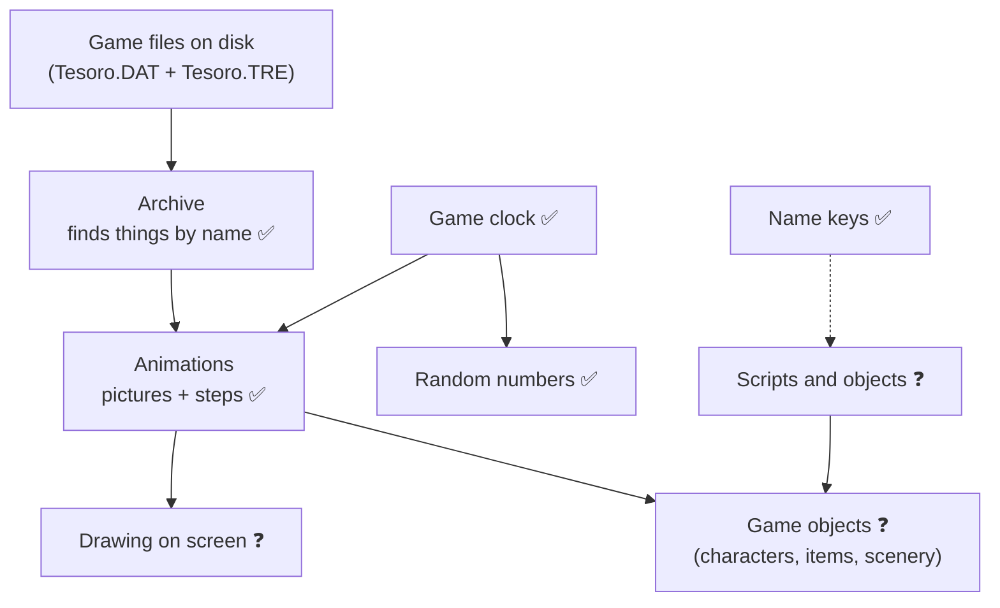
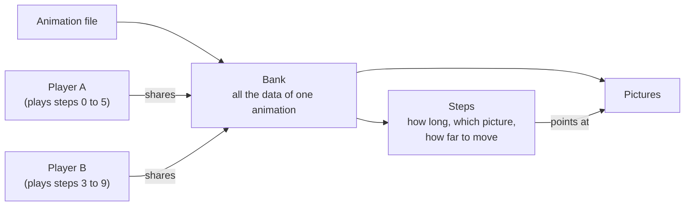

# How the parts of the game fit together

A plain-language map of the game's subsystems and how they talk to each other.
It grows as we recover more of the original. Written for people, not for the debugger.

**How much do we trust each part?**
- ✅ Recovered and checked against the original program
- 🟡 Recovered, but not yet checked or only partly understood
- ❓ Seen from the outside only, not read yet

Last updated: 29 October 2026.

---

## The big picture (what we know so far)

Read it top to bottom: the files feed the archive, the archive feeds the animations,
and animations are what game objects show on screen. The clock decides *when* things happen.
Boxes with a question mark are the parts we have not opened yet.

---

## Archive: the game's filing cabinet ✅

All the game's data sits in one big file (`Tesoro.DAT`). A second small file (`Tesoro.TRE`)
is the index: a list of names, each with the place in the big file where that thing starts.

When the game wants something (say an animation called `JIM`), it:
1. Looks the name up in the index (the index is kept in sorted order so the search is quick).
2. Gets back a position in the big file.
3. Jumps to that position and reads from there.

Everything else in the game that loads data goes through this.

*Open question:* we have not looked at the real files yet, only at the code that reads them.

## Clock and random numbers ✅

The game keeps its own clock that counts game time, not wall-clock time.
It can be paused (for example in menus), and it ignores long hiccups so a stall does not make
everything jump forward. Anything that moves or waits asks this clock what time it is.

Random numbers are derived from the clock, so they are not a separate generator with a seed.

## Name keys ✅

Names (of objects, animations and so on) are turned into a short number so the game can compare
and look them up quickly. The same name always gives the same number.

---

## Animations ✅ (loading and playing; drawing not read yet)

An animation file contains two things: **pictures** and **steps**.

- **Picture:** one image, kept as it is stored in the file. It can lighten or darken itself,
  and convert its colours if the screen needs a different colour format.
- **Step:** one moment of the animation. It says how long it lasts and which picture to show
  (or none). It can also carry a list of points (for example places a character may walk).
- **Bank:** everything one animation file holds. Loaded once, then only read.
- **Player:** the "play head". It remembers where in the animation we are, whether it loops,
  and when it started. Many players can share one bank, so ten characters can use the same
  animation without keeping ten copies of the pictures.

Some banks load their pictures later instead of straight away, to save memory until they are needed.

**Playing.** Each tick the player asks the clock for the time and moves its play head: while the
current step has lasted longer than its duration, it moves on to the next one. If the animation loops, it
jumps back to the first step and remembers how far the object moved during that lap, so a walking
character keeps advancing instead of snapping back. Between two steps the movement is blended smoothly
when the animation asks for it. The result is a small offset (x, y) that says where the object should be
drawn relative to its place. A player can be paused; on resume the time spent paused is subtracted so
the animation carries on where it stopped.

*Not done yet:* putting the current picture on screen, and who calls the tick (game objects).

---

## Still to explore

- Drawing: how pictures end up on the screen, and in which order.
- Game objects: characters, items, doors, and how each one owns animation players.
- Scripts: how story events and puzzles are described and run.
- Levels: how a scene is loaded and which objects it creates.
- Sound and music.
- Saving and loading.

Each time we finish one of these, its section above gets filled in and the diagram is updated.
