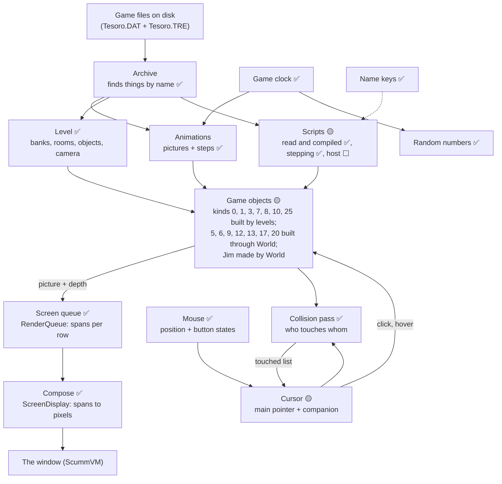
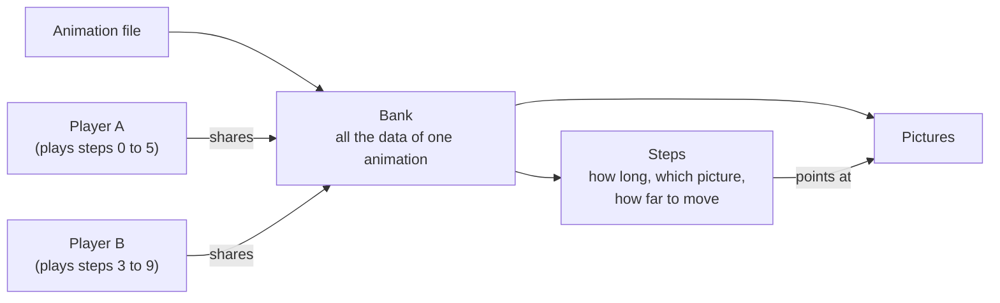
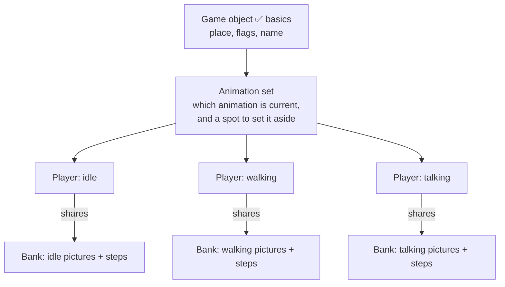
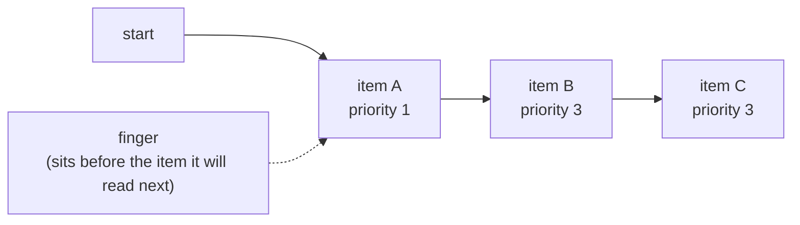
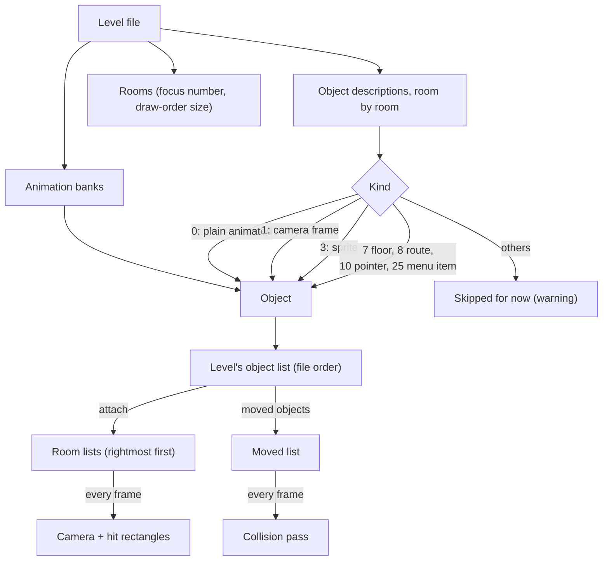
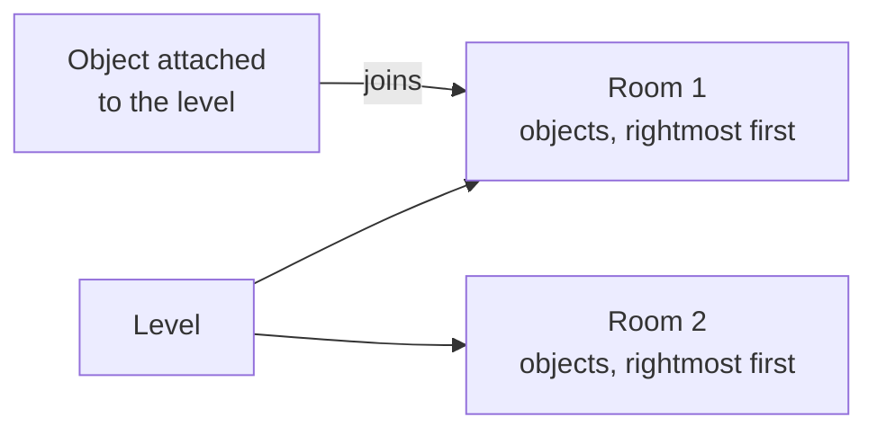
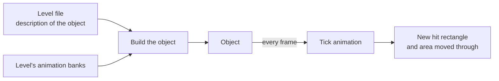
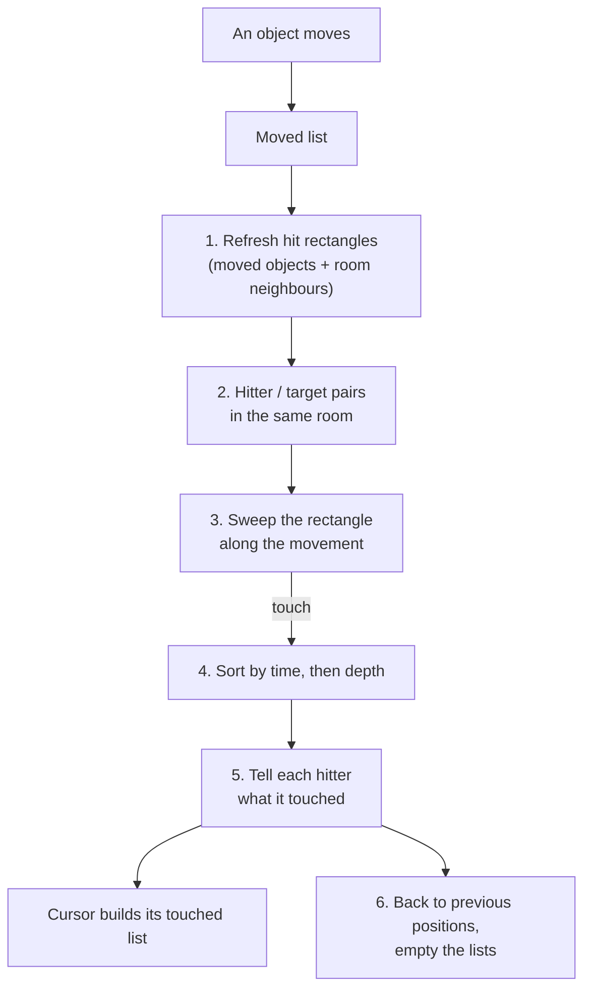

# How the parts of the game fit together

A plain-language map of the game's subsystems and how they talk to each other.
It grows as we recover more of the original. Written for people, not for the debugger.

**How much do we trust each part?**
- ✅ Recovered and checked against the original program
- 🟡 Recovered, but not yet checked or only partly understood
- ❓ Seen from the outside only, not read yet

Last updated: 31 October 2026 (full review against the codex branch).

---

## The big picture (what we know so far)

Read it top to bottom: the files feed the archive; the archive feeds the animations and the levels; a level builds its
game objects; the objects hand their pictures to the screen queue, which is composed into the window every frame. The mouse
moves the cursor, the collision pass tells the cursor what is under it, and the cursor clicks or hovers over those objects.
The clock decides *when* things happen. Boxes with a question mark are the parts we have not opened yet.

**Engine classes by area** (so each name can be found in the diagrams below):
- Files and time: `Archive`, `ArchiveIndex`, `GameClock`, name keys, random numbers.
- Lists: `CursorList` (the ordered list with a finger that levels, rooms and passes use).
- Pictures: `TextQueue` (laid-out text lines, drawn by `ScreenDisplay`), `AnimBank`, `AnimPlayer`, `AnimImage`, `AnimSet` (animations); `Display` (what objects draw to), `ScreenDisplay`, `RenderQueue` (the screen), `FadePresenter` (shows the steps of a fade in the window).
- World: `Level`, `Room`, `Camera`, `Object` and its kinds `CameraFrame` (1), `SpriteObject` (3), `WalkFloor` (7), `PathObject` (8), `MenuItem` (25), lists `ObjectList`. Small helpers: `ObjectRecord` (one object description of the level file), `ObjectRect`, `AnimSequence`, `BrightnessTable`. `MenuHost` is what a menu item asks of the game.
- Input: `InputStates`, `Mouse`, `Cursor` (both pointers), `HoverText`.
- Collisions: `sweepRects`, `Level::collisionPass`.
- The world: `World` (answers every host for real), `WorldLevel` (a level that builds the clickable kinds).
- Exits: `ExitDoor` (an exit between levels), `ExitHost` (what it asks of the game).
- Board game: `ConnectFour` (the thinking of the "Conecta" game) and `ConnectFourHost` (what it asks of the game).
- Items: `InventoryItem` (things Jim carries), `ItemHost` (what it asks of the game).
- Props: `ScriptedProp` (story props of kinds 12, 17 and 20), `PropHost` (what it asks of the game).
- Characters: `Character` (a clickable, speaking person of a level), `CharacterHost` (what it asks of the game, on top of `InteractiveHost`).
- Walking: `Jim` (the player's object), `JimWorld` (what he asks of the game), `WalkArea` (shape, scale and route), `InteractiveObject` (clickable base) and `InteractiveHost` (what it asks of the game), `JimWalker` (Jim's walk), `WalkTarget` (told on arrival), `Walker` and `JimWalkerHost` (what they ask of the game).
- Sound: `SoundDevice` (voices), `CdAudio` (music), `VoiceBackend` and `CdBackend` (what they play through; `MixerVoiceBackend`, `ScummCdBackend`).
- Menu: `ChoiceMenu` (one frame of the list of choices) and `ChoiceMenuHost` (pointer, label, mouse).
- Speaking: `Speaker` (the speaking rules of a character) and `SpeakerHost` (what it asks of the game).
- Spoken lines: `SpeechTables`, `SpeechTable` (the four `*.TXT` files), `WavLookup`; `StdioText` (the reader both text formats use).
- Scripts: `ScriptRunner` (runs blocks), `ScriptRun` (what one running block remembers), `ScriptHost` (what a running script asks of the game), `ScriptLibrary` (all blocks), `ScriptBlock` (one script: characters, commands, labels), `ScriptEntry` (one command), `ScriptLookup` (what a script asks the rest of the game while it is read).

**Which classes copy the original and which are only seams of the port.** The original is mostly plain functions on global tables.
- Mirror an original structure: `ScriptBlock`/`ScriptLibrary` (the script objects and their table), `ScriptEntry` (the 24-byte command), `SpeechTable`/`SpeechTables` (the four tables and their search).
- Port-only, no original counterpart: `JimWorld`, `ChoiceMenuHost`, `VoiceBackend`, `CdBackend`, `JimWalkerHost`, `SpeakerHost`, `ScriptHost` (the original calls the objects directly), `StdioText` (the original calls the C library directly; this repeats its reading rules on a memory buffer), `ScriptLookup` and `WavLookup` (let the readers ask for phrase numbers, levels and voice files without depending on the rest of the engine), and the `ScriptOp`/`ScriptMessage` names for numbers the original uses bare.
- Only behaviour was compared with the original; the class layout was never meant to match.

---

## Archive: the game's filing cabinet ✅

All the game's data sits in one big file (`Tesoro.DAT`). A second small file (`Tesoro.TRE`)
is the index: a list of names, each with the place in the big file where that thing starts.

When the game wants something (say an animation called `JIM`), it:
1. Looks the name up in the index (the index is kept in sorted order so the search is quick).
2. Gets back a position in the big file.
3. Jumps to that position and reads from there.

Everything else in the game that loads data goes through this.

The real files are read: the index and the levels of the shipped game load through it.

## Clock and random numbers ✅

The game keeps its own clock that counts game time, not wall-clock time.
It can be paused (for example in menus), and it ignores long hiccups so a stall does not make
everything jump forward. Anything that moves or waits asks this clock what time it is.

Random numbers are derived from the clock, so they are not a separate generator with a seed.

## Name keys ✅

Names (of objects, animations and so on) are turned into a short number so the game can compare
and look them up quickly. The same name always gives the same number.

---

## Animations ✅ (loading and playing; drawing not read yet)

An animation file contains two things: **pictures** and **steps**.

- **Picture:** one image, kept as it is stored in the file. It can lighten or darken itself,
  and convert its colours if the screen needs a different colour format.
- **Step:** one moment of the animation. It says how long it lasts and which picture to show
  (or none). It can also carry a list of points (for example places a character may walk).
- **Bank:** everything one animation file holds. Loaded once, then only read.
- **Player:** the "play head". It remembers where in the animation we are, whether it loops,
  and when it started. Many players can share one bank, so ten characters can use the same
  animation without keeping ten copies of the pictures.

Some banks load their pictures later instead of straight away, to save memory until they are needed.

**Playing.** Each tick the player asks the clock for the time and moves its play head: while the
current step has lasted longer than its duration, it moves on to the next one. If the animation loops, it
jumps back to the first step and remembers how far the object moved during that lap, so a walking
character keeps advancing instead of snapping back. Between two steps the movement is blended smoothly
when the animation asks for it. The result is a small offset (x, y) that says where the object should be
drawn relative to its place. A player can be paused; on resume the time spent paused is subtracted so
the animation carries on where it stopped.

**Per object (the "animation set").** In the code this group is called an `AnimSet`; the original has no such
name, it keeps the same pieces inside every object. It is the set of animations that belong to one object:

 A game object owns one player for each of its animation banks (for example "idle", "walking",
"talking") and one of them is current. Choosing another bank also says which steps to play. Each frame the
object ticks its current player. An object can set its animation aside while it is paused (a dialogue, a
menu): it remembers which bank it was on and how it was playing, pauses, and afterwards puts it back and
resumes. Some objects discard the movement the animation produces, so the picture plays in place.

## Object lists ✅

The level keeps its objects in lists, and the game uses one kind of list everywhere. It is a plain chain of
items with a "finger" (a cursor) that remembers where the last walk stopped.

- Walking the list moves the finger along; almost every operation starts by putting the finger back at the
  start and ends wherever it stopped, so the finger's position is a by-product, not something to rely on.
- Inserting puts the new item right after the finger, which is in front of the item the finger is about to reach.
- Some lists keep their items sorted by a number (the priority, for example the draw order): a new item goes in
  front of the first item with a bigger number, so items with equal numbers stay in the order they arrived.
- In the original, removed items' slots go onto a free list and are reused, all slots come from a block reserved
  when the list is created, and several lists can share one block. That is memory management only, so our version
  is just an ordered array with a finger position and gives the same results.

One quirk is kept on purpose: right after removing the first item the finger is parked in a state where a
further step would skip the new first item. Nothing we have read relies on it yet.

## The frame loop over the objects ✅

Each frame the game walks the main object list twice: pass A, then pass B (skipped if pass A reported "3", a
state change or exit request). In a pass every active object gets one turn (A: its update, B: its second update).
Before a pass all objects are marked "not yet done"; an object that has had its turn is marked done, so it never
runs twice in a pass. If an object's turn adds or removes objects (a dialogue starting, an item appearing), the
walk notices that the list changed and starts again from the top, skipping everything already done. One detail
matters: an object added right behind the one being run does not count as a change, so it waits for the next pass.
A turn that returns 2 or 3 ends the pass at once with that number; otherwise the pass returns 1. The engine
functions are `runUpdatePass` and `runUpdate2Pass`. Checked against the original with random lists whose objects
add and remove other objects during their turn. What 2 and 3 mean to each caller is not read yet.

## The world: levels, Jim and the main list 🟡

At start-up the game loads every level file (47 of them, from the despacho, the port and the ship to the volcano, the final
scenes and the credits), plus two menu levels (the main menu and the new-game menu) and an interface level (the item strip
and the save/menu objects). Each level is itself an object in the one main list that the frame loop walks; the interface level is
walked first and the level Jim is in next. A level, in turn, keeps its own lists of objects, rooms and a camera. Jim is one
object that moves between levels: entering a level takes him out of his old level's lists, puts him in the new one's and
makes the new level's camera follow him. The game begins with Jim in the main menu. The cursor lives in the interface level,
and its companion in whichever level Jim is in. Some objects (a door, a chest, a canoe...) are switched off right at the start.

### The world class (`World`) 🟡 (the engine's side of every host; scripts, movies and the inventory page are still missing)
Every ported object class asks "the rest of the game" for things through a small interface (a *host*: see below). `World` is the one class
that answers all of them for real, from the game's actual state:
- **Levels.** The table of the 47 levels in the game's own order (the numbers scripts and objects use). A level is read from the archive the first
  time something asks for it (the original reads them all at start-up; only the load time differs), with its pictures left unloaded until Jim
  enters. Its objects are built by the level reader: the plain ones as before, and now also the **characters (kind 5), exits (6), plain clickable
  things (9), scripted props (12, 17, 20) and items (13)**, each handed `World` as its host. Kinds still not built: 2, 11, 14, 15, 16, 19, 21, 22, 23, 24.
- **Spoken lines.** The four text files (`OBJETOS`, `ANIMS`, `CONVERS`, `ICONS`) are read from the archive and searched in the game's order; a
  line's voice is its sound file in the archive. Voices play on ScummVM's mixer through the ported sound device.
- **Jim.** Made on first use from his nine animation files and the line "JIM"; `World` puts him into a level (his first room), answers his walking
  questions from the level's walk area (the floor object and its route), draws his subtitles, and keeps his story bytes (the step the scripts move
  on, the byte beside it, the "has entered" flag).
- **The pointer and what it carries.** The carried item, the pointer's picture (item number plus seven while carried), the hover label, switching the
  pointer on and off while Jim answers.
- **The main list.** The one list of things that get a turn every frame (speakers waiting for their line to end, clicks waiting for Jim): inserted by
  priority, removed by object.
- **Changing level.** The steps of the original's scene change (forget the queued pictures, bring the cameras up to date, compose, clear, fade, wait) are
  there for the exits; the movie that starts when Jim first reaches the risco warns and does nothing.
**Scripts run.** `World` reads the four script files and answers everything a running script asks: finding objects, characters speaking (through
the same speaking rules, with the character's own colour and pose), Jim's script lines, walking Jim (the script is told when he arrives), animations,
looking, showing and switching objects, the choice menu (the pointer's picture is put aside and restored), sounds and music tracks. A running script is
an entry in the main list; a click or a menu item can start one. The one with a numbered type also has a scene routine behind its `DO` lines: 17 of the 19
are ported: the opening scene (type 1), the menu's fades (17), the captain's exit (21), the throne-room trips (20, also what a script's "run FANMTRONO"
does) and all the ones that only move Jim to another level and set the scene there (2 to 7, 9, 10, 12, 15, 16, 18, 19: where he appears, whether he
is shown, which objects are switched on or off, the fade and pause). The two left warn: types 8 and 14 (the board game "Conecta" in the fisherman's hut). Its thinking is ported and checked: `ConnectFour` (seven columns of
seven, lines of four; scores the last piece's lines, searches the best columns, avoids moves that let the player win at once, picks at random among equals,
and takes its turn after the player's: win, loss, draw or a move) matches the original on 1,200 random boards. What is not ported is the game's own
screen and state (the pieces' pictures, the blink of the winning line, the click that drops a piece, the timing). When a script finishes, a character it held for
speaking is let go and its held flag cleared (found by running it: the animation otherwise kept being reset). Seen working: the captain's talk
script plays Jim's and the captain's lines with subtitles and ends with Jim walking out of the despacho into the port.
**Starting the game.** "Nueva partida" now fades to the new-game menu and plays its script; the start button puts Jim in the port, shows him and
starts the opening script, which runs through the ship arriving and Jim walking into the despacho (the screen follows Jim into each level). Seen
running from the start button's code path; the two movies of the intro are skipped with a warning.
**Not there yet (they warn when reached):** the board game's screen, clicks and its two scene routines (types 8 and 14); the movies; turning a page of the inventory; the two frame changes of the
cabin's walk-area objects; Jim's use of item 37; the skip key (any mouse button skips a line for now); the voices start and finish on the mixer (checked with a silent audio driver: the captain's talk now ends by its voices, with no skipping), but nobody has listened to them yet; a subtitles option (always on).
**Seen working:** the engine reads all 47 levels with these objects, puts Jim in the despacho and draws the room with the captain in his chair, Jim
standing in front and the items of the room, with no warnings. Not checked against the original (the hosts are the engine's own decisions, not
ported functions).

### What "host" means here
A class never reaches into the rest of the game by itself. It calls a *host*: a small list of questions and orders ("is Jim speaking?", "put Jim
in that level", "find this object", "start this script"). In the checks against the original, a stand-in host logged every call so the port's calls
could be compared one by one. `World` is the real host. The interfaces: `InteractiveHost` (clickable things), `CharacterHost`, `PropHost`,
`ItemHost`, `ExitHost`, and `JimWorld` (Jim); they share one base so one `World` answers them all.

## Levels ✅ (loading, bookkeeping, the collision pass; shaped collisions and some kinds are not built yet)

A level file holds three things in this order: the level's animation banks, then its rooms, and in each room the objects
standing in it. Loading a level reads all of that, builds each object, and adds it to the level's one list of objects, in
file order. The objects are not yet in their rooms: a second step ("attach") gives each object its level and, for the kinds
that ask for it, sorts it into its room. A level also keeps a short list of the collidable objects that moved, which the
collision pass uses (see Collisions), a camera with fixed bounds, the time it was loaded, and a pointer to its single "special" object if
the file has one (an object of kind 1). The engine class is `Level`; it is itself an `Object`, so it can sit in the main list.

Each frame the second pass calls the level to update its cameras: for each room the camera moves towards that room's focus,
then every visible, active, not-yet-processed object of the room recomputes its hit rectangle and is told where the camera
is. Checked against the original on synthetic level files (load, attach, moved-list, lookup by name, camera move, room
camera update, and the collision pass). Kinds 0, 1, 3, 7, 8, 10 and 25 are built; other kinds are skipped with a warning (the classes for 5, 9, 12, 17 and 20 exist but the
level does not build them yet), so most real levels still load with objects missing (the main menu and the new-game menu load whole).
Real level files were loaded and drawn (menus) but only compared through those pictures, not byte by byte with the original.

## Level, room and scene: what the words mean

| Word | What it is | In the engine |
|---|---|---|
| **Level** | One scene file (`.LVL`) loaded into memory: the despacho, the port, the main menu, the interface strip. There are 47 game levels plus the main menu, the new-game menu and the interface. It owns the animation banks, the rooms, the object list and the camera. It is also an object itself, so it sits in the main list. | `Level` |
| **Room** | One screen-sized section inside a level. A level has one or more. A room keeps the list of the objects standing in it (rightmost first), a draw-order offset and the number the camera divides by. It is not an object and has no behaviour of its own. | `Room` (a plain struct inside the level) |
| **Scene** | Not a class. It is the everyday word for "a place in the game" and means the same thing as a level. The older prototype and its notes call a level a scene. | none, use *level* |

How they nest: the game has many levels; Jim is in one at a time; a level has rooms; a room lists its objects.
Every object also stays in the level's own list, in file order, which is what the frame passes and the lookup by name use.

Two things that are easy to mix up with a room:
- the **special object** of a level (kind 1, at most one per level) is a real object. The older notes sometimes call it the "room object". It is not a `Room`;
- the **camera** belongs to the level, not to a room. Each room only supplies the divisor the camera uses while that room is being updated.

## The camera ✅

Each level has a camera: a centre point on the level, kept so that the 640x480 view stays inside the level's bounds.
It can jump to a position or glide there over a given time, and it can follow an object (Jim) in coarse steps: when the
object walks more than a short distance (75 pixels) past where the camera is aiming, the aim moves 100 pixels toward it
and the camera glides there over three quarters of a second, as long as the level has room to scroll. Once per
frame, for each room, the game updates the camera and records its centre scaled by 300 divided by a number stored in the
room (apparently used to place subtitles; not checked on screen). The engine class is `Camera`. Checked against the
original with random sequences of moves, bounds, targets and clock steps. Which bound is the top of the screen is not established.

## Saving an object's state ✅

The level can write each object's state to a stream and read it back (apparently for save games, but the only caller found is not read yet, so it could also be a state kept while you are in another level). Each object writes a small record and reads it back: if it has animations, which animation bank is
current and the current bank's range and playing state (first and last step, and one byte each for the step being
played and the play flags, so only the low bytes survive a save); then, for objects that carry their own saved data, its
size and its bytes. Kinds that need more can add to this (not read yet). The engine functions are `saveState` and
`loadState` on the object. Checked against the original with random objects and streams, including cut-off streams.

## The pointer (cursor) 🟡

The mouse pointer is itself a game object, and there are two of them. The **main pointer** (object kind 10) lives in the interface
level: it is an animated picture (its current animation frame is the "verb": walk, look, use...), drawn on top of everything
through the screen's scaled-picture path. The **companion** is a plain object with no picture that stands in whichever level
the player is in and does the touching there. Both are placed at the mouse every frame: main at (mouse x + the interface camera x,
camera y − mouse y), companion the same relative to the player's level camera. The mouse itself counts from the middle of the
window (−320..319, −240..239), which the main pointer's construction sets up.

Both pointers take part in the ordinary collision pass; whatever their shapes overlap is added to a "touched this frame" list.
Once a frame the pointers work through those lists:
- an object that was not under the pointer last frame gets the pointer's attention if it accepts it, and is asked to show its
  name next to the pointer; only the first such object is served, because showing the name reports "handled";
- an object that stays under the pointer gets the click: left button runs the current verb on it, a re-press the alternative;
- an object that is no longer touched has its name hidden.
The previous frame's list is shared by both pointers and the whole game. Engine classes: `Cursor` (both pointers; derives from
`SpriteObject`), `HoverText`, `Mouse`, `InputStates`. Checked against the original: the click/hover logic with stub objects, the
pointer's draw (533 draws), the hitter test (2000 cases) and the move-to-position routine (918 calls); the frame placement and the second-pass wrapper are
ported from reading and not compared as a whole.

**How the pointer touches things.** The collision pass records a touch when one object says "I am the hitter for you". For the
pointer that answer is simply "you are marked as a hitter": the pointer looks at the *other* object's flag, so it touches Jim, the
clickable scenery and the menu items, and nothing else. (An earlier version of the port had this backwards, checking the pointer's
own flag, because the decompiler hid a detail of the call; it is fixed and checked against the original.) The companion borrows the
main pointer's animation frame for its hit rectangle, so hovering works in the level the player is in. With the real menu,
a pointer over "Nueva partida" or "Cargar partida" touches that item and starts hovering, and off the items it touches nothing.

Not ported yet: leaving a menu with the key, scrolling the interface strip, the thumbnail capture, walking Jim to a left click on
empty ground, drawing the hover text, the save-file scan at start, registering the pointer in the main list (the engine keeps it
itself for now).

## Rooms ✅

A level is split into rooms (screens). Each room keeps its own list of the objects standing in it, ordered by
horizontal position with the rightmost first; an object at the same position as another goes behind it.
An object joins its room's list when it is attached to the level (if it is a kind that asks for this), and
leaves it when it moves to another level. Each room also carries a draw-order offset, and the next room's offset
grows by the size of the one before. The engine class is `Room`. Checked against the original running the same
random sequences of inserts and removals. Each room also holds a number the camera uses as a divisor (see the camera). Not known: why the order
is right-to-left.

## Game objects 🟡

Everything you see in a level (Jim, other characters, items, doors, scenery) is a game object.
Whatever the kind, an object has:
- a place (x, y) and the place it is heading to, which it uses to work out the area it moved through;
- a few on/off switches: active, visible, can be hit, has animation;
- a name (stored as a short number so it can be compared quickly);
- a sort number that decides what is drawn in front of what: its own number, plus the number of the
  room it stands in, plus 5;
- its animation set (see above);
- a hit rectangle, taken from the picture it is currently showing, used to see what the mouse or a
  character touches.

A level file describes each object (place, name, which animations it uses). The level builds the
object from that description; building it also makes the object's own copy of each animation player.
Every frame the object ticks its animation and then recomputes its hit rectangle.

*Built by the level:* the plain animated object (kind 0), the camera frame (1), the sprite (3), the floor (7), the route (8), the pointer (10) and the menu item (25), as `Object`, `CameraFrame`, `SpriteObject`, `WalkFloor`, `PathObject`, `Cursor`, `MenuItem`. Each draws through the `Display` interface; the object's hit rectangle and its movement feed the collision pass.
*Built when `World` reads a level:* the characters (5), exits (6), the plain clickable (9), the scripted props (12, 17, 20) and items (13) (see their sections); Jim is made by `World` on first use.
*Not built yet:* kinds 2, 11, 14, 15, 16, 19, 21, 22, 23 and 24, and some of the interface strip's objects.

---

## What the levels contain (counted; the ported kinds are marked)

Counted from the shipped game files with `re/tools/drivers/level_kinds_driver.cpp` (the engine's own level loader, read-only).
Fifty levels in all. Only one object in the whole game is the plain animated kind (kind 0, in the interface strip); the commonest are kinds 3, 9 and 6.

| Kind | How many | Where |
|---|---|---|
| 3 | 217 | every level; the commonest object |
| 9 | 124 | most rooms of the story |
| 6 | 75 | numbered levels and most rooms |
| 20 | 44 | rooms with scenery |
| 7, 8 | 38, 39 | one of each in most rooms |
| 13 | 46 | interface strip only |
| 1 | 50 | exactly one per level (the special object) |
| 25 | 5 | main menu (2) and the new-game menu (3) |

**Kind 3 is ported and built ✅ (checked against the original's code).** It is an animated picture: it starts one run of animation
frames chosen by two bytes in the level file (hold one frame, hidden or shown, or play on to the next gap, optionally looping),
puts itself into its room's list when the level attaches its objects, ticks its animation every frame, and each frame asks
the screen (the `Display` interface) to draw its current frame at a position worked out from the camera.

**Kind 1 is ported ✅ (checked against the original).** The "special object" is really a camera frame: each level has
one, and when the level attaches its objects the frame sets the area the camera may show (its first frame's rectangle) and
puts the camera on its own position. It also names another object of the level, which it looks up at that moment, and keeps
three small values nobody has been traced reading yet.

**Kind 25 is ported ✅ except for what a click leads to.** A menu item shows one frame, starts hidden, carries an action number, and
since it is a hitter target the pointer hovers over it. A click (left, or the alternative, which does the same) acts by number:
- 0 "Nueva partida": the picture fades to black (4 steps of 100 ms), the player goes into the new-game menu, and the menu script
  `FANMMENU/nuevo` starts (video 1 and a picture, see Scripts); it ends the pass.
- 1 "Cargar partida": fade, then the saved-game list screen (not read).
- 2, 3, 4 (easy, regular, hard in the new-game menu): easy and hard start the scripts `FANMMENU/facil` and `FANMMENU/dificil`; regular
  fades and runs the routine that starts the game.
The click, the fade and the level change are ported and checked against the original (click call sequence 18/18, fade 74 frames);
the saved-game screen is not ported. In the engine, "Nueva partida" fades out, shows the new-game menu and plays its script, and the start button puts Jim in the port and starts the opening script (see The world class); the other actions warn.

**The main menu** (`PRINCIPAL`) is the smallest level: one room, two animation banks, four objects: the special object (kind 1),
one kind 3, and two kind 25. All three kinds are ported and the menu level is drawn in the window; the cursor and the click code are wired in the engine (see the frame loop). The new-game menu
(`NUEVO`) adds more kind 3 and kind 25 and nothing else.

## The screen: how pictures get drawn (first layer ✅)

The screen does not paint each picture straight away. Each frame, every object hands the screen its picture and a depth
number (smaller = nearer). For every one of the 480 screen rows the screen keeps a short list of **spans**: stretches of
the row, each pointing at the pixels that will show there. A new span cuts the ones behind it and is cut by the ones in front,
so a row ends up as a left-to-right list of visible pieces with nothing overdrawn. Only at the end of the frame, when the frame
is composed, are the pieces copied into the picture. Scaled pictures, shadow pictures and text take other routes.

What is ported and checked against the original: emptying the lists, adding an ordinary (literal) picture, the span
cutting (including pictures hanging off any screen edge) and the **compose**, which copies the spans of every row into
the 640x480 picture, left to right. The new `ScreenDisplay` class owns the queue and the picture. The compose relies on
the first picture of a frame being a full-screen background, as the game always draws. Not yet: the shadow picture kind,
scaled pictures (used by characters), shadows, text, the fades, and putting the finished picture on the real screen.

The second kind of picture, solid colour runs (the "type 3" images), is now ported too and checked the same way; the
difficulty menu (`NUEVO`) renders with it: three wooden-sign lines for easy, regular and hard.

**First picture (30 October 2026).** `re/tools/drivers/show_driver.cpp` loads a level from the shipped game with the
fresh classes (archive index, level, the three object kinds, camera, render queue, compose) and writes one frame as a picture.
`PRINCIPAL` (the main menu) comes out right: the wooden sign with its chains and the two lines of lettering, in 5-6-5
colours. This is a one-off check, not the engine's frame loop: nothing runs per frame yet, there is no mouse, and the two
menu items are hidden as the original starts them.

## Collisions: who touches whom ✅ (rectangles) / ⬜ (shapes)

Whenever an object moves it is put on the level's list of **moved objects** (`Level::objectMoved`; only objects that can be hit
are accepted, each once). Once per frame, in the first pass, the level runs the **collision pass** (`Level::collisionPass`):

1. **Bounds.** Every moved object works out its hit rectangle and the area it moved through; the other hittable, active objects
   in the same rooms do the same (an object is refreshed once per moved object in its room: the original does not mark them).
2. **Pairs.** For each moved object and each hittable, active neighbour in its room, the game asks "is one of you a hitter for
   the other?" (the cursor is a hitter for everything it can click; Jim is a hitter for doors; most scenery is neither).
3. **Sweep.** For a hitter and its target the hitter's hit rectangle is swept along its movement relative to the target
   (`sweepRects`): the answer is "already overlapping", "never touches", or the fraction of the movement at which it first
   touches. (Objects with outlines also get a pixel-accurate test, see below.)
4. **Sorting.** Each touch is filed in a list ordered by that moment, earliest first; touches at the same moment are ordered by
   depth (the larger of the two objects' sort numbers; touches involving Jim use 100).
5. **Telling.** In order, each hitter is told which object it touched and when (`onTouched`). This is how the cursor builds its
   "touched this frame" list.
6. **Reset.** The touch list is emptied, every moved object is put back at its previous position, and the moved list is emptied.

Checked against the original with scripted objects on synthetic levels (590 passes, 941 touches in order) and the sweep test on
120000 random rectangle pairs. **Not ported:** objects with shape entries in their animation (types 2 and 4 sequences) get a
second, pixel-accurate test that is read but not ported (it walks the movement a pixel at a time and compares outlines); the
port uses their rectangles and warns. Not checked: bounds worked out by the real `updateBounds` during a pass (scripted in the
test), a very long touch list. Also not ported: the one-shot verb the level runs instead of the pass after a picture reload.

## The fade and entering a level ✅ / 🟡

Leaving a menu fades the last picture to black: four steps, each rewriting every pixel with its red, green and blue scaled down
(192/256, 128/256, 64/256, 0) and holding it for 100 ms; the game stands still while it runs. This is `ScreenDisplay::fadeOut`, checked
against the original frame by frame. Entering a level is, in the original, Jim being moved into it: out of the old level's lists and
the main list, into the new one's, the camera put on him and set to follow him, the level's pictures reloaded, then Jim placed. `Jim::enterLevel` is ported (see Jim and walking), but the
engine does not use him yet, so its own `enterLevel` only makes the level current and puts its camera on the origin (which is where the menus' camera
belongs, since their scroll range is a single point).

## The frame loop and the mouse (stand-in ✅ / ⬜)

The original runs one **frame** about as often as the window refreshes: read the keyboard and mouse, freeze the game clock,
update sound, empty the screen's lists, run the first pass over the main object list (every object's update, the level's
collision pass), run the second pass (the level draws and composes, then shows the finished picture), unfreeze the clock.

The **mouse** keeps a position in the 640x480 window (clamped to the edges) and the state of its three buttons. Each button
goes through a small state machine: up, pressed this frame, held, held long enough to repeat, released this frame, releasing,
pressed again while releasing. The game reads these states instead of tracking presses itself. That state machine
(`InputStates`) is checked against the original's code; the host supplies the position directly instead of movement.

The engine runs a **reduced frame** inside ScummVM: events become mouse position and buttons, the clock freezes, the pointer, the
interface level and the current menu level each get their update, the cameras are updated, the screen is composed and copied to
the window. The pointer is found in the interface level and menu items are hooked to the engine, so hover and the click on
"Nueva partida" (fade, then the new-game menu) are wired, and a click can start scripts and the game through `World`. It is still not the
original's frame as a whole: the engine's own loop calls the passes it needs, and the sound, movies and some menu actions are missing. Not compared
against the original as a whole.

## Scripts 🟡 (read and compiled ✅, run ✅ with a stand-in world, nothing shown yet)

The story is told by **scripts**, and they are plain text. Four files in the archive hold them: `ANIMS.DLG` (cut scenes and the
menu scripts), `CONVERS.DLG` (conversations), `ICONS.DLG` (what happens when an inventory item is used) and `OBJETOS.DLG`
(what happens when Jim does something with an object). Together 145 named **blocks**. A block starts with a line `.NAME`, then
the names of the characters who talk in it, then one command per line, and ends with `.END`. A few blocks carry a number after
their name: that number says which piece of the game's own code handles the block's `DO` lines (a cut scene that needs
something no command can express, for instance the fade of the menu).

The commands are few: say a line (the vast majority, `PHRASE, n`), wait some milliseconds, `jmp` to a label, `if vN == V jmp`,
set a variable, `run` another block at a label, `play avi/cd/sound`, `menu` with its `menuitem` choices, `DO` (call the block's
own routine), and `sendmessage 'OBJECT' ...`, an order for an object: play an animation (and wait for it, loop it, stop it),
walk to a point, look up/down/left/right, show or hide it, switch it on or off. Variables are single bytes shared by the whole game.

The engine now **reads** all of it: `ScriptLibrary` turns each file into compiled commands (the original's 24-byte layout), and
a second step (`resolve`) replaces names by positions: jump targets, the chain of choices in a menu, which block a `run` starts.
This is checked against the original's own reader on all 145 shipped blocks, on invented blocks that use what the shipped scripts
never do, and on 500 randomly damaged real blocks (the same lines are accepted, rejected or compiled identically).

### Running a script ✅ (the stepping; the world it talks to is not there)
`ScriptRunner` walks a block's commands. It does one command after another until one has to wait, and then each frame it
looks whether the wait is over:
- a spoken line waits until the speaker stops talking and then a fifth of a second more (201 ms);
- `sleep` waits for its time; a walk waits until the character arrives; an animation order waits only if it asked to wait;
- `menu` shows the choices once (only those whose variable allows them), Jim says the chosen line, and then the script goes on
  after that choice. A script can only have one menu open: the lists are shared by every script.
- `run` starts another block at once; the first one keeps going next to it.
While any script runs the mouse pointer is switched off; when a script ends it is switched back on and every character the
script took over is handed back. The runner never touches the world itself. It asks a `ScriptHost` (find an object by name,
say a line, play an animation, walk, show a menu, play a video, sound or CD track, call the block's own `DO` routine).
The check swaps a recording stand-in for the real world and compares, on 977 random sessions over every shipped block, the
order of those requests and their values with what the original's code asked for. So the *stepping* is checked against the
original; what each request does (walking, drawing text, the menu screen, the `DO` routines) is not.
Found while reading: the thing the original calls "Jim's input" is the **main cursor**, not Jim; and a menu item reached from
outside a menu is skipped, not run.

What the **check** does not cover: the real hosts. `World` now answers them for real (see The world class), so lines are shown and said and
characters walk, but that part is the engine's own decision, not compared with the original. The `DO` routines are mostly ported (two
warn, see above); the menu screen is not.

### Speaking, sound and the choice menu 🟡 (read; text ✅ and the speaking rules ✅ ported, sound, menu and the characters themselves ⬜)
What a spoken line does once a script asks for it (all read from the original, none of it ported yet):
- **Starting.** The speaker (a character in the level, or Jim) pauses its animation, starts the line's voice (if the line has a WAV; the audio is plain 8-bit mono 22 kHz), picks a *pose* (the third number on the script line chooses one of the character's pose animations; Jim chooses his idle pose from the way he faces), remembers where its subtitle goes, and joins the list of things updated every frame.
- **While it lasts.** Each frame the speaker moves its mouth (a random frame about every tenth of a second; **Jim's mouth stays shut when a script makes him speak** (his script lines pass a colour that is not positive), but moves when he answers a verb) and, if the subtitles option is on, queues the text: Jim's is centred on the middle of the screen, a character's grows downwards from a point above its head.
- **Ending.** When the voice has finished, or the player presses the skip key or the mouse button. **A line with no voice file never ends by itself** (353 of the 2,687 shipped lines have none, 299 of them the object descriptions): it waits for the player. The script then waits 201 ms more.
- **The choice menu.** Every frame the menu draws the choices as white text, left aligned at the margin, from the bottom up (the block is pushed down so that it ends near the bottom edge), draws the pointer, and turns the choice under the mouse yellow; a left click returns that choice. Jim then says the chosen line, and the script goes on after it.
- **Other things scripts start.** `play sound` plays a voice file from the archive the same way; `play cd` plays a CD audio track; `play avi` plays a movie from the game disc (`INSTALL\BIN\DATA<number>.BIN`, not in the archive, format unread) until it ends or a key is pressed; `run 'FANMTRONO'` is a scene change to the throne room (label `ir`: Jim hidden) or the village (any other label).
Ported and checked against the original:
- **Text** (`TextQueue`, drawn through `ScreenDisplay`): breaks a text into lines, places them (centred or left aligned, kept on screen) and draws the letters of the font (an ordinary animation file: letter *c* is picture *c* - 0x21) over the finished frame. The same lines, positions, colours and pixels as the original on 400 random cases with made-up fonts. A text call also changes the "layer depth" that decides where scaled pictures go for the rest of the frame (the original does; the choice menu uses 5, subtitles 0).
- **The speaking rules** (`Speaker`): start a line, end it when the voice finishes or the player skips, wait for the player when there is no voice, move the mouth about every tenth of a second, give the line back. Compared with the original on 800 random sessions (calls to the sound, animation and list code are hooks, so what they do inside is not covered).
Also ported: **the sound device** (`SoundDevice`: three voice records, the 44-byte WAV check, ids, the active list that is tidied once a frame; compared with the original on 800 sessions, with the mixer standing in for DirectSound) and the **music** (`CdAudio`: one track at a time, looping). `MixerVoiceBackend` and `ScummCdBackend` connect them to ScummVM. Not checked: how long a voice lasts exactly (the mixer decides), and which CD track number means which file.
Also ported: **the choice menu** (`ChoiceMenu`: lays the choices out and bottom-aligns them, tracks the one under the mouse, answers a click; 9,152 runs identical to the original with its own text layout).
The real `SpeakerHost`/`ScriptHost` now live in `World`. Still to do: moving Jim's own subtitle onto the same placement code as the characters'.

### Interactive objects (things you click) 🟡 (base ✅ ported; the kinds on top ⬜)
Most clickable things in a level share one base, `InteractiveObject`. It is a scene object (`Object`) that also takes the pointer and acts as the place Jim walks to.
- **Click.** The pointer tells the object which verb it carries. The object stops Jim if he is speaking, makes him forget his line, and sends him to its *approach point* (a spot given in the level data), with itself as the thing to tell when he gets there.
- **Arrival.** Jim turns to the facing the level data names and the object runs the verb: look, talk and the others each make Jim say the object's own line for that verb, or a stock answer ("No veo nada en especial.", "No contesta.", "No, no tengo ganas."). Using an inventory item gets "Yo no pinto ahí que me lo cargo." for item 0 and nothing visible for others. Verb 0 has no stock answer and the last two verbs do nothing.
- **Waiting.** After Jim starts the line the object marks itself *pending*, switches the pointer off and joins the main list; once Jim is free again it switches the pointer back on and drops out of the list.
- **Hover label.** The label shows the object's hover-name line if the level gives one, otherwise its own name spelled from its key.
- **What it asks of the game** is one interface, `InteractiveHost` (Jim, the pointer, the main list, the carried item, the phrases). The characters, props, items and exits that override verbs are ported on top of it (see their sections).
Checked against the original on 500 random sessions (constructor, click, update, arrival, hover and the answers; every call to the rest of the game identical). One thing found: the click and the arrival both put the carried item back before asking the object to use it, so an item's own reply table is only reached when something calls the use directly.
- **Kind 9 is the base itself**: the level factory builds it with no state and no overrides, and only stores the subtype byte (the second data byte) in the object. So the plain clickable props are already ported. The kinds that override verbs on top of the same base are 12, 17 and 20 (scripted props, ported, see below), 13 (items you carry, ported, see below), 6 (exits and doors, ported, see below) and the kind 5 characters (`Character`, ported, see below).

### Characters (the people of a level) 🟡 (base kind ✅ and the story subtypes ✅ ported; the factory, door and kind 9 objects ⬜)
A person of a level is a clickable object (`InteractiveObject`) that also speaks (`Speaker`): `Character`. What the original does when it builds one:
- **Its record** starts with two numbers, the text colour and the text width, then the clickable object's own data (approach point, verb lines).
- **Its animations are told apart by a tag at the start of each animation file**, not by anything in the level: a file tagged `MIR` holds the standing frames that show which way it faces (frame 1 up, 2 down, 3 left, 4 right); files tagged `HAB` are the poses it speaks in, in file order (a script's say command picks one by number; with none, it speaks in whatever animation it is showing). Room for four poses; more than four would overwrite the object's own pose count in the original, so the port warns.
- **Saying a line** works as for Jim (the speaking rules, `Speaker`): pause and set aside the current animation, start the voice, take the pose, join the main list.
- **Subtitle placement.** A line said with a colour that is not positive (Jim's script lines) is centred in the middle of the screen, 640 wide. Any other line is centred on the speaker's anchor point (a spot above its head, in screen terms) and wrapped at the character's text width. Drawing a character's subtitle also moves the level's camera on by one step (a quirk of the original). While it speaks the mouth frame changes about every tenth of a second; when it is quiet but still holding a speaking pose the mouth is shut.
- **Walking** is not done for the plain character: the walk order only marks that it was asked, and the next frame the object skips its usual update once. (Jim's walk is the real one.)
- **Verbs** are the clickable object's own answers, except for the *story characters* (`StoryCharacter`): the record's subtype byte (0 to 16) picks the person, and 14 of them replace looking, talking and using an item. Each replacement first brings a few bytes of the character's own saved state up to date from other objects of the game (for example whether the tavern's Nudero is set, whether an interface item is on screen, a byte of the recruiter in the port), then starts a script block (named like `FCAPITAN`) at a label (`hablar` to talk, `mirar` to look, or one named after the item's story). Some item uses start nothing and fall back to the generic answer; subtypes 2 and 4 do nothing at all for items they do not know. The subtype also sets how many state bytes the person keeps and whether it starts looping its first animation. Subtype 3 hides the tavern's Dick while it speaks and shows him again afterwards, and is not drawn while it holds a speaking pose it is not using. Subtypes 9 to 12 are plain characters.
- **What it asks of the game:** `CharacterHost` gains `findObject` (an object by name in one of the game's levels) and `startScript`.
Checked against the original on 600 random sessions (the original builds the object from synthetic animation files with tags, then say, update, draw, face, pose, click, arrival and hover all run for real; every call to the rest of the game, every result and every field identical; 27 of 29 deliberate bugs caught, the other two have no visible effect because a character's animation movement is cleared every frame). Subtitle placement is checked too (692 text calls identical). The story subtypes are checked on 600 more sessions (28,095 calls, every state byte of the character and of the objects it reads); the scripts they start are not run, only that the right ones start with the right state.

### Scripted props (the things of the story) 🟡 (ported and checked; the factory and the scripts themselves ⬜)
Three kinds of the level files (12, 17 and 20; 12, 17 and 30 subtypes) are clickable props whose verbs run the game's story scripts: `ScriptedProp`, on the same clickable base. Each subtype replaces a few of the verbs (look, talk, pick up, the other verbs) and the use of items; everything it does not replace is the base's stock answer.
- **Set the state, start a script.** Most replacements first set one or two bytes of the prop's own saved state from the world (is an item of the inventory on screen, a byte of another object in some level, Jim's story step, a random number, which level Jim is in), then start a script block (named like `FLIBRO`) at a label (`mirar`, `coger`, `hablar` or a name of the story), giving it the prop's state, another object's state, a one-byte temporary, or nothing.
- **Picking up** shows the item in the interface (it is an object of the interface level that is switched on) and hides the prop. A few props instead switch some other object off, or move the story step on, or run another object's verb (the beach exit).
- **Items.** The item numbers the subtypes react to are fixed per subtype; any other item gets the base's reply, except where the original does nothing at all (a few props ignore unknown items entirely).
- **A scene change** (subtype 11 of kind 20) shows Jim, moves the prop into another level and puts Jim at that level's floor, facing right, letting go of the carried item.
- **What it asks of the game:** `PropHost`: find an object by name in a level of the game, start a script, the level Jim is in, Jim's story step, a random number, Jim's scene entry and letting go of the carried item.
Checked against the original on 1,500 random sessions covering all 59 subtypes: every call to the rest of the game, every result and every state byte of the prop, Jim and the objects it reads identical; 38 deliberate bugs caught (three have no visible effect). Not checked: the scripts themselves, how much a lookup that finds nothing matters (the original would crash; the port warns), and the kinds 13 (items) and 6 (doors), which are not read yet.

### Items you carry (the inventory) 🟡 (ported and checked; the interface page and the pointer around them ⬜)
Kind 13 of the level files are the objects of the inventory page of the interface: `InventoryItem`, on the clickable base. The data's second byte is the item's number and also picks the subtype (13 items have story behaviour, the rest are plain).
- **Click with a verb.** If the item has a line for that verb Jim says it. Otherwise verb 0 picks the item up; any other verb first asks the item's own handler (looking at the recipe book, opening the pot...), and if that does nothing, picks it up.
- **Picking up** makes the pointer show the item's picture (its number plus seven) and hides the item on its page (when the page is scrolled to the right); putting it back does the opposite.
- **An item used on another** looks in this item's list of combinations for the one the pointer carries, then in the carried item's list for this one (each combination names an object of the interface and what Jim says about the pair); the interface then turns a page. If neither has one, the items' own use handlers get a go (some subtypes turn one item into another, switching interface objects on and off, or start a script), and failing that Jim says "No, no tengo ganas.". 
- **Pending click.** Like the other clickable things, the click waits in the main list until Jim has finished speaking, then runs.
- **What it asks of the game:** `ItemHost` on top of `PropHost`: the carried item, the pointer's picture, how far the interface is scrolled, turning a page, a frame of another object, and the item counter.
Checked against the original on 1,400 random sessions over all subtypes: every call, result and state field identical; 41 deliberate bugs caught (two cannot change anything). Not checked: the click and arrival the item shares with other clickable things (never reached by its own data), and what happens when something is used with nothing carried (the original would crash; the port warns).

### Exits and doors 🟡 (ported and checked; the level change itself is a host call)
Kind 6 of the level files are the exits of a level: `ExitDoor`, on the clickable base. Its data names the level it leads to, the object there that Jim comes out next to, and the way Jim faces when he arrives; the subtype (second data byte) adds what the story needs at ten of them.
- **Going through** (verb 0, once Jim has reached the exit and is not held by a scene): Jim turns to the exit's facing, the screen is cleared and faded (effect 4, speed 100) with a 300 ms pause, then Jim is put into the other level at the other object's approach point, turned to the arrival facing, and the other object gets told that Jim came out next to it (`exitArrival`).
- **Right click** with verb 0 skips the walk in the first 23 levels: Jim is put at the exit's approach point and the arrival runs at once.
- **The arrival slot.** Most exits do the same: when Jim is in the level at place 16 and has not been there before, a movie (number 9) starts. The cabin exit (subtype 3) sets up the cabin scene (frames of the walk-area object and the one it leads to, a random state, a script); the laboratory exit (subtype 10) starts a script chosen by the level Jim is in (three levels); one exit (subtype 6) does nothing.
- **Subtypes** override going through: some start a script first or instead (the tavern, the beach, the cave, the cabin, the first time only), one is a switch that hides and shows the exit (subtype 8: while off it cannot be clicked, even with the right button), one chooses its script by which jar of the inventory Jim has.
- **What it asks of the game:** `ExitHost` on top of `PropHost`: object lookup by key, scripts in a given level, Jim's phase and "entered" bytes and his level, his position, and the steps of the level change (reset the queued pictures, bring the cameras up to date, compose, clear, fade, wait, movie).
Checked against the original on 1,300 random sessions over all subtypes: every call, result and state field identical; 36 deliberate bugs caught (three have no visible effect). Not checked: what the level change steps do inside (they are hooks; the screen routines are checked on their own), and the cabin's two frame changes, which act on objects the port only reaches through the host.

### Jim and walking 🟡 (read; walking ✅, the walk area ✅ and Jim as an object ✅ ported; the world around him ⬜)
Jim is a character like the others (he speaks through the same `Speaker` rules) with nine animation files: four walking directions, a standing one (`QUIETO`) whose frames show which way he faces, and four speaking ones. What the original does:
- **Walking to a point.** A walk order gives a destination, the object to tell on arrival (or nobody) and whether to go straight. Jim faces the way the longer side of the trip points (left/right when the trip is wider than tall, otherwise up/down), starts that direction's walk loop, and each frame moves by exactly what the animation moves (so feet do not slide), stretched by his current size and corrected along the other axis so he follows the straight line.
- **Size.** Jim shrinks with distance: the level's walk area gives a scale from the shape of its edges (1:1 is 0x100), and his hit rectangle is scaled with him.
- **Obstacles.** A straight walk that touches the walk area's edge is turned into a route along the area's corner points: first to the corner nearest him, then corner by corner, then to the real destination. The route is not a search, just "nearest corner to nearest corner".
- **Arriving.** On arrival he stands facing the last direction, leaves the update list, and if somebody was waiting (a clickable object, or the next corner) it is told, which is what makes a click run the verb.
Ported and checked against the original: `WalkArea` (scale, route, corner stepping; 1,200 random shapes) and `JimWalker` (walk order, per-frame step, arrival, touch; 1,000 random sessions, with the calls to animation, list and speaker hooked). **Jim as an object** (`Jim`) is ported too: he is built from his nine animation banks, speaks through a `Speaker` and walks through a `JimWalker`, draws himself scaled with distance, scales his hit rectangle, and answers the touch. Compared with the original on 400 sessions: its own constructor builds him from nine made-up animation files and the original methods run on the real players; the calls, results, his fields and all nine players agree. Things found on the way: when a line starts while he is walking, the walking step runs too (starting a line runs the object's own update); the speaking and walking code share one byte; his talk draw draws the body from the first frame of the speaking bank and the mouth frame on top; walking switches animation without clearing the "held" flag. Not checked: saving and loading him.
**Entering a level** (`Jim::enterLevel`) is ported from reading: Jim leaves the old level (its lists, its room, its place in the main list), joins the new level and room, the new level's camera starts on his old spot and then follows him, the level goes into the main list, the pictures that were left unloaded are loaded and brightened to the level's setting, and he is put at the new spot (he can only be hit by other objects except on the map). Checked for order and effects with a stand-in world, not against the original code. The small Jim methods that resume his facing and forward item 37 to the interface level are ported too (the interface object's answer is not read yet).
**The floor of a level** is two objects, read from the shipped data: the *floor* (`WalkFloor`, kind 7, named SUELO in every level) whose outline gives the size of things at each place and which the level's camera-frame object points at, and the *route* (`PathObject`, kind 8, named PATH) whose corners Jim walks round obstacles by; the floor names its route. Both are ported and every one of the 38 shipped levels that has a floor finds its route (not compared with the original code; 12 levels, menus and the like, have none). One thing not ported: in the island levels the floor borrows its animation from the floor of another level.
`World` is the real `JimWorld` now. Still to do: the collision that triggers the route (which object touches Jim there is inferred, not confirmed).

### Spoken lines ✅ (read; not yet shown or played)

What the characters say is not in the scripts: a script only names a line (`ANM1OFF0`). The text is in four files, `OBJETOS.TXT`,
`ANIMS.TXT`, `CONVERS.TXT` and `ICONS.TXT`, one line each as `ID, "text"` (2,687 lines in all, in an old DOS code page:
accents and the opening question and exclamation marks are single bytes above 127). The game reads each file into a table sorted by the name key, and
remembers where the voice recording `ID.WAV` is in the archive (or that there is none). When a script mentions a line, the four
tables are searched in that order and the first hit is kept. This is `SpeechTables`, checked against the original's reader, sort
and search on the shipped files, on damaged copies of them and on texts that end exactly at the original's stopping point.
The text reader both formats share is `StdioText`, a small copy of the C library behaviour the original relies on (`scanf`
matching and skipping). Showing the text, playing the voice and the font (`FUENTES.ANM`) now work through `World`; not compared with the original.

**What the menu scripts do** (block `FANMMENU`, type 17; read from the commands, the pictures behind the object names are not
looked at yet): `nuevo` (started by "Nueva partida") plays video 1 and shows the object `CENSURA` for 5.5 seconds, then ends.
`facil` and `dificil` (started by the "easy" and "hard" signs of the new-game menu) each fade out, play CD track 7 over a black
background and show a series of objects one after another (easy: `ENHORABUENA`, `CONSEGUISTE`, `HASGANADO`, the last one looping;
hard: `PLAF`, `AY`, `PUM`, `HASMUERTO`), then an animated text (`TXTFACIL`, `TXTDIFICIL`), fade again and hide them all. By the
names (congratulations, you won / bang, ouch, you died) they look like gag endings, so only "regular" (action 3) would start the real game.
This is a reading of the names, not something seen on screen.

### Save/load menu objects (kinds 22 and 23) 🟡 (read, not ported)

Two kinds of the interface level make up the save/load screen. Kind 22 is a **button**; its first data byte says what it does:
previous or next saved game, load, save, new-game fade, scroll the strip away, or the subtitles on/off switch. The slot buttons
show a small saved picture of the selected game; a save file is named `isla` plus a four-digit number. Loading restores Jim,
then every level, then the interface level, and puts Jim back into his level. Kind 23 is the **caption** under the picture: it
shows "POSICION VACIA" when no game is selected, otherwise the slot number and the save's date. Not compared with the original;
the exact file layout and a few return values are still open (see the contract of the button click).

### The board's column buttons (kind 21) 🟡 (read, not ported)

Each column of the "Conecta" board is a clickable object named `OBJCOL1`, `OBJCOL2`, and so on. Clicking one does nothing while a
move is still playing out. Otherwise, if the column is not full (seven pieces), it puts the player's piece on top, remembers the
column and the time, and starts the board's update (blinking and the reply move, not read yet). Not compared with the original.

**The level factory** (the code that turns each record of a level file into an object) is read: each kind picks a size and a
constructor, and the kinds with subtypes (5, 6, 12, 13, 17, 20) swap in a class per subtype. Kind 18 has no case, so a record of that kind builds nothing.

## Still to explore

- The object kinds still not built (2, 11, 14, 15, 16, 19, 21 to 24) and the rest of the interface strip.
- The board game's screen and clicks, the movies, the inventory page, the skip key and a subtitles option.
- The shaped (pixel-accurate) part of the collision test, shadows, and the companion pointer.
- Sound and movies checked end to end, the saved-game list, saving and loading.

Each time we finish one of these, its section above gets filled in and the diagram is updated.
