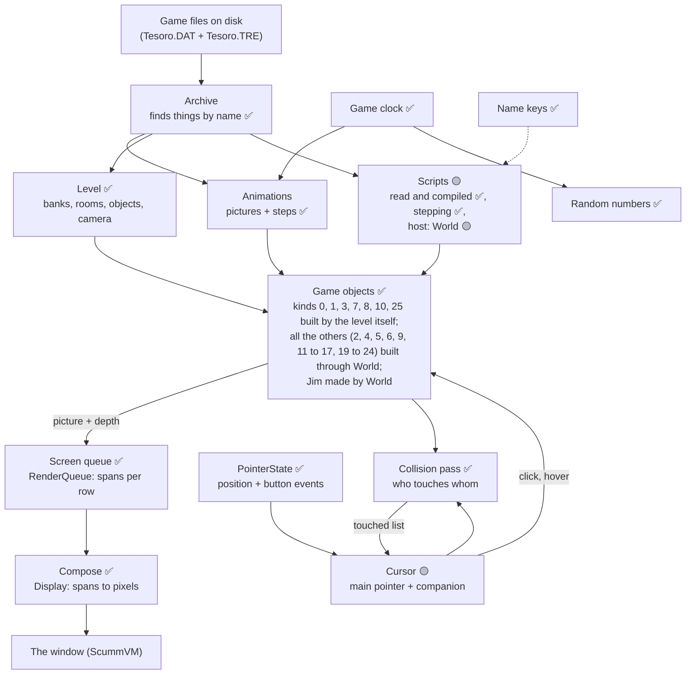
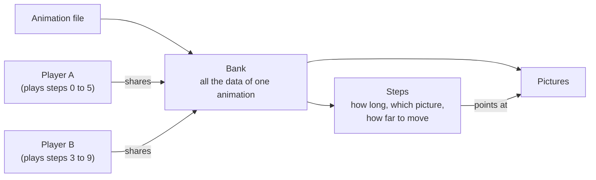
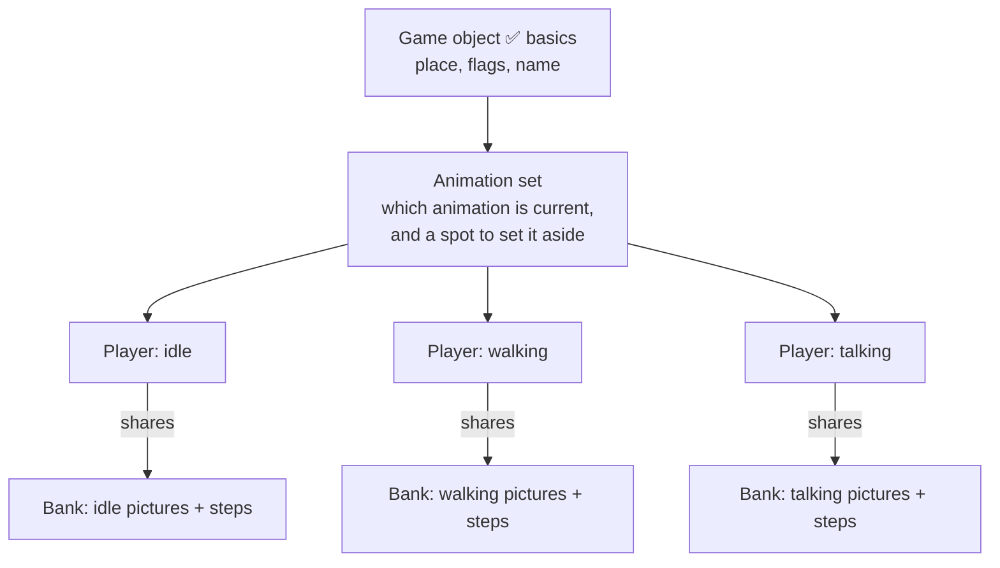
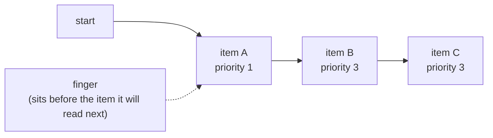
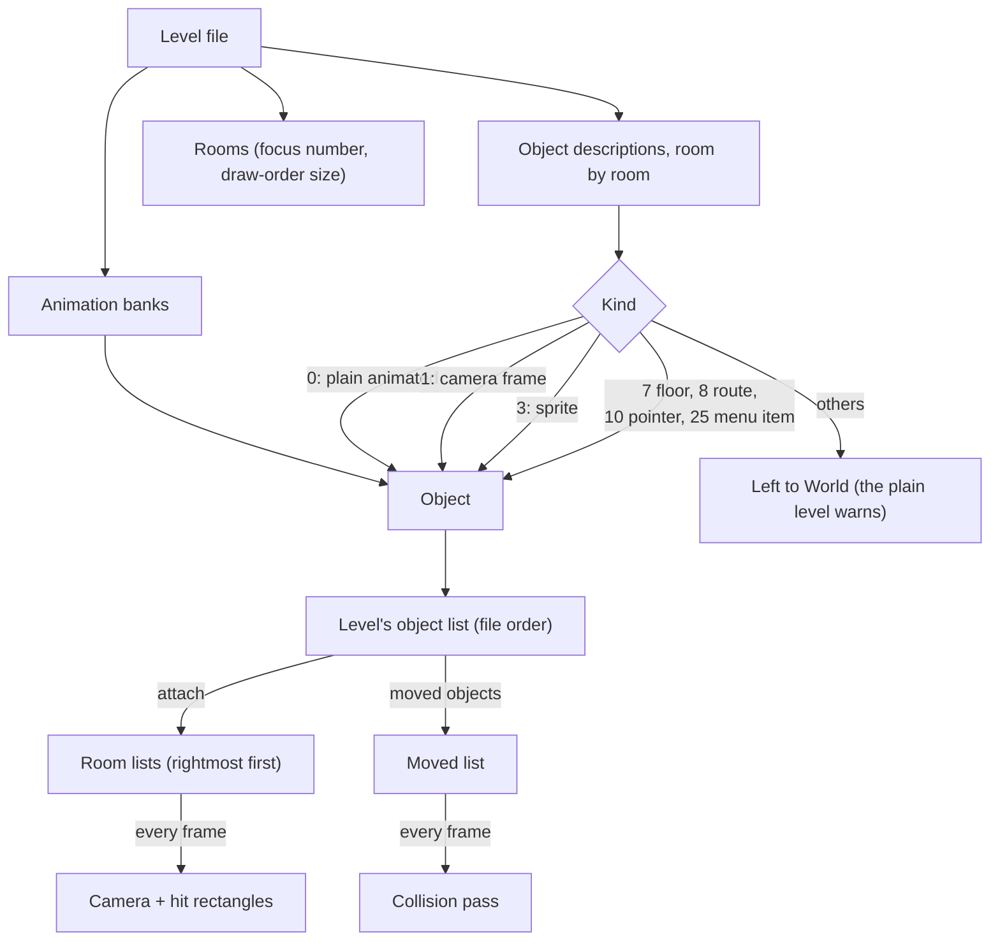
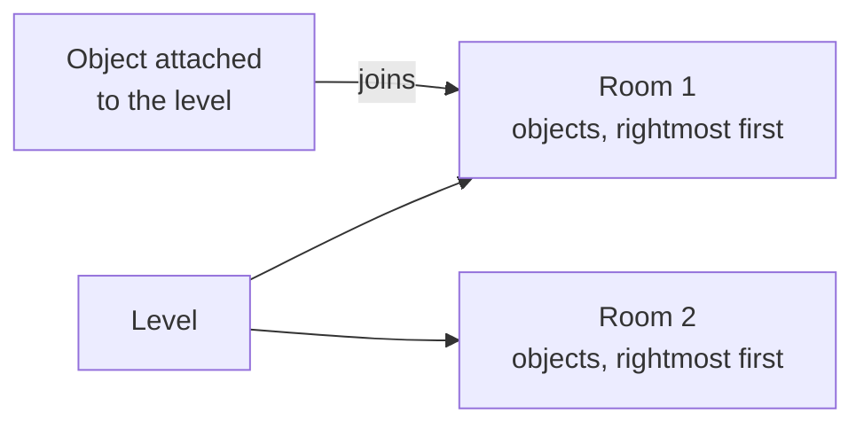
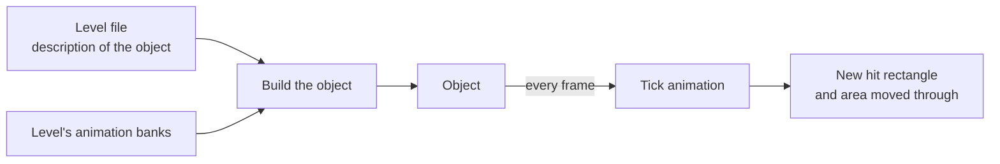
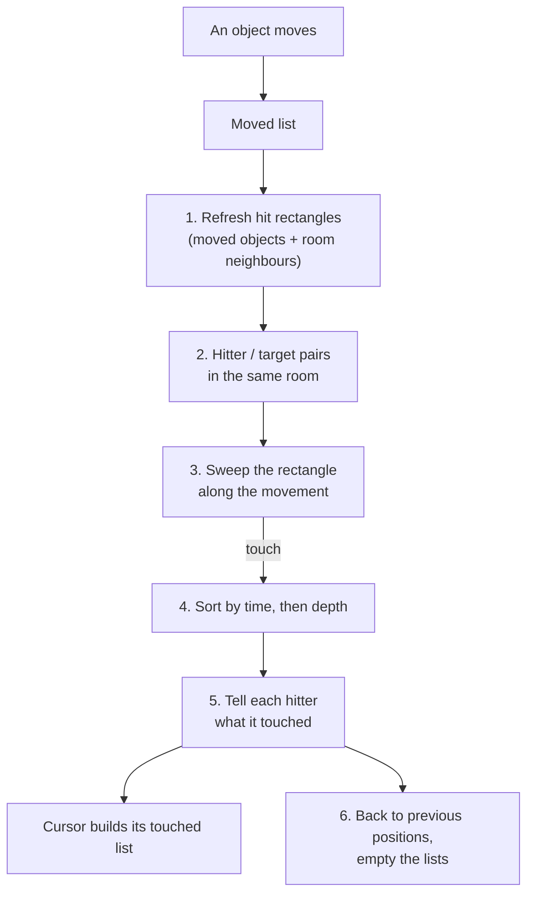
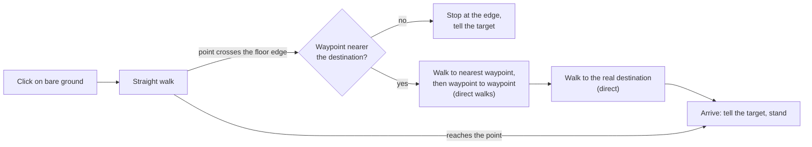
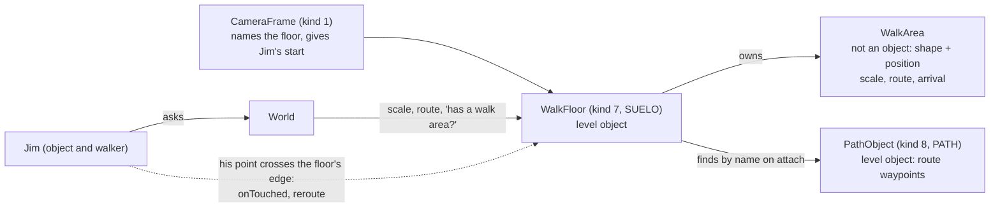

# How the parts of the game fit together

A plain-language map of the game's subsystems and how they talk to each other.
It grows as we recover more of the original. Written for people, not for the debugger.

**How much do we trust each part?**
- ✅ Recovered, ported, and run against the original's code (its machine code, or a real saved game) with the parts the heading names matching
- 🟡 Ported or recovered, but something the heading names has not been compared with the original or has never been seen working: **the heading says what**
- ❓ Seen from the outside only, not read yet

None of this is yet "seen on the original's screen" except two menu screens and a saved game's file (4 Nov): ✅ means matches the original's *code*, not what the original shows.

Last updated: 4 November 2026 (headings and counts audited against the engine branch `codex/object-kinds` and the ledger).
On 6 November the port-only host interfaces were removed on the branch `codex/remove-hosts` (see "Which classes copy the original"), together with every member function and field that nothing in the engine used (about 60 accessors that only the comparison drivers called, five fields that were written but never read, and the `core/random.*` files: random numbers now come from ScummVM's `RandomSource`). The option "Enable cut content" was added there too. The shear parameter of the scaled-image drawing (never used by the game, and a memory-corrupting bug in the original) was removed on `codex/remove-hosts`. `ScreenDisplay` and the abstract `Display` base behind it were merged into one class, `Display` (`core/display.*`). The animation step type `AnimSequence` was renamed `AnimStep` in the same branch (`AnimBank::sequence(i)` is now `step(i)`, `sequenceCount()` is `stepCount()`); the older sections below still say "sequence" for the same thing. The per-cluster sections below still use the old host names, as written when each cluster was ported; read `XHost` there as `World`.

## Where the reverse engineering stands (4 November 2026)

Counted from `re/ledger.json` (the generated `CHECKLIST.md` has the per-function list). The game's own code is 447 functions:

| Stage | Functions | Share |
|---|---|---|
| Read (decompiled) | 447 | 100% |
| Understood (contract written) | 431 | 96% |
| Ported to C++ (or later) | 405 | 90% |
| Run against the original machine code and matched | 354 | 79% |
| Replaced by a ScummVM service (DirectDraw, DirectSound, input and similar) | 3 | |
| Seen in the running original | 0 | 0% as functions. Compared in screenshots of the original under DOSBox-X (4 Nov): the main menu and the new-game menu (same picture). Compared with a real saved game of the original: its layout and its object records |

- **What is left unread** is small and not the story: the memory pool, the display's constructor and its two mask and second-row raster routines, the window and start-up code.
  Most of these are replaced by ScummVM (window, input, sound, memory). The polygon routines are read and ported (see Outlines below).
- **Every object kind of the level files is now built** by the engine (see the table of kinds): 0 to 17 and 19 to 25. Kind 18 has no case in the original's factory, so a record of that kind builds nothing, and no shipped level has one (counted over all levels, 5 Nov).
  The engine's `Level` alone still builds only 0, 1, 3, 7, 8, 10 and 25 (the menus load whole with it); `World` supplies the rest.
- **The scene routines** behind the numbered script blocks (the `DO` lines): the engine has all of them. The two board-game routines (types 8 and 14) and the other seventeen are ported *and compared* with the original by emulation (5 Nov: 400 runs of the original routines from random starts; the port made the same calls in the same order and left the same state). Reading them first found one real defect, now fixed: in the CONV35 scene (type 12) the harbour guard ORZOGUEI was switched on and off the wrong way round. They live in their own class, `SceneRoutines`, which asks the game through `SceneAdapter` (the block's view of `World`).
- **Nothing known still warns when reached:** turning an inventory page, scrolling the interface out, the pixel-accurate collision and the step after a picture reload are all ported (see Outlines and the picture-reload step).
  The subtitles option is the original's own on/off switch (one byte of Jim's progress, kept in saves since 5 Nov). Skipping a line follows the original: Escape or the right button, when it goes up (the left button does not skip); since 5 Nov, read from the original's speaker step, not run against it with real input.
- **Played to the end (5 Nov):** Gabriel finished the game in the engine under ScummVM and found it fine apart from a handful of bugs, all fixed (by their commit titles: Jim moving during conversations, an error when loading a game, the inventory strip showing in the main menu, certain items that could not be looked at, the save/load menu staying open after a load, Jim not selectable by the pointer, and fixes to Jim's walking). Every one of them is in the engine's own wiring (the `World` host, the menus, the pointer), none in a function the checks against the original cover: the comparisons found their own, different bugs (the save bytes, the walk overflow, the skip key), and playing found these. A complete playthrough is evidence that the story can be finished, not that every scene looks and behaves like the original's.
- **The playthrough fixes checked against the original (5 Nov):** each fix Gabriel made while playing was compared with what the original's code does.
  - *Script order (new scripts go in front of equal priorities):* **matches**: the original starts scripts with the "in front" insert at priority 0x1e.
  - *Item scripts start in Jim's level:* **matches**: the original's nine item verb handlers pass Jim's level. The comparison could not see this (it ignored the level); it now records it.
  - *The inventory strip is unavailable in the menus and on the board:* **matches**: the original tests Jim's level against the board and the two menus; the engine, which does not put Jim in the menus, tests its own place.
  - *Loading from the save screen slides the interface out:* **matches**: the original's load ends with that very call, right after turning Jim to his saved facing.
  - *Load no longer puts the level in the main list twice:* **matches**: Jim's entry into the level does the insert in the original, and the old menu level leaves the list.
  - *Hover names are white:* **matches**: the original calls the label with the colour 0xffff, and clearing leaves the colour alone.
  - *Jim selectable by the pointer:* **matches**: Jim's table of verbs is the clickable object's own, with the same stock answers per verb (verb 0, 5 and 6 none; verbs 1 to 4 the usual four lines), the same pending and answered steps, and the item verbs as the base does.
  - *Walking fixes:* **match** (shown earlier: the overflow of the squared distance, the shifts, the floor guard).
  Two things the check found beyond the fixes: Jim's walk order must also be put in front of equal priorities (the engine used the plain insert; fixed, with the comparison now telling the two inserts apart), and the item comparison's blind spot above.
- **Sanitizers and a script smoke run (5 Nov):** the comparison drivers build and run clean under the address and undefined-behaviour checkers (one finding, a harmless negative shift in the walking code, fixed). All 452 labels of the 145 script blocks were started in the sanitizer-built engine and run for 1,200 frames each: no crash and no checker finding; 15 labels could not be placed in a level holding all their characters, and the opening scene is slow under the checkers but ran to the end. The only warning that appeared (115 labels, from loading the two kitchen levels) is four animation sequences whose point lists claim a point their data does not hold; the original reads whatever lies after the data in memory (explained under Animations: real banks). Found and hardened: a script that leaves a level's floor on a picture its animation does not have no longer aborts (the floor then gives the plain scale).
- **Still the honest limit:** "compared" means the original's machine code was run next to the port on invented or real inputs (and, for saves, a real file). Apart from the two menu screens, nothing is checked against what the original *shows on screen* (walking, speech, scenes, movies), and the voices were never listened to.

---

## The big picture (what we know so far)

Read it top to bottom: the files feed the archive; the archive feeds the animations and the levels; a level builds its
game objects; the objects hand their pictures to the screen queue, which is composed into the window every frame. The mouse
moves the cursor, the collision pass tells the cursor what is under it, and the cursor clicks or hovers over those objects.
The clock decides *when* things happen. Boxes with a question mark are the parts we have not opened yet.

**Engine classes by area** (so each name can be found in the diagrams below):
- Files and time: `Archive`, `ArchiveIndex`, `GameClock`, name keys. Random numbers come from ScummVM's `RandomSource` in the engine (since 6 Nov on `codex/remove-hosts`; the original derived them from the millisecond tick).
- Lists: plain `Common::Array` (`ObjectList`) for levels, rooms and the pointer, and `MainList` (objects in priority order, with an edit counter so a pass can tell its turn changed the list).
- Pictures: `TextQueue` (laid-out text lines, drawn by `Display`), `AnimBank`, `AnimPlayer`, `AnimImage`, `AnimSet` (animations); `Display` (the screen: what objects draw to), `RenderQueue`.
- World: `Level`, `Room`, `Camera`, `Object` and its kinds `CameraFrame` (1), `SpriteObject` (3), `WalkFloor` (7), `PathObject` (8), `MenuItem` (25), lists `ObjectList`. Small helpers: `ObjectRecord` (one object description of the level file), `ObjectRect`, `AnimStep`, `BrightnessTable`. a menu item asks the engine directly.
- Input: `PointerState` (the pointer position and button events; the engine fills it from ScummVM events, Escape is a flag in the engine), `Cursor` (both pointers), `HoverText`.
- Collisions: `sweepRects`, `Level::collisionPass`.
- The world: `World` (answers every host for real), `WorldLevel` (a level that builds the clickable kinds).
- Exits: `ExitDoor` (an exit between levels).
- Board game: `ConnectFour` (the thinking of the "Conecta" game).
- Items: `InventoryItem` (things Jim carries).
- Board columns and pieces: `BoardColumn` (kind 21), `BoardPieces` (shows the 49 piece objects and blinks the winning four), `BoardGame` (the board, whose turn it is and the game's start and turn loop).
- Notes and map places: `NoteObject` (kind 24), `MapPlace` (kind 19).
- The pointer's frame step: `Cursor` (Escape, the interface pages, the menu opening); keys: Escape's events in the engine.
- Save and load screen: `MenuButton` (kind 22), `SlotLabel` (23).
- Inventory strip: `InventoryStrip` (kind 11).
- Groups, shadows and wanderers: `ItemGroup` (kind 2), `ShadowSprite` (4), `DepthZone` (14), `ClickCatcher` (15), `PathSprite` (16).
- Props: `ScriptedProp` (story props of kinds 12, 17 and 20).
- Characters: `Character` (a clickable, speaking person of a level).
- Walking: `Jim` (the player's object), `WalkArea` (shape, scale and route), `InteractiveObject` (clickable base), (Jim's walk is part of `Jim`: until 12 Nov 2026 it was a separate `JimWalker` class that only reached back into `Jim`, and the two were merged), `WalkTarget` (told on arrival).
- Sound: `SoundDevice` (voices, plays on the ScummVM mixer), `CdAudio` (music, through ScummVM's audio CD support), `Voices` (the two together, owned by `World`).
- Menu: `ChoiceMenu` (one frame of the list of choices; asks `Scripts` for pointer, label and mouse).
- Speaking: `Speaker` (the speaking rules of a character) and `SpeakerHost` (what it asks of its owner, `Jim` or a character: the one interface left that two classes really implement).
- Spoken lines: `SpeechTables`, `SpeechTable` (the four `*.TXT` files); `StdioText` (the reader both text formats use).
- Scene routines: `SceneRoutines` (the native routines behind the `DO` lines of the numbered blocks) and `SceneAdapter` (their view of the game for the block that is running).
- Scripts: `ScriptRunner` (runs blocks), `ScriptRun` (what one running block remembers), `Scripts` (the compiled blocks, the runner and everything a running block asks of the game; lives in `scripts.h`), `ScriptLibrary` (all blocks), `ScriptBlock` (one script: characters, commands, labels), `ScriptEntry` (one command).

**Which classes copy the original and which are only seams of the port.** The original is mostly plain functions on global tables.
- Mirror an original structure: `ScriptBlock`/`ScriptLibrary` (the script objects and their table), `ScriptEntry` (the 24-byte command), `SpeechTable`/`SpeechTables` (the four tables and their search).
- Port-only, no original counterpart: `SpeakerHost` (the original calls the objects directly), `SceneAdapter`, `Voices`, `StdioText` (the original calls the C library directly; this repeats its reading rules on a memory buffer), and the `ScriptOp`/`ScriptMessage` names for numbers the original uses bare.
- Only behaviour was compared with the original; the class layout was never meant to match.

---

## Archive: the game's filing cabinet ✅

All the game's data sits in one big file (`Tesoro.DAT`). A second small file (`Tesoro.TRE`)
is the index: a list of names, each with the place in the big file where that thing starts.

When the game wants something (say an animation called `JIM`), it:
1. Looks the name up in the index (the index is kept in sorted order so the search is quick).
2. Gets back a position in the big file.
3. Jumps to that position and reads from there.

Everything else in the game that loads data goes through this.

The real files are read: the index and the levels of the shipped game load through it.

## Clock and random numbers ✅

The game keeps its own clock that counts game time, not wall-clock time.
It can be paused (for example in menus), and it ignores long hiccups so a stall does not make
everything jump forward. Anything that moves or waits asks this clock what time it is.

Random numbers are derived from the clock, so they are not a separate generator with a seed.

## Name keys ✅

Names (of objects, animations and so on) are turned into a short number so the game can compare
and look them up quickly. The same name always gives the same number.

---

## Animations ✅ (loading and playing; drawing not read yet)

An animation file contains two things: **pictures** and **steps**.

- **Picture:** one image, kept as it is stored in the file. It can lighten or darken itself,
  and convert its colours if the screen needs a different colour format.
- **Step:** one moment of the animation. It says how long it lasts and which picture to show
  (or none). It can also carry a list of points (for example places a character may walk).
- **Bank:** everything one animation file holds. Loaded once, then only read.
- **Player:** the "play head". It remembers where in the animation we are, whether it loops,
  and when it started. Many players can share one bank, so ten characters can use the same
  animation without keeping ten copies of the pictures.

Some banks load their pictures later instead of straight away, to save memory until they are needed.

**Playing.** Each tick the player asks the clock for the time and moves its play head: while the
current step has lasted longer than its duration, it moves on to the next one. If the animation loops, it
jumps back to the first step and remembers how far the object moved during that lap, so a walking
character keeps advancing instead of snapping back. Between two steps the movement is blended smoothly
when the animation asks for it. The result is a small offset (x, y) that says where the object should be
drawn relative to its place. A player can be paused; on resume the time spent paused is subtracted so
the animation carries on where it stopped.

**Per object (the "animation set").** In the code this group is called an `AnimSet`; the original has no such
name, it keeps the same pieces inside every object. It is the set of animations that belong to one object:

 A game object owns one player for each of its animation banks (for example "idle", "walking",
"talking") and one of them is current. Choosing another bank also says which steps to play. Each frame the
object ticks its current player. An object can set its animation aside while it is paused (a dialogue, a
menu): it remembers which bank it was on and how it was playing, pauses, and afterwards puts it back and
resumes. Some objects discard the movement the animation produces, so the picture plays in place.

**Real banks compared (5 Nov):** every animation bank of the 50 real levels (360 banks, 2,919 sequences) was loaded by the original's loader in the emulator and by the engine's, and compared in full: header, each sequence's fields, hit rectangle, points, scales and outline split, and the image positions. All identical except four single-point outlines in the two kitchen levels (bank 1, sequences 1 and 2 of COCINA and COCINA2): their data holds no point although they claim one, so the original reads the bytes that follow in memory (here the next record's values, which depend on how the memory arena was filled), and the engine reads zero. Those four outlines are the one known difference; it affects only a point test on a kitchen object.

## Object lists ✅

The level keeps its objects in lists, and the game uses one kind of list everywhere. It is a plain chain of
items with a "finger" (a cursor) that remembers where the last walk stopped.

- Walking the list moves the finger along; almost every operation starts by putting the finger back at the
  start and ends wherever it stopped, so the finger's position is a by-product, not something to rely on.
- Inserting puts the new item right after the finger, which is in front of the item the finger is about to reach.
- Some lists keep their items sorted by a number (the priority, for example the draw order): a new item goes in
  front of the first item with a bigger number, so items with equal numbers stay in the order they arrived.
- In the original, removed items' slots go onto a free list and are reused, all slots come from a block reserved
  when the list is created, and several lists can share one block. That is memory management only, so our version
  is just an ordered array with a finger position and gives the same results.

One quirk is kept on purpose: right after removing the first item the finger is parked in a state where a
further step would skip the new first item. Nothing we have read relies on it yet.

## The frame loop over the objects ✅

Each frame the game walks the main object list twice: pass A, then pass B (skipped if pass A reported "3", a
state change or exit request). In a pass every active object gets one turn (A: its update, B: its second update).
Before a pass all objects are marked "not yet done"; an object that has had its turn is marked done, so it never
runs twice in a pass. If an object's turn adds or removes objects (a dialogue starting, an item appearing), the
walk notices that the list changed and starts again from the top, skipping everything already done. One detail
matters: an object added right behind the one being run does not count as a change, so it waits for the next pass.
A turn that returns 2 or 3 ends the pass at once with that number; otherwise the pass returns 1. The engine
functions are `MainList::runUpdate` and `runUpdate2`. Checked against the original with random lists whose objects
add and remove other objects during their turn. What 2 and 3 mean to each caller is not read yet.

## The world: levels, Jim and the main list 🟡 (the engine's own wiring; the functions it calls are compared one by one, the wiring as a whole is not)

At start-up the game loads every level file (47 of them, from the despacho, the port and the ship to the volcano, the final
scenes and the credits), plus two menu levels (the main menu and the new-game menu) and an interface level (the item strip
and the save/menu objects). Each level is itself an object in the one main list that the frame loop walks; the interface level is
walked first and the level Jim is in next. A level, in turn, keeps its own lists of objects, rooms and a camera. Jim is one
object that moves between levels: entering a level takes him out of his old level's lists, puts him in the new one's and
makes the new level's camera follow him. The game begins with Jim in the main menu. The cursor lives in the interface level,
and its companion in whichever level Jim is in. Some objects (a door, a chest, a canoe...) are switched off right at the start.

### The world class (`World`) 🟡 (answers every host from the real game state; what `World` decides is the engine's own and is compared only through the pieces it feeds)
Every ported object class asks "the rest of the game" for things through a small interface (a *host*: see below). `World` is the one class
that answers all of them for real, from the game's actual state:
- **Levels.** The table of the 47 levels in the game's own order (the numbers scripts and objects use). A level is read from the archive the first
  time something asks for it (the original reads them all at start-up; only the load time differs), with its pictures left unloaded until Jim
  enters. Its objects are built by the level reader: the plain ones as before, and now also the **characters (kind 5), exits (6), plain clickable
  things (9), scripted props (12, 17, 20) and items (13)**, each handed `World` as its host. Every kind of the level files is built now (see the lists under the level's objects).
- **Spoken lines.** The four text files (`OBJETOS`, `ANIMS`, `CONVERS`, `ICONS`) are read from the archive and searched in the game's order; a
  line's voice is its sound file in the archive. Voices play on ScummVM's mixer through the ported sound device.
- **Jim.** Made on first use from his nine animation files and the line "JIM"; `World` puts him into a level (his first room), answers his walking
  questions from the level's walk area (the floor object and its route), draws his subtitles, and keeps his story bytes (the step the scripts move
  on, the byte beside it, the "has entered" flag).
- **The pointer and what it carries.** The carried item, the pointer's picture (item number plus seven while carried), the hover label, switching the
  pointer on and off while Jim answers. Hover names are shown in white; the label's colour was lost on the way from the object to the label until 5 Nov.
- **Where Jim is in the menus.** The original puts Jim in the menu level, and several checks ask "is Jim in a menu?" (the strip, the save button). The engine does not put Jim there, so those checks go by the engine's own menu state (`place()`); the strip is off in both menus and on the board level. Any other check ported from "Jim's level is a menu" needs the same care.
- **Where the game can be saved.** The original's save button is on only in levels 0 to 22 (not on the board game); the lab maze (23 to 43) and the closing scenes cannot be saved. ScummVM's own save, load and autosave follow that rule in the engine (loading stays open in the menus). The original's own menu still lets you load from inside the lab; ScummVM's load shortcut does not (a deliberate stricter choice, 5 Nov).
- **The main list.** The one list of things that get a turn every frame (speakers waiting for their line to end, clicks waiting for Jim): inserted by
  priority, removed by object.
- **Changing level.** The steps of the original's scene change (forget the queued pictures, bring the cameras up to date, compose, clear, fade, wait) are there for the exits; the movie that starts when Jim first reaches place 16 plays through `World::startMovie` (see The movies).
- **Scripts run.** `World` reads the four script files and answers everything a running script asks: finding objects, characters speaking (through
the same speaking rules, with the character's own colour and pose), Jim's script lines, walking Jim (the script is told when he arrives), animations,
looking, showing and switching objects, the choice menu (the pointer's picture is put aside and restored), sounds and music tracks. A running script is
an entry in the main list; a click or a menu item can start one. The one with a numbered type also has a scene routine behind its `DO` lines: 17 of the 19
are ported: the opening scene (type 1), the menu's fades (17), the captain's exit (21), the throne-room trips (20, also what a script's "run FANMTRONO"
does) and all the ones that only move Jim to another level and set the scene there (2 to 7, 9, 10, 12, 15, 16, 18, 19: where he appears, whether he
is shown, which objects are switched on or off, the fade and pause). All 19 are ported now: types 8 and 14 are the board game "Conecta" in the fisherman's hut (see The board game); only these two are compared with the original, the other seventeen (the class `SceneRoutines`, the throne-room trips since 5 Nov) are compared too: the original routines were run 400 times from random starts and the port made the same calls and left the same state (what the world does with each call is not part of that check). The game's thinking is ported and checked: `ConnectFour` (seven columns of
seven, lines of four; scores the last piece's lines, searches the best columns, avoids moves that let the player win at once, picks at random among equals,
and takes its turn after the player's: win, loss, draw or a move) matches the original on 1,200 random boards. The game's own
screen and state (the pieces' pictures, the blink of the winning line, the click that drops a piece, the timing) are ported too, as `BoardColumn`, `BoardPieces` and `BoardGame`. When a script finishes, a character it held for
speaking is let go and its held flag cleared (found by running it: the animation otherwise kept being reset). Seen working: the captain's talk
script plays Jim's and the captain's lines with subtitles and ends with Jim walking out of the despacho into the port.
- **Starting the game.** "Nueva partida" now fades to the new-game menu and plays its script; the start button puts Jim in the port, shows him and
starts the opening script, which runs through the ship arriving and Jim walking into the despacho (the screen follows Jim into each level). Seen
running from the start button's code path; the introduction movie plays first (see The movies).
- **Not there yet:** the voices start and finish on the mixer (checked with a silent audio driver: the captain's talk now ends by its voices, with no skipping), but nobody has listened to them yet.
- **Seen working:** the engine reads all 47 levels with these objects, puts Jim in the despacho and draws the room with the captain in his chair, Jim
standing in front and the items of the room, with no warnings. Not checked against the original (the hosts are the engine's own decisions, not
ported functions).

### What "host" means here
Objects reach the rest of the game through `World` ("is Jim speaking?", "put Jim in that level", "find this object", "start this script"), which they
are handed when they are built. Since 6 Nov the port-only interfaces that stood between them and `World` (the `*Host` classes, `JimWorld`, the sound
backends, `ScriptHost` and the other script-side ones) are gone: objects call `World`, the scripts call `Scripts`, the walker calls `Jim`. The comparison
drivers in `re/tools/drivers` (which plugged stand-in hosts into those interfaces) no longer build against the engine branch `codex/remove-hosts`;
they remain valid against `codex/object-kinds`.

## Levels ✅ (loading, bookkeeping, the collision pass including shaped collisions; the plain `Level` builds only some kinds, `World` the rest)

A level file holds three things in this order: the level's animation banks, then its rooms, and in each room the objects
standing in it. Loading a level reads all of that, builds each object, and adds it to the level's one list of objects, in
file order. The objects are not yet in their rooms: a second step ("attach") gives each object its level and, for the kinds
that ask for it, sorts it into its room. A level also keeps a short list of the collidable objects that moved, which the
collision pass uses (see Collisions), a camera with fixed bounds, the time it was loaded, and a pointer to its single "special" object if
the file has one (an object of kind 1). The engine class is `Level`; it is itself an `Object`, so it can sit in the main list.

Each frame the second pass calls the level to update its cameras: for each room the camera moves towards that room's focus,
then every visible, active, not-yet-processed object of the room recomputes its hit rectangle and is told where the camera
is. Checked against the original on synthetic level files (load, attach, moved-list, lookup by name, camera move, room
camera update, and the collision pass). The plain `Level` builds kinds 0, 1, 3, 7, 8, 10 and 25 and skips the others with a warning, so loaded by itself most real levels have objects missing
(the main menu and the new-game menu load whole). In the engine the levels of the game are read by `WorldLevel`, which builds every other kind too (see the world class).
**Drawn too (4 Nov):** 49 of the 50 real levels were drawn by the original's own drawing code in the emulator (pictures loaded, the room cameras updated, every object asked to draw, the frame composed) at three game times each, and by the engine; all 147 frames are pixel-identical (70,560 of 70,560 rows). Only the plain, camera-frame and sprite kinds were built for real (the other kinds were built as plain objects, which draw nothing), so the characters, props and items are not in these pictures. The interface level could not be drawn by the original in the emulator (its own drawing code faulted), so it is not covered. A deliberate change of the animation timing or of the depth ordering is caught. All 50 real level files were loaded by the original's loader (run in the emulator on the shipped game data) and by the engine's, and the results are identical (4 Nov): camera, rooms, animation banks, and for every object its name, place, sort value, flags and animation players, after loading and after attaching (100 comparisons, 50 levels). Every kind except the camera frame was built as the plain object on both sides, so the kinds' own constructors are not part of this; each has its own comparison.

## Level, room and scene: what the words mean

| Word | What it is | In the engine |
|---|---|---|
| **Level** | One scene file (`.LVL`) loaded into memory: the despacho, the port, the main menu, the interface strip. There are 47 game levels plus the main menu, the new-game menu and the interface. It owns the animation banks, the rooms, the object list and the camera. It is also an object itself, so it sits in the main list. | `Level` |
| **Room** | One screen-sized section inside a level. A level has one or more. A room keeps the list of the objects standing in it (rightmost first), a draw-order offset and the number the camera divides by. It is not an object and has no behaviour of its own. | `Room` (a plain struct inside the level) |
| **Scene** | Not a class. It is the everyday word for "a place in the game" and means the same thing as a level. The older prototype and its notes call a level a scene. | none, use *level* |

How they nest: the game has many levels; Jim is in one at a time; a level has rooms; a room lists its objects.
Every object also stays in the level's own list, in file order, which is what the frame passes and the lookup by name use.

Two things that are easy to mix up with a room:
- the **special object** of a level (kind 1, at most one per level) is a real object. The older notes sometimes call it the "room object". It is not a `Room`;
- the **camera** belongs to the level, not to a room. Each room only supplies the divisor the camera uses while that room is being updated.

## The camera ✅

Each level has a camera: a centre point on the level, kept so that the 640x480 view stays inside the level's bounds.
It can jump to a position or glide there over a given time, and it can follow an object (Jim) in coarse steps: when the
object walks more than a short distance (75 pixels) past where the camera is aiming, the aim moves 100 pixels toward it
and the camera glides there over three quarters of a second, as long as the level has room to scroll. Once per
frame, for each room, the game updates the camera and records its centre scaled by 300 divided by a number stored in the
room (apparently used to place subtitles; not checked on screen). The engine class is `Camera`. Checked against the
original with random sequences of moves, bounds, targets and clock steps. Which bound is the top of the screen is not established.

## Saving an object's state ✅

The level can write each object's state to a stream and read it back: this is what saved games hold (see Saved games, checked against a real save of the original). Each object writes a small record and reads it back: if it has animations, which animation bank is
current and the current bank's range and playing state (first and last step, and one byte each for the step being
played and the play flags, so only the low bytes survive a save); then, for objects that carry their own saved data, its
size and its bytes. Kinds that need more can add to this (not read yet). The engine functions are `saveState` and
`loadState` on the object. Checked against the original with random objects and streams, including cut-off streams.

## The pointer (cursor) 🟡 (the logic, the frame step and the drawing compared with the original's code; the hover text and the walk to a click on bare ground never seen on screen)

The mouse pointer is itself a game object, and there are two of them. The **main pointer** (object kind 10) lives in the interface
level: it is an animated picture (its current animation frame is the "verb": walk, look, use...), drawn on top of everything
through the screen's scaled-picture path. The **companion** is a plain object with no picture that stands in whichever level
the player is in and does the touching there. Both are placed at the mouse every frame: main at (mouse x + the interface camera x,
camera y − mouse y), companion the same relative to the player's level camera. The mouse itself counts from the middle of the
window (−320..319, −240..239), which the main pointer's construction sets up.

Both pointers take part in the ordinary collision pass; whatever their shapes overlap is added to a "touched this frame" list.
Once a frame the pointers work through those lists:
- an object that was not under the pointer last frame gets the pointer's attention if it accepts it, and is asked to show its
  name next to the pointer; only the first such object is served, because showing the name reports "handled";
- an object that stays under the pointer gets the click: left button runs the current verb on it, a re-press the alternative;
- an object that is no longer touched has its name hidden.
The previous frame's list is shared by both pointers and the whole game. Engine classes: `Cursor` (both pointers; derives from
`SpriteObject`), `HoverText`, `PointerState`. Checked against the original: the click/hover logic with stub objects, the
pointer's draw (533 draws), the hitter test (2000 cases) and the move-to-position routine (918 calls); the frame placement and the second-pass wrapper are
ported from reading and not compared as a whole.

**How the pointer touches things.** The collision pass records a touch when one object says "I am the hitter for you". For the
pointer that answer is simply "you are marked as a hitter": the pointer looks at the *other* object's flag, so it touches Jim, the
clickable scenery and the menu items, and nothing else. (An earlier version of the port had this backwards, checking the pointer's
own flag, because the decompiler hid a detail of the call; it is fixed and checked against the original.) The companion borrows the
main pointer's animation frame for its hit rectangle, so hovering works in the level the player is in. With the real menu,
a pointer over "Nueva partida" or "Cargar partida" touches that item and starts hovering, and off the items it touches nothing.

**The pointer's frame step ✅ (5 November 2026; compared with the original).** The interface is a strip of screens that slides sideways:
page 0 is the strip of carried things at the bottom, a page beyond the right edge holds the item pictures, and the save screen
waits to the left. **Escape** (the first of the five keys the game's keyboard watches: Escape, Return, Space, S, L) and the
right mouse button turn the pages: in the main menu Escape fades out and empties the main list, which ends the game; in the
new-game menu it goes back to the main menu; in the game it opens the save screen (not on the board game's level): the pointer
lets go of what it carries, the save button is switched on in the first 23 levels, the subtitle switch shows its setting, a small
picture of the scene (every third pixel of every third row, 213x160, taken without the pointer) is kept, and the interface slides to the
save screen. Escape again slides it back; the right button on page 0 slides the strip out. The class is `Cursor` with `CursorHost`
(answered by `World`, with the keys kept by the engine). Compared with the original code on 500 sessions (every page, key state,
right-button value and place; the pointer's and the companion's places, the strip, its square and pictures, the held item, the
label, the sample's checksum): identical; all but one of 51 deliberate mistakes found (the other changes nothing). Since then the
picture of the chosen saved game, the scene picture in the save file and the walk to a click on empty ground are ported (not compared with the original); the hover text is queued for drawing but has not been seen on screen.

## Rooms ✅

A level is split into rooms (screens). Each room keeps its own list of the objects standing in it, ordered by
horizontal position with the rightmost first; an object at the same position as another goes behind it.
An object joins its room's list when it is attached to the level (if it is a kind that asks for this), and
leaves it when it moves to another level. Each room also carries a draw-order offset, and the next room's offset
grows by the size of the one before. The engine class is `Room`. Checked against the original running the same
random sequences of inserts and removals. Each room also holds a number the camera uses as a divisor (see the camera). Not known: why the order
is right-to-left.

## Game objects ✅ (the common base; every kind has its own section below)

Everything you see in a level (Jim, other characters, items, doors, scenery) is a game object.
Whatever the kind, an object has:
- a place (x, y) and the place it is heading to, which it uses to work out the area it moved through;
- a few on/off switches: active, visible, can be hit, has animation;
- a name (stored as a short number so it can be compared quickly);
- a sort number that decides what is drawn in front of what: its own number, plus the number of the
  room it stands in, plus 5;
- its animation set (see above);
- a hit rectangle, taken from the picture it is currently showing, used to see what the mouse or a
  character touches.

A level file describes each object (place, name, which animations it uses). The level builds the
object from that description; building it also makes the object's own copy of each animation player.
Every frame the object ticks its animation and then recomputes its hit rectangle.

*Built by the level:* the plain animated object (kind 0), the camera frame (1), the sprite (3), the floor (7), the route (8), the pointer (10) and the menu item (25), as `Object`, `CameraFrame`, `SpriteObject`, `WalkFloor`, `PathObject`, `Cursor`, `MenuItem`. Each draws through `Display`; the object's hit rectangle and its movement feed the collision pass.
*Built when `World` reads a level:* the characters (5), exits (6), the plain clickable (9), the scripted props (12, 17, 20) and items (13) (see their sections); Jim is made by `World` on first use.
*Also built by `World`:* the groups (2), shadows (4), strip (11), depth zones (14), click catchers (15), wanderers (16), save menu objects (22, 23) note objects (24), map places (19) and board columns (21).
*Not built:* kind 18 only: the original's factory has no case for it, so a record of that kind builds nothing; no shipped level contains one.

---

## What the levels contain (counted; every kind is ported now)

Counted from the shipped game files with `re/tools/drivers/level_kinds_driver.cpp` (the engine's own level loader, read-only).
Fifty levels in all. Only one object in the whole game is the plain animated kind (kind 0, in the interface strip); the commonest are kinds 3, 9 and 6.

| Kind | How many | Where |
|---|---|---|
| 3 | 217 | every level; the commonest object |
| 9 | 124 | most rooms of the story |
| 6 | 75 | numbered levels and most rooms |
| 20 | 44 | rooms with scenery |
| 7, 8 | 38, 39 | one of each in most rooms |
| 13 | 46 | interface strip only |
| 1 | 50 | exactly one per level (the special object) |
| 25 | 5 | main menu (2) and the new-game menu (3) |

**Kind 3 is ported and built ✅ (checked against the original's code).** It is an animated picture: it starts one run of animation
frames chosen by two bytes in the level file (hold one frame, hidden or shown, or play on to the next gap, optionally looping),
puts itself into its room's list when the level attaches its objects, ticks its animation every frame, and each frame asks
the screen (`Display`) to draw its current frame at a position worked out from the camera.

**Kind 1 is ported ✅ (checked against the original).** The "special object" is really a camera frame: each level has
one, and when the level attaches its objects the frame sets the area the camera may show (its first frame's rectangle) and
puts the camera on its own position. It also names another object of the level, which it looks up at that moment, and keeps
three small values nobody has been traced reading yet.

**Kind 25 is ported ✅ except for what a click leads to.** A menu item shows one frame, starts hidden, carries an action number, and
since it is a hitter target the pointer hovers over it. A click (left, or the alternative, which does the same) acts by number:
- 0 "Nueva partida": the picture fades to black (4 steps of 100 ms), the player goes into the new-game menu, and the menu script
  `FANMMENU/nuevo` starts (video 1 and a picture, see Scripts); it ends the pass.
- 1 "Cargar partida": fade, then the pointer opens the interface's saved-game screen the way its menu key does (small picture of the scene, interface slides to the save page).
- 2, 3, 4 (easy, regular, hard in the new-game menu): easy and hard start the scripts `FANMMENU/facil` and `FANMMENU/dificil`; regular
  fades and runs the routine that starts the game.
The click, the fade and the level change are ported and checked against the original (click call sequence 18/18, fade 74 frames);
In the engine, "Nueva partida" fades out, shows the new-game menu and plays its script, "Cargar partida" fades out and opens the saved-game screen (the call sequence is checked, what the screen does afterwards is the saved-games section), and the start button puts Jim in the port and starts the opening script (see The world class).

**The main menu** (`PRINCIPAL`) is the smallest level: one room, two animation banks, four objects: the special object (kind 1),
one kind 3, and two kind 25. All three kinds are ported and the menu level is drawn in the window; the cursor and the click code are wired in the engine (see the frame loop). The new-game menu
(`NUEVO`) adds more kind 3 and kind 25 and nothing else.

## The screen: how pictures get drawn (first layer ✅)

The screen does not paint each picture straight away. Each frame, every object hands the screen its picture and a depth
number (smaller = nearer). For every one of the 480 screen rows the screen keeps a short list of **spans**: stretches of
the row, each pointing at the pixels that will show there. A new span cuts the ones behind it and is cut by the ones in front,
so a row ends up as a left-to-right list of visible pieces with nothing overdrawn. Only at the end of the frame, when the frame
is composed, are the pieces copied into the picture. Scaled pictures, shadow pictures and text take other routes.

What is ported and checked against the original: emptying the lists, adding an ordinary (literal) picture, the span
cutting (including pictures hanging off any screen edge) and the **compose**, which copies the spans of every row into
the 640x480 picture, left to right. The new `Display` class owns the queue and the picture. The compose relies on
the first picture of a frame being a full-screen background, as the game always draws. Not yet: putting the finished picture on the real screen (see the shadows below).

The second kind of picture, solid colour runs (the "type 3" images), is now ported too and checked the same way; the
difficulty menu (`NUEVO`) renders with it: three wooden-sign lines for easy, regular and hard.

**Shadow pictures ✅ (5 November 2026, unscaled ones).** Any picture that is neither of the two kinds above is a shadow. Its rows
go into a second list per screen row (the *mask* queue), cut by the same rules, each stretch carrying a page number of a 32 KB
table (`TABLA1.TBL`, read at start) and, optionally, a window of depths ("darken only what lies between these two depths";
without one, a shadow darkens what lies behind it). When the frame is composed, before the rows are laid down, each shadow stretch
is merged into the row it falls on: a stretch of ordinary pixels becomes a *shadow span* that is copied through the table (every
pixel's colour is looked up on the page, giving a darker one), a stretch of solid colour is darkened at once, and a stretch that
was already drawn (by a scaled picture) is darkened in place in the picture. The row is cut where the shadow starts and ends.
The game's own quirk is kept: a shadow span stops being a position, so two shadows over the same stretch are undefined in the
original (it faults or draws noise); the port assumes shadows do not overlap on screen. Checked against the original on 456
composed frames (179 with shadows, random tables, depth windows, edges, scaled pictures under them) and on the mask lists of 165
more with several shadows: every row identical; 21 of 24 deliberate mistakes found (the others change nothing that is drawn).
`RenderQueue` (queueing, merging) and `Display` (the table and the copy). **Scaled solid and scaled shadow pictures** are ported too (5 November 2026): they paint nothing, they only enter their scaled stretches into the row lists (the mask lists for a shadow), so a scaled solid or shadow picture drawn after the rows are laid down, on top of the finished frame, shows nothing, as in the original. Checked against it on 426 composed frames with scaled pictures of all three kinds mixed (every row identical, all deliberate mistakes found). Shear is still ignored (the game never uses it). In the engine the warning about unported shadow pictures is gone from the village, and the board screen never queued
one, so nothing visibly changed in the two scenes played (no scene played shows the effect).

**First picture (30 October 2026).** `re/tools/drivers/show_driver.cpp` loads a level from the shipped game with the
fresh classes (archive index, level, the three object kinds, camera, render queue, compose) and writes one frame as a picture.
`PRINCIPAL` (the main menu) comes out right: the wooden sign with its chains and the two lines of lettering, in 5-6-5
colours. This is a one-off check, not the engine's frame loop: nothing runs per frame yet, there is no mouse, and the two
menu items are hidden as the original starts them.

## Collisions: who touches whom ✅ (rectangles) / ⬜ (shapes)

Whenever an object moves it is put on the level's list of **moved objects** (`Level::objectMoved`; only objects that can be hit
are accepted, each once). Once per frame, in the first pass, the level runs the **collision pass** (`Level::collisionPass`):

1. **Bounds.** Every moved object works out its hit rectangle and the area it moved through; the other hittable, active objects
   in the same rooms do the same (an object is refreshed once per moved object in its room: the original does not mark them).
2. **Pairs.** For each moved object and each hittable, active neighbour in its room, the game asks "is one of you a hitter for
   the other?" (the cursor is a hitter for everything it can click; Jim is a hitter for doors; most scenery is neither).
3. **Sweep.** For a hitter and its target the hitter's hit rectangle is swept along its movement relative to the target
   (`sweepRects`): the answer is "already overlapping", "never touches", or the fraction of the movement at which it first
   touches. (Objects with outlines also get a pixel-accurate test, see below.)
4. **Sorting.** Each touch is filed in a list ordered by that moment, earliest first; touches at the same moment are ordered by
   depth (the larger of the two objects' sort numbers; touches involving Jim use 100).
5. **Telling.** In order, each hitter is told which object it touched and when (`onTouched`). This is how the cursor builds its
   "touched this frame" list.
6. **Reset.** The touch list is emptied, every moved object is put back at its previous position, and the moved list is emptied.

Checked against the original with scripted objects on synthetic levels (590 passes, 941 touches in order) and the sweep test on
120000 random rectangle pairs. **Not ported:** objects with shape entries in their animation (types 2 and 4 sequences) get a
second, pixel-accurate test (see Outlines: it walks the movement a pixel at a time and compares outlines), which is ported. Not checked: bounds worked out by the real `updateBounds` during a pass (scripted in the
test), a very long touch list.

## The fade and entering a level 🟡 (the fade ✅ compared frame by frame; entering a level compared only as an order of steps with a stand-in world)

Leaving a menu fades the last picture to black: four steps, each rewriting every pixel with its red, green and blue scaled down
(192/256, 128/256, 64/256, 0) and holding it for 100 ms; the game stands still while it runs. This is `Display::fadeOut`, checked
against the original frame by frame. Entering a level is, in the original, Jim being moved into it: out of the old level's lists and
the main list, into the new one's, the camera put on him and set to follow him, the level's pictures reloaded, then Jim placed. `Jim::enterLevel` is ported (see Jim and walking) and is how the game's levels are entered; the engine's own `enterLevel` is used for the two menus only, where it makes the level current and puts its camera on the origin (which is where the menus' camera
belongs, since their scroll range is a single point).

## The frame loop and the mouse 🟡 (the mouse, keyboard and the pieces ✅ compared; the frame as a whole has the original's order but was not run next to it)

The original runs one **frame** about as often as the window refreshes: read the keyboard and mouse, freeze the game clock,
update sound, empty the screen's lists, run the first pass over the main object list (every object's update, the level's
collision pass), run the second pass (the level draws and composes, then shows the finished picture), unfreeze the clock.

The **mouse** keeps a position in the 640x480 window (clamped to the edges) and the state of its three buttons. Each button
goes through a small state machine: up, pressed this frame, held, held long enough to repeat, released this frame, releasing,
pressed again while releasing. The game reads these states instead of tracking presses itself. That state machine
(`InputStates`) is checked against the original's code; the host supplies the position directly instead of movement.

**The input devices** are read and checked (4 November). Keyboard and mouse share one base: it makes the single DirectInput object the first time
and counts the devices using it, so the last device to go releases it; each device is created, given its data format and its cooperation level
with Windows, and every failure shows its own Spanish "DIRECTINPUT: error ..." box (the start-up then stops with a general device error).
The **keyboard** watches only five keys, in this order: Escape, Return, Space, S and L (the engine's five key flags are the same list), with a release
delay of 200 ms and a repeat delay of 20 seconds. The **mouse** is in exclusive mode, adds up the movement the device reports (one to one, no
acceleration) and clamps the position to its limits; its three buttons use 300 ms and 500 ms until the main pointer is built, which then sets 200 ms and 20 seconds.
Once per frame each device is read; if the read fails it asks for the device back once and tries again, and if that fails too it leaves the states as they were.
One detail to remember when the clicks are tested: the pointer code's "right-click" path (its second button mask) is not the right mouse
button but the left button **pressed again within the release delay**; the real right button is a separate state byte that the pointer's own
update and the menu check. Checked against the original's code with a fake DirectInput (every field, every failure box, the retry order, 300 random
keyboard and mouse frames); not checked: real DirectInput behaviour. In the engine this is `Mouse` and the new `Keyboard` (the five watched keys, same delays; the engine's loop feeds it host key events); DirectInput itself has no equivalent. Since 5 Nov the engine's `Keyboard` and `Mouse` classes are compared with the original too: the original's constructors and reads were run with the fake DirectInput and the classes give the same key and button states, pointer positions and key order (5,367 checks; changing a timing, a clamp edge or the key mapping is caught). What is still not seen is real DirectInput behaviour and the host's own mouse handling.

The engine's **frame** (`TesoroEngine::runFrame`) now has the original's order (5 Nov 2026, read against the original's 21-line frame function, not run side by side): the host's events become key and mouse states, the keyboard is read, then the mouse, the game clock is frozen for the rest of the frame, the sound is looked after, the queued pictures are cleared, then the two passes over the main list (the second skipped when the first reports a state change), then the clock is let go and the frame ends if the main list is empty. Everything else happens *inside* the passes, as in the original, because the main list holds the things that act: scripts and speakers (priorities 5 and 6), **the pointer (0xf)**, the interface level (0x13) and the level the player is in (0x14), and the original's "top object" (100, which does nothing). The pointer used to be stepped by hand before and after the passes, which put it ahead of the scripts and behind Jim; it is now an ordinary entry. The picture is no longer composed by the loop: it is the second step of the player's level (its cameras, then composing, then showing it in the window; the interface level's second step is only its cameras), so a frame whose first pass asked for a state change (a level change) composes and shows nothing, as in the original. What the engine still does not have: the memory pool's per-frame reset (there is no such pool), the real window and message handling, and the flip of the original's display; the sound update is the engine's own. The menus use the same loop (their level is the player's level). Seen only in a headless run (it keeps running with no warnings); not compared as one whole against the original.

## Scripts 🟡 (read and compiled ✅, stepping ✅ checked with a stand-in world; the real world, `World`, answers for them in the engine and is not compared)

The story is told by **scripts**, and they are plain text. Four files in the archive hold them: `ANIMS.DLG` (cut scenes and the
menu scripts), `CONVERS.DLG` (conversations), `ICONS.DLG` (what happens when an inventory item is used) and `OBJETOS.DLG`
(what happens when Jim does something with an object). Together 145 named **blocks**. A block starts with a line `.NAME`, then
the names of the characters who talk in it, then one command per line, and ends with `.END`. A few blocks carry a number after
their name: that number says which piece of the game's own code handles the block's `DO` lines (a cut scene that needs
something no command can express, for instance the fade of the menu).

The commands are few: say a line (the vast majority, `PHRASE, n`), wait some milliseconds, `jmp` to a label, `if vN == V jmp`,
set a variable, `run` another block at a label, `play avi/cd/sound`, `menu` with its `menuitem` choices, `DO` (call the block's
own routine), and `sendmessage 'OBJECT' ...`, an order for an object: play an animation (and wait for it, loop it, stop it),
walk to a point, look up/down/left/right, show or hide it, switch it on or off. Variables are single bytes shared by the whole game.

The engine now **reads** all of it: `ScriptLibrary` turns each file into compiled commands (the original's 24-byte layout), and
a second step (`resolve`) replaces names by positions: jump targets, the chain of choices in a menu, which block a `run` starts.
This is checked against the original's own reader on all 145 shipped blocks, on invented blocks that use what the shipped scripts
never do, and on 500 randomly damaged real blocks (the same lines are accepted, rejected or compiled identically).

**The scripts against the data (5 Nov):** `re/tools/check_script_data.py` checks every reference of the 145 blocks (370 of them): every object a script names exists in a level, every block a `run` starts and its label exists, and every movie it plays is on the disc. All do except one: the label `ciruelaabierta` of block `FIPLATO` names an object `ICIRUELAABRT`, while the level's object is `ICIRUELABRT`. A typo of the original's data: the original finds nothing there too (the engine warns), so it is only reachable if the player uses a plum already opened, which the story may never allow.

### Running a script ✅ (the stepping; the world it talks to is not there)
`ScriptRunner` walks a block's commands. It does one command after another until one has to wait, and then each frame it
looks whether the wait is over:
- a spoken line waits until the speaker stops talking and then a fifth of a second more (201 ms);
- `sleep` waits for its time; a walk waits until the character arrives; an animation order waits only if it asked to wait;
- `menu` shows the choices once (only those whose variable allows them), Jim says the chosen line, and then the script goes on
  after that choice. A script can only have one menu open: the lists are shared by every script.
- `run` starts another block at once; the first one keeps going next to it.
While any script runs the mouse pointer is switched off; when a script ends it is switched back on and every character the
script took over is handed back. The runner never touches the world itself. It asks `Scripts` (find an object by name,
say a line, play an animation, walk, show a menu, play a video, sound or CD track, call the block's own `DO` routine).
The check swaps a recording stand-in for the real world and compares, on 977 random sessions over every shipped block, the
order of those requests and their values with what the original's code asked for. So the *stepping* is checked against the
original; what each request does (walking, drawing text, the menu screen, the `DO` routines) is not.
Found while reading: the thing the original calls "Jim's input" is the **main cursor**, not Jim; and a menu item reached from
outside a menu is skipped, not run.

What the **check** does not cover: the real hosts. `World` now answers them for real (see The world class), so lines are shown and said and
characters walk, but that part is the engine's own decision, not compared with the original. The `DO` routines are all ported and compared (see above), and the choice menu is ported (`ChoiceMenu`, compared on its own).

### Speaking, sound and the choice menu 🟡 (text, speaking rules, sound device, music and choice menu ✅ compared with the original's code; the voices and the music were never heard)
What a spoken line does once a script asks for it (read from the original; ported and compared as listed further down):
- **Starting.** The speaker (a character in the level, or Jim) pauses its animation, starts the line's voice (if the line has a WAV; the audio is plain 8-bit mono 22 kHz), picks a *pose* (the third number on the script line chooses one of the character's pose animations; Jim chooses his idle pose from the way he faces), remembers where its subtitle goes, and joins the list of things updated every frame.
- **While it lasts.** Each frame the speaker moves its mouth (a random frame about every tenth of a second; **Jim's mouth stays shut when a script makes him speak** (his script lines pass a colour that is not positive), but moves when he answers a verb) and, if the subtitles option is on, queues the text: Jim's is centred on the middle of the screen, a character's grows downwards from a point above its head.
- **Ending.** When the voice has finished, or the player lets go of Escape or the right mouse button (the left button does nothing). **A line with no voice file never ends by itself** (353 of the 2,687 shipped lines have none, 299 of them the object descriptions): it waits for the player. The script then waits 201 ms more.
- **The choice menu.** Every frame the menu draws the choices as white text, left aligned at the margin, from the bottom up (the block is pushed down so that it ends near the bottom edge), draws the pointer, and turns the choice under the mouse yellow; a left click returns that choice. Jim then says the chosen line, and the script goes on after it.
- **Other things scripts start.** `play sound` plays a voice file from the archive the same way; `play cd` plays a CD audio track; `play avi` plays a movie from the game disc (`INSTALL\BIN\DATA<number>.BIN`, not in the archive; plain AVI files with Indeo 5 video) until it ends or a key is pressed; `run 'FANMTRONO'` is a scene change to the throne room (label `ir`: Jim hidden) or the village (any other label).
Ported and checked against the original:
- **Text** (`TextQueue`, drawn through `Display`): breaks a text into lines, places them (centred or left aligned, kept on screen) and draws the letters of the font (an ordinary animation file: letter *c* is picture *c* - 0x21) over the finished frame. The same lines, positions, colours and pixels as the original on 400 random cases with made-up fonts. A text call also changes the "layer depth" that decides where scaled pictures go for the rest of the frame (the original does; the choice menu uses 5, subtitles 0).
- **The speaking rules** (`Speaker`): start a line, end it when the voice finishes or the player skips, wait for the player when there is no voice, move the mouth about every tenth of a second, give the line back. Compared with the original on 800 random sessions (calls to the sound, animation and list code are hooks, so what they do inside is not covered).
**Outlines (pixel-accurate collision, 4 November).** Some animation steps carry an *outline*: a closed shape stored as two chains of points, the first running left to right and the second coming back. When two moving objects' rectangles touch and both have outlines, the original refines the answer: it walks the movement one pixel at a time along its longer side, cuts the other object's outline to the columns the first one covers, and asks whether the two shapes touch (tested both ways round). An object with a single point uses a point-in-shape test instead. The three shape routines (contains a point, cut to columns, touch test) are checked against the original on thousands of random convex shapes (`Outline`); the stepping around them (`Level::shapedContactTime`) is also checked, through the whole collision pass against the original (3,496 passes with convex outlines, single points and no movement, identical). The levels' own animation banks hold 104 outlines: 31 single points and 73 shapes of 2 to 13 points, 25 of them not convex; each is stored as one chain left to right and one back, which is what the routines assume. The comparison with the original uses these shipped shapes and random non-convex ones: the three routines match on 7,084 cases and the whole collision pass on 3,616 touch-order and 8,936 state checks. Four shipped shapes in the tavern start at their rightmost point; when two such shapes meet, the original's touch test reads the word next to the shape's point list, which depends on memory addresses, so those cases cannot be compared and the engine treats such reads as 0. Not covered: the outlines of Jim's and other characters' animation files, which are not in the level files. The engine used to ignore outlines and use the rectangles. Odd details kept as read: with a single-point hitter and no movement there is no touch, with a single-point other and no movement the touch time is 1, and a point test that finds the start outside the shape gives a touch at time 0.

**Bugs found by running it headless (4 November).** The engine can be run without a window (SDL dummy video, a scripted-click hook kept local and never committed): it reproduced the menu crash and then showed why Jim walked through everything. Jim's "who do I hit" test compared one of *his own* fields to 7 where the original compares the *other object's kind* to 7, so he never collided with the walk floor and nothing stopped or re-routed him; the touch handler also asked the wrong object whether it had a walk area. Both are fixed (the floor now stops Jim at its edge). The pointer is also now ignored while scripts have switched it off (it was updated every frame regardless, so Jim walked during cutscenes). Lesson: a function marked "ported" can be wrong where the ledger's contract was; running the game is the check the function-level comparisons cannot give.

**Drawing order of a frame (4 November).** The original's second pass lets the interface level draw first, then the level the player is in, which also finishes the frame; the engine had them the other way round. It now matches. In the main menu the finished frame is byte-for-byte the same either way (pictures are sorted by depth), so this only matters where two pictures share a depth.

**What stops the game being playable yet (4 November, honest status).** The percentage of functions ported is not the same as a playable game: the engine runs a reduced frame and several things the original does in its main loop are not wired. Found while testing: a click on bare ground did not walk Jim (the pointer's walk step was a warning) and the name under the pointer was never drawn (also a warning); both are now ported (`Cursor::update2` walks Jim, `Cursor::draw` queues the label) but **not yet seen running**. Movies are now played (they are ordinary AVI files with Indeo 5 video, so ScummVM's AVI player does it; built but not seen). The objects the game starts switched off (the beach canoe, the volcano and swamp characters, the first door and others) now start switched off (`World::applyStartState`, not compared). The introduction movie now plays when the game starts, before the main menu (decodes and ends in a headless run; picture and sound unchecked). Still open: the sound update in the frame loop, the use-item-37 reply, the display and window start-up, the save and load format, and everything that only shows up when the game is played for a while. The ledger counts each function once; bugs live in the gaps between them, so the next work is playing it and fixing what breaks, not more function counts.

**The picture-reload step (4 November).** When Jim enters a level its animation pictures are loaded late, and the level's next step is replaced once by a "pictures reloaded" step: it starts the level's CD music track (the one stored in the level's camera-frame object, taken from the level Jim is in) and then does the normal step. The ship's deck adds story events to that step: its music changes from track 8 to 9 once the story has moved on, the mutiny scene ("FANMOTIN") starts when the story step has passed 2 (and the step goes up by one), and at step 0 the fisherman's state is moved from 2 to 3. In the engine this is `WorldLevel::picturesReloaded`, which used to be a warning. Checked: the original, with the things it calls replaced by recorders, behaves as described over 600 cases; the C++ is reviewed against that, not run against the original. The island map replaces the step completely (no music, no collision pass) with its own story update: once ORZOGUEI's four tasks are done it unlocks the canoe on the beach (and hides JUSTINO in the volcano), and FERNAN in the swamp appears when JUSTINO's state says so. That is `WorldLevel::mapEvents`, checked the same way.

**Sound set-up** (read and checked 4 November, with fake Windows audio): the sound device first opens the CD-audio player, counts the disc's tracks (at most 100)
and notes each track's length in seconds. **If the disc cannot be read the original refuses to start** ("Error al leer el CD"; the CD player is the only music source, and
there is no fallback). Then DirectSound is created with a 22 kHz 16-bit stereo main buffer and three one-second 8-bit mono 22 kHz buffers for voices and effects; each failure shows its own Spanish
"DIRECTSOUND: error ..." box, and a single failed voice buffer is tolerated (the device still starts). On shutdown the original stops the music, frees the CD object and releases only the main buffer; it never
releases the three voice buffers or DirectSound itself (the program ends right after). ScummVM's mixer and audio-CD manager stand in for all of it; the track count and lengths are not used by the engine.

Also ported: **the sound device** (`SoundDevice`: three voice records, the 44-byte WAV check, ids, the active list that is tidied once a frame; compared with the original on 800 sessions, with the mixer standing in for DirectSound) and the **music** (`CdAudio`: one track at a time, looping). `MixerVoiceBackend` and `ScummCdBackend` connect them to ScummVM. Not checked: how long a voice lasts exactly (the mixer decides), and which CD track number means which file.
Also ported: **the choice menu** (`ChoiceMenu`: lays the choices out and bottom-aligns them, tracks the one under the mouse, answers a click; 9,152 runs identical to the original with its own text layout).
`Scripts` (formerly `ScriptHost`) now lives in `scripts.h`. Still to do: moving Jim's own subtitle onto the same placement code as the characters'.

### Interactive objects (things you click) ✅ (the base compared on 500 sessions; the kinds on top are in the sections below)
Most clickable things in a level share one base, `InteractiveObject`. It is a scene object (`Object`) that also takes the pointer and acts as the place Jim walks to.
- **Click.** The pointer tells the object which verb it carries. The object stops Jim if he is speaking, makes him forget his line, and sends him to its *approach point* (a spot given in the level data), with itself as the thing to tell when he gets there.
- **Arrival.** Jim turns to the facing the level data names and the object runs the verb: look, talk and the others each make Jim say the object's own line for that verb, or a stock answer ("No veo nada en especial.", "No contesta.", "No, no tengo ganas."). Using an inventory item gets "Yo no pinto ahí que me lo cargo." for item 0 and nothing visible for others. Verb 0 has no stock answer and the last two verbs do nothing.
- **Waiting.** After Jim starts the line the object marks itself *pending*, switches the pointer off and joins the main list; once Jim is free again it switches the pointer back on and drops out of the list.
- **Hover label.** The label shows the object's hover-name line if the level gives one, otherwise its own name spelled from its key.
- **What it asks of the game** is one interface, `InteractiveHost` (Jim, the pointer, the main list, the carried item, the phrases). The characters, props, items and exits that override verbs are ported on top of it (see their sections).
Checked against the original on 500 random sessions (constructor, click, update, arrival, hover and the answers; every call to the rest of the game identical). One thing found: the click and the arrival both put the carried item back before asking the object to use it, so an item's own reply table is only reached when something calls the use directly.
- **Kind 9 is the base itself**: the level factory builds it with no state and no overrides, and only stores the subtype byte (the second data byte) in the object. So the plain clickable props are already ported. The kinds that override verbs on top of the same base are 12, 17 and 20 (scripted props, ported, see below), 13 (items you carry, ported, see below), 6 (exits and doors, ported, see below) and the kind 5 characters (`Character`, ported, see below).

### Characters (the people of a level) ✅ (the base kind and the story subtypes compared with the original's code; the scripts they start are the Scripts section's)
A person of a level is a clickable object (`InteractiveObject`) that also speaks (`Speaker`): `Character`. What the original does when it builds one:
- **Its record** starts with two numbers, the text colour and the text width, then the clickable object's own data (approach point, verb lines).
- **Its animations are told apart by a tag at the start of each animation file**, not by anything in the level: a file tagged `MIR` holds the standing frames that show which way it faces (frame 1 up, 2 down, 3 left, 4 right); files tagged `HAB` are the poses it speaks in, in file order (a script's say command picks one by number; with none, it speaks in whatever animation it is showing). Room for four poses; more than four would overwrite the object's own pose count in the original, so the port warns.
- **Saying a line** works as for Jim (the speaking rules, `Speaker`): pause and set aside the current animation, start the voice, take the pose, join the main list.
- **Subtitle placement.** A line said with a colour that is not positive (Jim's script lines) is centred in the middle of the screen, 640 wide. Any other line is centred on the speaker's anchor point (a spot above its head, in screen terms) and wrapped at the character's text width. Drawing a character's subtitle also moves the level's camera on by one step (a quirk of the original). While it speaks the mouth frame changes about every tenth of a second; when it is quiet but still holding a speaking pose the mouth is shut.
- **Walking** is not done for the plain character: the walk order only marks that it was asked, and the next frame the object skips its usual update once. (Jim's walk is the real one.)
- **Verbs** are the clickable object's own answers, except for the *story characters* (`StoryCharacter`): the record's subtype byte (0 to 16) picks the person, and 14 of them replace looking, talking and using an item. Each replacement first brings a few bytes of the character's own saved state up to date from other objects of the game (for example whether the tavern's Nudero is set, whether an interface item is on screen, a byte of the recruiter in the port), then starts a script block (named like `FCAPITAN`) at a label (`hablar` to talk, `mirar` to look, or one named after the item's story). Some item uses start nothing and fall back to the generic answer; subtypes 2 and 4 do nothing at all for items they do not know. The subtype also sets how many state bytes the person keeps and whether it starts looping its first animation. Subtype 3 hides the tavern's Dick while it speaks and shows him again afterwards, and is not drawn while it holds a speaking pose it is not using. Subtypes 9 to 12 are plain characters.
- **What it asks of the game:** `CharacterHost` gains `findObject` (an object by name in one of the game's levels) and `startScript`.
Checked against the original on 600 random sessions (the original builds the object from synthetic animation files with tags, then say, update, draw, face, pose, click, arrival and hover all run for real; every call to the rest of the game, every result and every field identical; 27 of 29 deliberate bugs caught, the other two have no visible effect because a character's animation movement is cleared every frame). Subtitle placement is checked too (692 text calls identical). The story subtypes are checked on 600 more sessions (28,095 calls, every state byte of the character and of the objects it reads); the scripts they start are not run, only that the right ones start with the right state.

### Scripted props (the things of the story) ✅ (compared on 1,500 sessions; the scripts they start are the Scripts section's)
Three kinds of the level files (12, 17 and 20; 12, 17 and 30 subtypes) are clickable props whose verbs run the game's story scripts: `ScriptedProp`, on the same clickable base. Each subtype replaces a few of the verbs (look, talk, pick up, the other verbs) and the use of items; everything it does not replace is the base's stock answer.
- **Set the state, start a script.** Most replacements first set one or two bytes of the prop's own saved state from the world (is an item of the inventory on screen, a byte of another object in some level, Jim's story step, a random number, which level Jim is in), then start a script block (named like `FLIBRO`) at a label (`mirar`, `coger`, `hablar` or a name of the story), giving it the prop's state, another object's state, a one-byte temporary, or nothing.
- **Picking up** shows the item in the interface (it is an object of the interface level that is switched on) and hides the prop. A few props instead switch some other object off, or move the story step on, or run another object's verb (the beach exit).
- **Items.** The item numbers the subtypes react to are fixed per subtype; any other item gets the base's reply, except where the original does nothing at all (a few props ignore unknown items entirely).
- **A scene change** (subtype 11 of kind 20) shows Jim, moves the prop into another level and puts Jim at that level's floor, facing right, letting go of the carried item.
- **What it asks of the game:** `PropHost`: find an object by name in a level of the game, start a script, the level Jim is in, Jim's story step, a random number, Jim's scene entry and letting go of the carried item.
Checked against the original on 1,500 random sessions covering all 59 subtypes: every call to the rest of the game, every result and every state byte of the prop, Jim and the objects it reads identical; 38 deliberate bugs caught (three have no visible effect). Not checked: how much a lookup that finds nothing matters (the original would crash; the port warns). The scripts they start are run by `ScriptRunner`; the items (13) and doors (6) have their own sections.

### Items you carry (the inventory) ✅ (compared on 1,400 sessions; the interface page and the pointer around them are in the pointer section)
Kind 13 of the level files are the objects of the inventory page of the interface: `InventoryItem`, on the clickable base. The data's second byte is the item's number and also picks the subtype (13 items have story behaviour, the rest are plain).
- **Click with a verb.** If the item has a line for that verb Jim says it. Otherwise verb 0 picks the item up; any other verb first asks the item's own handler (looking at the recipe book, opening the pot...), and if that does nothing, picks it up.
- **Picking up** makes the pointer show the item's picture (its number plus seven) and hides the item on its page (when the page is scrolled to the right); putting it back does the opposite.
- **An item used on another** looks in this item's list of combinations for the one the pointer carries, then in the carried item's list for this one (each combination names an object of the interface and what Jim says about the pair); the interface then turns a page. If neither has one, the items' own use handlers get a go (some subtypes turn one item into another, switching interface objects on and off, or start a script), and failing that Jim says "No, no tengo ganas.".
- **Pending click.** Like the other clickable things, the click waits in the main list until Jim has finished speaking, then runs.
- **What it asks of the game:** `ItemHost` on top of `PropHost`: the carried item, the pointer's picture, how far the interface is scrolled, turning a page, a frame of another object, and the item counter.
Checked against the original on 1,400 random sessions over all subtypes: every call, result and state field identical; 41 deliberate bugs caught (two cannot change anything). Not checked: the click and arrival the item shares with other clickable things (never reached by its own data), and what happens when something is used with nothing carried (the original would crash; the port warns).

### Exits and doors 🟡 (ported and checked; the level change itself is a host call)
Kind 6 of the level files are the exits of a level: `ExitDoor`, on the clickable base. Its data names the level it leads to, the object there that Jim comes out next to, and the way Jim faces when he arrives; the subtype (second data byte) adds what the story needs at ten of them.
- **Going through** (verb 0, once Jim has reached the exit and is not held by a scene): Jim turns to the exit's facing, the screen is cleared and faded (effect 4, speed 100) with a 300 ms pause, then Jim is put into the other level at the other object's approach point, turned to the arrival facing, and the other object gets told that Jim came out next to it (`exitArrival`).
- **Right click** with verb 0 skips the walk in the first 23 levels: Jim is put at the exit's approach point and the arrival runs at once.
- **The arrival slot.** Most exits do the same: when Jim is in the level at place 16 and has not been there before, a movie (number 9) starts. The cabin exit (subtype 3) sets up the cabin scene (frames of the walk-area object and the one it leads to, a random state, a script); the laboratory exit (subtype 10) starts a script chosen by the level Jim is in (three levels); one exit (subtype 6) does nothing.
- **Subtypes** override going through: some start a script first or instead (the tavern, the beach, the cave, the cabin, the first time only), one is a switch that hides and shows the exit (subtype 8: while off it cannot be clicked, even with the right button), one chooses its script by which jar of the inventory Jim has.
- **What it asks of the game:** `ExitHost` on top of `PropHost`: object lookup by key, scripts in a given level, Jim's phase and "entered" bytes and his level, his position, and the steps of the level change (reset the queued pictures, bring the cameras up to date, compose, clear, fade, wait, movie).
Checked against the original on 1,300 random sessions over all subtypes: every call, result and state field identical; 36 deliberate bugs caught (three have no visible effect). Not checked: what the level change steps do inside (they are hooks; the screen routines are checked on their own), and the cabin's two frame changes, which act on the floor and its route object through the world (ported 5 Nov from reading the original; the driver's stand-in host does not check them).

### Jim and walking 🟡 (walking, the walk area, Jim as an object and his saved bytes ✅ compared with the original's code; entering a level and the world around him compared only with stand-ins; no walk seen in the original yet)
Jim is a character like the others (he speaks through the same `Speaker` rules) with nine animation files: four walking directions, a standing one (`QUIETO`) whose frames show which way he faces, and four speaking ones. What the original does:
- **Walking to a point.** A walk order gives a destination, the object to tell on arrival (or nobody) and whether to go straight. Jim faces the way the longer side of the trip points (left/right when the trip is wider than tall, otherwise up/down), starts that direction's walk loop, and each frame moves by exactly what the animation moves (so feet do not slide), stretched by his current size and corrected along the other axis so he follows the straight line.
- **Size.** Jim shrinks with distance: the level's walk area gives a scale from the shape of its edges (1:1 is 0x100), and his hit rectangle is scaled with him.
- **Obstacles.** A straight walk that touches the walk area's edge is turned into a route along the area's waypoints: first to the waypoint nearest him, then waypoint by waypoint, then to the real destination. The route is not a search, just "nearest waypoint to nearest waypoint".
- **Arriving.** On arrival he stands facing the last direction, leaves the update list, and if somebody was waiting (a clickable object, or the next waypoint) it is told, which is what makes a click run the verb.

**A walk from click to arrival** (the whole sequence ran in the scratch engine on 13 Nov 2026, in the tavern, headless: a click inside the floor stays straight; one whose straight line leaves the floor edge is rerouted once along the waypoints; compared with the original's code only through the pieces, not seen in the original):

1. **The click.** A click on bare ground with the walking pointer asks `World` to walk Jim to that point: a walk order with no target and `direct` false, which allows one reroute later.
2. **The straight walk.** Jim moves in a straight line towards the point.
3. **The floor edge.** There is no obstacle object. Jim's walking banks have a single point as their hit shape and the floor is collidable, so the collision pass tells Jim (`onTouched`) when that point crosses the floor's outline. An obstacle such as the tavern table is a notch cut into that outline.
4. **One reroute.** The floor names a route object, and Jim asks that route's `WalkArea` for a route to the original destination:
   - If no waypoint is nearer the destination than Jim is, there is no route: he stops where he touched the edge and the target, if any, is told as if he had arrived.
   - Otherwise he walks to the waypoint nearest him, then waypoint by waypoint to the one nearest the destination, then to the real destination.
   - Each of these walks is `direct`, which switches the floor-edge check off for the rest of the trip, so he is never rerouted twice.
   A direct walk (or one with no route) that touches the floor edge simply stops: Jim stands where he is and the order is dropped. So a click outside the floor ends at the edge, not at the click.
5. **Arrival.** The original target (or the next waypoint) is told, and Jim stands facing the last direction. If the target was already a waypoint, he stops there and turns to stand.

Ported and checked against the original: `WalkArea` (scale, route, waypoint stepping; 1,200 random shapes) and the walk (then `JimWalker`: walk order, per-frame step, arrival, touch; 1,000 random sessions, with the calls to animation, list and speaker hooked). **Jim as an object** (`Jim`) is ported too: he is built from his nine animation banks, speaks through a `Speaker` and walks (the walking code is in `Jim` itself since 12 Nov 2026), draws himself scaled with distance, scales his hit rectangle, and answers the touch. Compared with the original on 400 sessions: its own constructor builds him from nine made-up animation files and the original methods run on the real players; the calls, results, his fields and all nine players agree. Things found on the way: when a line starts while he is walking, the walking step runs too (starting a line runs the object's own update); the speaking and walking code share one byte; his talk draw draws the body from the first frame of the speaking bank and the mouth frame on top; walking switches animation without clearing the "held" flag. Saving him is compared with the original's save routine (5 Nov: the bytes match, including the four progress bytes and the last chosen bank); loading him is not.
**Entering a level** (`Jim::enterLevel`) is ported from reading: Jim leaves the old level (its lists, its room, its place in the main list), joins the new level and room, the new level's camera starts on his old spot and then follows him, the level goes into the main list, the pictures that were left unloaded are loaded and brightened to the level's setting, and he is put at the new spot (he can only be hit by other objects except on the map). Checked for order and effects with a stand-in world, not against the original code. The small Jim methods that resume his facing and forward item 37 to the interface level are ported too: item 37 calls the bucket object (ICUBOMAR) of the interface with "no item", and that object's answer is the item-37 routine already ported and compared (that the bucket really is item 37 is inferred from the names, not read from the level data).
**The floor of a level** is two objects, read from the shipped data: the *floor* (`WalkFloor`, kind 7, named SUELO in every level) whose outline gives the size of things at each place and which the level's camera-frame object points at, and the *route* (`PathObject`, kind 8, named PATH) whose waypoints Jim walks round obstacles by; the floor names its route. Both are ported and every one of the 38 shipped levels that has a floor finds its route (not compared with the original code; 12 levels, menus and the like, have none). In the lab levels (23 to 43, except 34) the floor takes its animation from the floor of level 42 and the level is dimmed to 200/256, which also sets how dark Jim is drawn there; ported 5 Nov (not compared with the original). It had been skipped silently because a level's number was set after its objects attached, so the check "is this a lab level?" never passed: any object that looks at its level's number while attaching needs the number set first.
**How the floor, the route and the walk area relate (final engine).** Three classes, two of them level objects:

- **`WalkFloor`** does four jobs: it gives the size of things at each place (`scaleAt`), it is the edge Jim bumps into (collidable; Jim is the hitter against kind 7, and the touch starts the route), it is where Jim starts (the camera frame names it), and it names its route object.
- **Why a floor "has an animation".** It is only the file format: every object's data lives in animation banks, and a step of the type that carries points holds the outline with a scale per point. The floor shows exactly one step (a range of one step, so it never plays) and nothing is drawn. A script can switch the floor to another step, changing the walkable shape. A step number past the end of the bank (the original then reads whatever follows) gives the plain scale in the engine.
- **`WalkArea`** is a helper, not an object: it holds a pointer to a step's shape plus a position and does the calculations. The floor owns one for the scale at a point. The route object owns another, built on first use with Jim as the walker, for the route (`findPath`, the waypoints, the arrival check as a `WalkTarget`). `World` reaches both through the objects.
- **`PathObject`** is separate from the floor: its step points are the **waypoints** (stops placed by the level's designer along an obstacle) Jim walks round obstacles by, and it is also something Jim can be told to arrive at.
- **Jim and the walking.** There is one class: `Jim` is the object (his nine animations, position, drawing, hit rectangle, entering a level) and also keeps the walking state (destination, 24.8 position, facing, size) and does the walk order, the per-frame step, the arrival and the touch of the floor's edge. It used to be two classes (`Jim` and `JimWalker`, the second reaching into the first through friend access); the walk code was moved over unchanged, and the walk area now holds Jim to tell him where to go.

`World` is the real `JimWorld` now. Still to do: the collision that triggers the route (which object touches Jim there is inferred, not confirmed).

**What each block's own routine does** (ported as `SceneRoutines`, see The world): the blocks that carry a type number (see above) run a small piece of
native code at their `DO` lines, and nearly all of them are scene changes: fade, put Jim into another level at a fixed spot (or
beside a named object), move the camera there, show or hide him, and re-find the block's characters in the new level. A few also
switch objects on or off or choose an animation (the boat, the sky, the doors of the ship). Two run the board game (above). Two
types (the conversations 34 and 36) have none. Compared with the original's routines (400 runs, 5 Nov). The level numbers in the contracts are table positions; their names (DESPACHO, PUERTO, PLAYA, MAPA, POBLADO, TABLERO and so on) are listed in `STRUCTS.md`.

### Spoken lines ✅ (read and ported; shown through `World`, the voices never listened to)

What the characters say is not in the scripts: a script only names a line (`ANM1OFF0`). The text is in four files, `OBJETOS.TXT`,
`ANIMS.TXT`, `CONVERS.TXT` and `ICONS.TXT`, one line each as `ID, "text"` (2,687 lines in all, in an old DOS code page:
accents and the opening question and exclamation marks are single bytes above 127). The game reads each file into a table sorted by the name key, and
remembers where the voice recording `ID.WAV` is in the archive (or that there is none). When a script mentions a line, the four
tables are searched in that order and the first hit is kept. This is `SpeechTables`, checked against the original's reader, sort
and search on the shipped files, on damaged copies of them and on texts that end exactly at the original's stopping point.
The text reader both formats share is `StdioText`, a small copy of the C library behaviour the original relies on (`scanf`
matching and skipping). Showing the text, playing the voice and the font (`FUENTES.ANM`) now work through `World`; not compared with the original.

**What the menu scripts do** (block `FANMMENU`, type 17; read from the commands, the pictures behind the object names are not
looked at yet): `nuevo` (started by "Nueva partida") plays video 1 and shows the object `CENSURA` for 5.5 seconds, then ends.
`facil` and `dificil` (started by the "easy" and "hard" signs of the new-game menu) each fade out, play CD track 7 over a black
background and show a series of objects one after another (easy: `ENHORABUENA`, `CONSEGUISTE`, `HASGANADO`, the last one looping;
hard: `PLAF`, `AY`, `PUM`, `HASMUERTO`), then an animated text (`TXTFACIL`, `TXTDIFICIL`), fade again and hide them all. By the
names (congratulations, you won / bang, ouch, you died) they look like gag endings, so only "regular" (action 3) would start the real game.
This is a reading of the names, not something seen on screen.

### Shadows and wandering sprites (kinds 4 and 16) 🟡 (kind 16 ✅ compared with the original's code; kind 4 ported but in no shipped level, so nothing can test it)

**Kind 4** is a sprite whose only job is to draw its picture when that picture is of the shadow type (type 2), through the second
queue of the screen (the shadow pictures section above); the level file gives it one extra number that goes with the picture. **Kind 16** is an animated sprite that
waits a random while and then travels along a path taken from another object's animation (a named anchor object in the same level),
choosing one of the anchor's paths at random. The distance it has moved is read from its own animation's movement, and its size
changes along the path from a table of scales. One oddity of the original: the wait is compared with the clock minus a thousandth of
the start time, which looks like a slip and leaves only a short moment each time in which it can set off.

### The inventory strip (kind 11) 🟡 (ported and ✅ checked against the original; the stand-alone constructor and the drawing are not)

The strip of carried things at the bottom of the screen is one object of the interface level (kind 11) together with four
named neighbours: `ICONOS` (the row of item pictures), `CUADRADO` (the highlight square), `CURSOR` and `TEXTOICONOS` (where the item's
name goes). While the pointer is away the pictures sit below the screen. When the pointer comes over the strip they rise by 85
pixels (not on the board game's screen and two other levels); the item whose picture is within 35 pixels of the pointer's
position lights up and the one left behind is dimmed. Moving away lowers them again. Clicking an item makes the pointer take its
picture (and puts back what the pointer carried before). Kind 4 occurs in none of the shipped levels; kind 16 only in the tavern (three of them). The wanderer's waiting, setting off, walking
along the path, resizing and arriving were run through the original code and the port together on 200 invented pairs of animation
files (over 200,000 frames, every random choice replayed): the results are identical, and eleven deliberate mistakes in the port were all
found. Not checked: drawing it, an anchor missing from the level, and paths the original itself would misread. With a real frame time
(40 ms or more) the wanderer sets off now and then, not on a regular schedule, which is how the original behaves too.

**Correction (6 Nov 2026): in the real game the original's wanderers never set off.** The waiting test divides the stored time by 1000 instead of the elapsed time, so it can only pass while the game clock is below about 45 ms. The three tavern wanderers (`PERSONA1` to `PERSONA3`, following the path object `CAMINOS`, waits 15 to 40) are therefore never seen, in the original or in the port (the author saw none in DOSBox either). The pictures are complete walk cycles (8 to 10 frames each), and no script mentions them. They are meant to pass behind the window and the door (their depth lies between the room and the view outside). On `codex/remove-hosts` the new option "Enable cut content" (config key `cut_content`, on by default) measures the wait in whole seconds, which makes them walk; with it off the original's test is kept. The meaning of the units is a guess (seconds), not recovered. ✅ for the arithmetic (simulated), ❓ for what the authors intended.

### Depth zones and click catchers (kinds 14 and 15) 🟡 (kind 15 ported and ✅ checked against the original; kind 14 ported, in no shipped level)

**Kind 14** is an invisible zone around a piece of scenery. When Jim touches it, his drawing order is set to the zone's order plus
a number that depends on which side of the zone's box he was on (above, below, left, right or inside), so he walks in front of or behind
it. It only takes part when its kind number reads 255, which a built one never does, and no shipped level has one, so it is dead code in the original; it is ported anyway.
**Kind 15** is a region the pointer can see but that does nothing when clicked and shows no text, so it simply stops the click. It does not read the approach point or lines of the other clickable kinds. It was run through the original code and the port together on 200 invented objects: identical (the first run found the port reading data the original ignores, now fixed).

### Map places and note objects (kinds 19 and 24) ✅ (both ported and checked against the original; the map level's own hook is not)

**Kind 19** is a place on the map: clicking it takes Jim to the level named in its data, next to that level's `SALIDA` object, and
returns "moved". One destination (level 15, the sacred island) first checks the canoe object of level 7: while its state byte is
0 the script `FMAPA` at label `tsagrada` runs instead, so the place cannot be reached yet. Destinations below 7 are
refused. **Kind 24** is an object whose look and use verbs (verbs 1 and 3) start the script `FNOTALAB` at `mirar`, handing it the
object's own data byte so the script knows which object it was. **Kind 24 is ported** as `NoteObject` (with `NoteHost`, answered by `World`): the data byte is kept as a whole number the script can also change, and the other verbs are those of any clickable object. It was run through the original code and the port together on 200 invented objects: the object's state, the script looked up and started, the number the script saw and the value it left behind were identical; three of four deliberate mistakes were found (the fourth did not build). **Kind 19 is ported** as `MapPlace` (with `MapPlaceHost`, answered by `World`). It is a clickable object without the usual data: only the level, the hover name and the picture are read, and any verb travels. On arrival Jim faces the opposite way to the exit's own facing, the pointer's label is cleared and the exit's arrival routine runs (the earlier note that no facing was given was wrong). It was run through the original code and the port together on 300 invented places (all destinations, the canoe ready or not, any facing): the state, every lookup, the travel, the script and the result were identical; eight deliberate mistakes were all found. Where the original would crash (no canoe, no exit in the level) the port warns.

### Groups of objects (kind 2) and level hooks 🟡 (kind 2 ✅ compared; the level hooks are ported and checked against the original's behaviour with recorders, not run against it)

**Kind 2** is a named list of other objects of the same level (the strip's `ICONOS` is one): it keeps the names from the level file and, when the level is attached, finds each object and keeps the list (a name that is not found stays as an empty place, so the order always follows the level file). The group was run through the original code and the port together on 300 invented groups, up to 260 names: identical; seven deliberate mistakes were all found. **Levels** have a hook that runs for them: the base one starts the level's music track (a number in the camera-frame object's data) and the map level (`MAPA`) uses it for story switches: when four things are done in the village, the canoe appears on the beach and the volcano's and swamp's characters are switched. Both hooks are ported (`WorldLevel::picturesReloaded` and `mapEvents`, see the picture-reload step) and checked against the original with its callees replaced by recorders.

### Saved games 🟡 (the layout and every object's record ✅ compared with a real save of the original, 4 Nov; the file stays the port's own, and loading and the save screen's picture are not compared)

A saved game is one file named `isla` plus a four-digit number. In order it holds: the small picture shown in the list (a
screenshot taken when the menu opened, 213 x 160 pixels; the engine writes it too since 5 Nov), the number of the level Jim is in, Jim's own state, then every existing level in table
order (its own state, then one record per object: name, flags, state; Jim himself is left out), and last the interface level's
objects. The two menu levels are not saved. Loading reads it back in the same order, finds each object again by its name (an object
that has disappeared makes the rest of that level's records unreadable, because the original does not skip it), puts Jim into the
saved level at his saved spot and turns him as he was. The engine writes the same order (level number, Jim, visited levels with their objects, the interface) into ScummVM's save files; a level never visited is not saved, and a damaged file is refused instead of read on. The file is the port's own, not the original's. Saving every shipped level's objects and loading them back gives the same result, except in the harbour, where two objects share a name and the original's format cannot tell them apart either. What each object's own state holds is already read and checked (animation
position, flags and the small block of story bytes); the loader and the level loop are not compared with the original. **Checked against a real save (4 Nov):** a game saved by the original at its very first moment was read from the reference disk. Its layout starts as ours does (picture, level number, Jim with his progress bytes and subtitles on). It then holds *all* 47 levels in order, with no count or level numbers, where ours holds only the visited ones with a count and numbers. The engine's loader reads the original's records for levels 0 to 23 without trouble, so what each object saves is the original's format. At the same moment the first level is byte for byte identical; the second has the same records and differs only in the current frame of some looping animations (the two saves were taken at different times). The picture-and-menu side of saving was not part of this. **Fixed 5 Nov:** Jim's part holds four progress bytes (scene phase, story step, the subtitles setting and one more) and the number of the bank he last chose; the engine used to write zeros for the first and the playing bank for the second, so a loaded game lost the story step, the scene phase and the subtitles setting. The bytes Jim writes are now compared with the original's save routine (identical); his loading is not. The same comparison run exposed a second defect, also fixed: when a walk ran far off, the squared distance to the destination overflowed in the engine differently from the original's 32-bit integers, so Jim could keep walking instead of snapping to his destination.

### Save/load menu objects (kinds 22 and 23) ✅ (the two objects compared with the original's code; what the buttons do with files goes through ScummVM's saves, see Saved games)

Two kinds of the interface level make up the save/load screen. Kind 22 is a **button**; its first data byte says what it does:
previous or next saved game, load, save, new-game fade, scroll the strip away, or the subtitles on/off switch. The slot buttons
show a small saved picture of the selected game; a save file is named `isla` plus a four-digit number. Loading restores Jim,
then every level, then the interface level, and puts Jim back into his level. Kind 23 is the **caption** under the picture: it
shows "POSICION VACIA" when no game is selected, otherwise the slot number and the save's date. The file layout is now confirmed against a real save (see Saved games); a few return values of the button click are still open (see its contract). The objects are `MenuButton` and `SlotLabel` (with `MenuButtonHost` and `SlotLabelHost`, answered by `World`). The subtitles switch, the new-game button (fade and end of the frame) and the hover pictures work and were run through the original code and the port together (1,345 button operations and 818 caption drawings identical, 21 deliberate mistakes found); choosing, loading and saving go through ScummVM's saves (not compared with the original); scrolling the interface out is ported (the pointer section).

### The board game ✅ (buttons, pieces and the game's own logic ported and checked against the original; the level changes around it are not compared)

Each column of the "Conecta" board is a clickable object named `OBJCOL1`, `OBJCOL2`, and so on. Clicking one does nothing while a
move is still playing out. Otherwise, if the column is not full (seven pieces), it puts the player's piece on top, remembers the
column and the time, and starts the board's update. **Ported** as `BoardColumn` (with `BoardColumnHost`, answered by `World`, which keeps the board, the busy mark and the time of the move). It was run through the original code and the port together on 300 invented buttons, 207 of them clicked on random boards (busy, full or free): the return value, the busy mark, every board byte, the time stamp and the order of calls were identical; ten of eleven deliberate mistakes were found (the eleventh did not build). The pieces are shown by `BoardPieces` (below). Where the original would read outside the board (a column number of 7 or more, never in a shipped level) the port warns.

**The pieces** are 49 objects of the board's level all named `FICHA`, in the level's order: seven columns of seven rows. Each time a piece is dropped (and whenever the screen refreshes the board) `BoardPieces` shows the ones that have been dropped, each in the colour of the side that dropped it (the first or second picture bank), and hides the rest. When the game is over (state 1: machine won or draw, state 2: player won) it flips a blink mark every 200 ms of game time, and while the mark is off the four winning pieces are hidden. `World` calls it on Jim's level after a drop. It was run through the original code on real list memory with 397 invented boards (short and long lists, stale cursors, every game state): the blink, the time stamp and the visibility and picture of every piece were identical; all twelve deliberate mistakes were found. Nothing sets the game state or the winning cells yet: that is the game around it.

**The game around it** is two script routines, now ported as `BoardGame` (with `BoardGameHost`, answered by `World`). The conversation `CONV33` starts it: Jim is moved into the board's level at his own spot and made inactive, the pointer is shown, the board is emptied (only the column counts), the pieces are shown, the busy mark, the state and the move time are cleared, and the story block `FCONECTA` is started with the script variables, after the game has left 0xff in variable 2 (the value it had is kept). `FCONECTA` is a loop in the game's own script: run the turn routine, sleep 10 ms, repeat while variable 2 is 0xff; then leave and speak. The turn routine: while the game goes on and a move is playing out, 1.5 seconds after the player's piece the machine answers at once (the choosing is the ported `ConnectFour`; its random numbers come from the game's random function); a win by the player sets state 2, a win by the machine or a full board state 1, and then the move time and the blink time are set. A finished game blinks the winning four for 3 seconds, then the pointer hides and variable 2 gets the saved value, or 2 if the player won. Leaving puts Jim back in the village room and shows him. **Compared with the original code** (the game's globals in emulated memory, 300 invented sessions with 2,713 steps: starts, turns at every edge of the two waits, clicks, wins, draws): the board, the winning cells, the variable, the state, the stamps and the order of calls were identical; 17 deliberate mistakes were all found (two others changed nothing). **Not compared:** the level changes, Jim's and the pointer's switches and the start of `FCONECTA` (the engine's script wiring, read from the original but not run against it), and the sentence Jim says afterwards. **Played in the engine** (4 Nov 2026, with a local test patch that starts the conversation's routine, not shipped): the board screen comes up, a click on a column drops a blue piece, 1.5 s later a red one answers, about nine moves later the machine won, the result variable came back as the value it had before, and Jim was back in the village with the pointer on. What was not seen: the winning four blinking (the shot times did not catch it), the board's holes show odd pieces of the monkey and the leaves: these are in the shipped pictures themselves (the full-screen background picture and a 320x200 overlay of the face and board, both dumped before any drawing), so it is the game's own art, not a drawing error; the scene also holds a black 101x289 silhouette object that nothing draws, as in the original (a plain object has no drawing routine), no sound, and the sentence after the game.

**The level factory** (the code that turns each record of a level file into an object) is read: each kind picks a size and a
constructor, and the kinds with subtypes (5, 6, 12, 13, 17, 20) swap in a class per subtype. Kind 18 has no case, so a record of that kind builds nothing.

## The movies 🟡 (format read on all 13 files and the player ported; playback never seen in the engine or compared with the original's)
The game's movies are not in the archive: they are 13 files, `data00.bin` to `data12.bin`, in the `bin` folder of the game disc. Checked on 5 Nov 2026 with a media probe: every one is a plain AVI with Intel Indeo 5 video at 640x480 (12 frames a second, or 23.98 for 00, 05, 06 and 08), and six carry uncompressed sound at 22 kHz (00, 02 and 08 are 16-bit stereo, 12 is 16-bit mono, 03 is 8-bit mono, 04 is 8-bit stereo); the rest are silent. They run from 1 to 147 seconds (data02, 147 s, is the longest). Three places start one: the game's start-up (movie 0, the introduction), a script's `play avi` line (the number is in the script) and the exit arrival of the first visit to place 16 (movie 9).
The original builds a DirectShow graph for the file, plays it full screen and loops, polling the keyboard and re-drawing the screen, until the movie ends or the skip key's first state bit is set; it then drops the graph, waits for the mouse buttons to come up and sleeps half a second. The engine plays the file with ScummVM's AVI decoder (the Indeo 4/5 component is switched on for the engine), centred in the 640x480 window, until it ends or Escape is let go, then waits for the buttons and half a second too (`World::startMovie`, `TesoroEngine::releaseInputAfterMovie`). A missing or undecodable file warns and the script goes on, as in the original (which returns "false"). **Checked:** the file facts above (read from the shipped files). **Not checked:** the playback itself (a run with the dummy video and audio drivers printed no warning, but whether the file was opened and shown could not be observed), the exact skip-key timing, and the sound through the mixer.

## Still to explore

Ordered by what blocks the most (the full list of open functions is in `CHECKLIST.md`):
- **Seeing a movie play**: the player is ported and the format is known (see The movies), but nobody has watched one play in the engine yet; the original's wait for completion and its repeated blits of the screen (read, not reproduced) are the part to check.
- **Shaped collision in play**: the shaped test is ported and checked against the original, but it only matters for the few objects whose pictures carry outlines (see Outlines); nobody has seen it decide a touch in a running game.
- **The frame loop as a whole**: the engine's frame now follows the original's order (see The frame loop and the mouse), but it has not been run side by side with the original's frame, and nobody has played a whole session with the new order. Since 5 November the engine reads the game's five keys and ends the game when the main list is emptied (as the original's frame does), which is what Escape in the main menu does.
- **The save screen's picture, seen on screen**: the scene picture is now stored in every save and drawn into the screen's picture object (PLANTILLA1) when a game is chosen, loaded or saved, and emptied when the screen opens; nobody has looked at it in a running game, and builds before 5 Nov wrote saves without it (those are refused).
- **Observing the running original**: everything above is "compared with the original's code", never "seen on screen"; that waits for captures from the DOSBox-X reference environment (`reference/README.md`).

Each time we finish one of these, its section above gets filled in and the diagram is updated.
